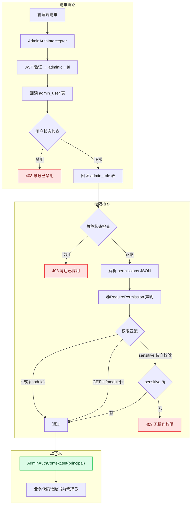

# Admin RBAC: 管理端模块级权限模型

> 基于权限码的管理端访问控制，支持模块级读写分离、敏感操作独立授权、即时生效的角色变更。

---

## 架构总览



---

## 问题描述

管理后台是系统中最敏感的入口。与面向 C 端用户的 API 不同，管理端需要：

1. **细粒度权限** — 不同管理员只能操作不同模块
2. **读写分离** — 查看设备列表 ≠ 删除设备
3. **敏感操作独立控制** — 查看明文手机号需要额外授权
4. **即时生效** — 停用管理员后，下一个请求就必须被拒绝

传统 RBAC 的问题：
- 权限判断散落在每个 Controller 方法中
- 角色变更后需要重启才生效
- 敏感操作与普通操作使用同一套权限，无法独立控制

## 设计决策

### 决策 1：注解声明 + 拦截器统一校验

```java
@RequirePermission("device")      // 写操作：需要模块码
@GetMapping("/devices")
public R<List<Device>> list() { ... }

@RequirePermission("device")      // 写操作：需要模块码
@DeleteMapping("/devices/{id}")
public R<Void> delete(@PathVariable Long id) { ... }
```

**为什么用注解？** 权限声明与业务代码放在一起，review 时一眼可见。比在每个方法开头手动调用 `checkPermission()` 更不容易遗漏。

**为什么拦截器统一校验？** 所有管理端请求走同一个拦截器，权限逻辑集中在一处，不需要每个 Controller 重复实现。

### 决策 2：权限码三层体系

```
*                    → 超级管理员（所有权限）
{module}             → 模块管理员（读+写）
{module}:r           → 模块只读
sensitive            → 敏感操作（独立于 *）
```

**模块列表**：
```
device     设备管理
schematic  原理图
ota        固件升级
comm       通信数据
user       用户管理
system     系统设置
admin      管理员管理
audit      审计日志
```

**匹配规则**：
| HTTP 方法 | 接受的权限码 |
|-----------|-------------|
| GET / HEAD | `*` / `{module}` / `{module}:r` |
| POST / PUT / DELETE | `*` / `{module}` |

### 决策 3：sensitive 独立于 *

```java
// 查看明文手机号需要 sensitive 码，* 不能覆盖
@GetMapping("/users/{id}/mobile")
@RequirePermission("sensitive")
public R<String> getMobile(@PathVariable Long id) {
    String mobile = userMapper.selectMobileById(id);
    piiCipher.audit("view_mobile", currentAdminId(), mobile);  // 审计
    return R.ok(piiCipher.decrypt(mobile));
}
```

**为什么 sensitive 独立于 *？**
- 超级管理员不一定需要看明文手机号
- 遵循最小权限原则 — 只给确实需要的账号授权
- 审计要求 — 敏感操作需要可追溯、可审计

### 决策 4：每次请求回读数据库（即时生效）

```java
// AdminAuthInterceptor.preHandle()
AdminUser user = adminUserMapper.selectById(token.adminId());  // 回读用户
AdminRole role = adminRoleMapper.selectById(user.roleId);       // 回读角色
Set<String> permissions = parsePermissions(role.permissions);  // 解析权限
```

**为什么不用 JWT claims 携带权限？**
- JWT 是无状态的，签发后无法修改
- 如果用 JWT 携带权限，停用账号/修改角色后，旧 token 在过期前仍然有效
- 管理端流量低（vs C 端），每次回读数据库的性能代价可接受

**即时生效场景**：
| 操作 | 传统 JWT 方案 | 本方案 |
|------|-------------|--------|
| 停用管理员 | 等 JWT 过期（12h） | 下一个请求即拒绝 |
| 修改角色权限 | 等 JWT 过期 | 下一个请求生效 |
| 重置密码 | 等 JWT 过期 | 立即吊销（jti 黑名单） |

### 决策 5：ThreadLocal 上下文 + afterCompletion 清理

```java
// 存入
AdminAuthContext.set(principal);

// 业务代码读取
AdminPrincipal current = AdminAuthContext.get();
Long adminId = current.adminId();

// 请求结束清理
@Override
public void afterCompletion(...) {
    AdminAuthContext.clear();
}
```

**注意顺序**：先校验权限，再写入 ThreadLocal。如果权限拒绝时 preHandle 抛异常，afterCompletion 不会执行，ThreadLocal 不会被污染。

## 代码实现

### RequirePermission 注解

```java
@Target({ElementType.METHOD, ElementType.TYPE})
@Retention(RetentionPolicy.RUNTIME)
public @interface RequirePermission {
    String value();  // 模块名或 "sensitive"
}
```

### AdminAuthInterceptor 核心逻辑

```java
@Component
public class AdminAuthInterceptor implements HandlerInterceptor {

    @Override
    public boolean preHandle(HttpServletRequest request, HttpServletResponse response, Object handler) {
        // 1. JWT 验证
        String authorization = request.getHeader("Authorization");
        if (authorization == null || !authorization.startsWith("Bearer ")) {
            throw new UnauthorizedException("缺少访问令牌");
        }
        AdminToken token = jwtService.verify(authorization.substring(7).trim());

        // 2. 回读用户和角色
        AdminUser user = adminUserMapper.selectById(token.adminId());
        if (user == null) throw new UnauthorizedException("账号不存在");
        if (user.status != 1) throw new ForbiddenException("账号已禁用");

        AdminRole role = adminRoleMapper.selectById(user.roleId);
        if (role == null || role.status != 1) throw new ForbiddenException("角色已停用");

        // 3. 解析权限
        Set<String> permissions = parsePermissions(role.permissions);
        AdminPrincipal principal = new AdminPrincipal(
            user.id, user.username, user.name, user.roleId,
            role.code, role.name, permissions,
            user.mustChangePassword == 1, token.jti()
        );

        // 4. 校验权限（先校验，再写 ThreadLocal）
        checkPermission(request, handler, principal);
        AdminAuthContext.set(principal);
        return true;
    }

    private void checkPermission(HttpServletRequest request, Object handler, AdminPrincipal principal) {
        if (!(handler instanceof HandlerMethod method)) return;

        RequirePermission required = method.getMethodAnnotation(RequirePermission.class);
        if (required == null) {
            required = method.getBeanType().getAnnotation(RequirePermission.class);
        }
        if (required == null) return;  // 未声明 = 免鉴权（登录即可）

        String module = required.value();
        Set<String> permissions = principal.permissions();

        // 全局管理员或模块管理员
        if (permissions.contains("*") || permissions.contains(module)) return;

        // GET/HEAD 接受只读码
        boolean read = "GET".equalsIgnoreCase(request.getMethod())
                    || "HEAD".equalsIgnoreCase(request.getMethod());
        if (read && permissions.contains(module + ":r")) return;

        throw new ForbiddenException("无操作权限");
    }

    @Override
    public void afterCompletion(HttpServletRequest request, HttpServletResponse response,
                                Object handler, Exception ex) {
        AdminAuthContext.clear();  // 必须清理
    }
}
```

### 角色权限数据结构

```json
// admin_role.permissions 字段
{
  "permissions": ["device", "device:r", "ota", "audit:r", "sensitive"]
}
```

**权限码存储为 JSON 数组**，解析为 Set 后用于匹配。

### 与数据权限的关系

| 层次 | 模型 | 控制什么 |
|------|------|---------|
| 功能权限 | Admin RBAC（本文） | 能访问哪些接口 |
| 数据权限 | [行级数据权限模型](data-permission-model.md) | 能看到哪些数据行 |

两者独立，通常同时使用。例如：
- `@RequirePermission("device")` → 能访问设备接口
- `dataScope = OWN_DISTRIBUTOR` → 只能看到本渠道的设备

## Trade-offs

| 选择 | 代价 | 缓解 |
|------|------|------|
| 每次回读数据库 | 每请求 2 次额外查询 | 管理端流量低，可接受 |
| ThreadLocal | 需要 afterCompletion 清理 | 拦截器统一处理，业务无感知 |
| 注解声明 | 未声明 = 免鉴权（可能遗漏） | 代码 review + 集成测试覆盖 |
| sensitive 独立 | 角色配置更复杂 | 遵循最小权限原则 |
| JSON 存储权限 | 无法直接 SQL 查询权限 | 管理端不按权限搜索，无此需求 |

## 相关文档

- [行级数据权限模型](data-permission-model.md) — 数据范围控制
- [PII 加密与脱敏](pii-encryption.md) — `sensitive` 权限控制的明文访问
- [审计日志与合规记录](audit-and-compliance.md) — 管理端操作审计
