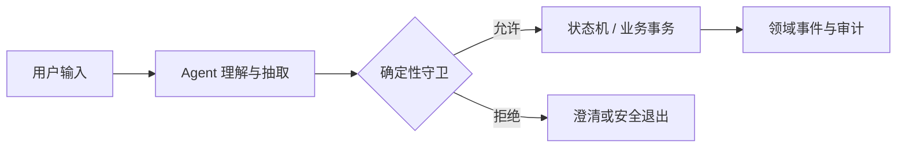

# AI Agent 架构：声明式编排与命令式状态机怎么选

> Agent 系统的核心问题不是“模型是否足够聪明”，而是**谁掌握可执行状态、谁能在错误发生前拦住它**。
>
> 本文比较声明式编排与命令式状态机两种范式，并给出一套按风险分层的混合方案。示例为工程结构抽象，不包含具体业务数据。

> **验证入口**：本仓库无可运行实现｜**证据边界**：来自高风险 AI 应用的工程结构抽象，实现与阈值已泛化，不构成行业基准。

---

## 一、先把两个问题分开

一个 Agent 应用通常同时包含两类工作：

1. **理解用户意图**：抽取字段、判断意图、生成候选方案；
2. **执行高风险动作**：创建订单、提交审批、生成医疗或法律结论、触发支付。

第一类问题允许概率性；第二类问题通常不允许。把两者交给同一个 Prompt 决策，系统就会出现一个隐蔽缺口：**模型既可以理解业务，也可以决定是否能越过业务约束。**

更稳妥的边界是：



模型负责提出候选动作，代码负责判断这个动作在当前状态是否合法。

---

## 二、两种范式

| 维度 | 声明式编排 | 命令式状态机 |
|---|---|---|
| 业务规则位置 | Skill 文档、工具描述、Agent 提示 | 代码、类型、状态转移表 |
| 下一动作由谁决定 | Agent | 当前状态 + 事件 |
| 灵活性 | 高 | 较低 |
| 可测试性 | 依赖模型输出与提示 | 可对每个状态转移写确定性测试 |
| 高风险边界 | 容易出现“文档写了但执行时不遵守” | 守卫不通过就不能流转 |
| 适用场景 | 低风险、流程线性、快速迭代 | 合规、高分支、强前置条件 |

### 2.1 声明式编排

声明式方案把业务约束写进 Skill 和工具描述：

```text
只有用户明确选择商品后，才能调用确认订单工具。
不得从自然语言推断内部 ID。
支付接口未返回成功前，不得向用户宣布支付完成。
```

Agent 读取这些描述，自行决定调用顺序。它的优势是接入快、工具组合灵活，适合原型、内容问答、低风险导购和线性点单。

它的边界也很明确：**提示词是概率性约束，不是运行时保证。** 模型可能漏读、误解或跨轮次遗忘，因此不能把支付、医疗分诊、权限变更等关键动作只建立在“模型会遵守说明”之上。

### 2.2 命令式状态机

命令式方案先定义合法状态与转移：

```text
awaiting_input
  -> validated
  -> compliance_passed
  -> completed
```

每个转移都带前置条件、权限校验、幂等键和副作用。Agent 输出的只是“候选意图”，必须经过守卫才能进入状态机。

```text
候选意图 + 当前状态
  -> 状态转移是否合法？
  -> 操作者是否有权限？
  -> 业务不变量是否满足？
  -> 执行事务并记录事件
```

状态机换来的是可测试性与审计能力，代价是新增分支时必须显式建模。

---

## 三、按风险分层，而不是二选一

真实系统通常采用混合结构：

| 链路 | 推荐范式 | 原因 |
|---|---|---|
| 科普、搜索、内容推荐 | 声明式 | 错误可撤回，体验优先 |
| 标准点单、预约 | 声明式或轻量状态机 | 流程较短，约束较少 |
| 身份确认、额度、审批 | 状态机 | 前置条件和权限边界不能绕 |
| 医疗、金融、法务结论 | 状态机 + 确定性校验 | 错误代价高，必须可追溯 |

推荐的分层方式：

1. **理解层**：允许 Agent 做意图识别、实体抽取和候选方案生成；
2. **决策层**：用状态转移表、策略引擎和规则校验决定能否执行；
3. **执行层**：业务事务、幂等、事件和审计采用普通后端工程手段；
4. **表达层**：Agent 可以组织解释语言，但不能篡改执行结果。

混合不是在高风险链路上妥协，而是让模型只承担它擅长的部分。

---

## 四、接口粒度：原子接口还是业务聚合接口

声明式系统偏爱原子工具：

```text
搜索资源 -> 查看详情 -> 选择资源 -> 确认订单 -> 支付
```

原子接口灵活，但 Agent 必须理解完整依赖图。接口越多，越容易出现跳步、重试和错误参数组合。

高风险链路的另一种做法是按业务阶段提供聚合接口：

```text
提交申请 -> 审核申请 -> 生成结果
```

聚合接口把中间状态封装在服务端，Agent 只能看到允许它看到的结果。这样会牺牲一部分组合自由度，却换来了两个重要保证：

- 中间状态和敏感判断不会暴露给模型；
- 每一步都能独立鉴权、幂等和审计。

选择标准不是“接口越少越好”，而是：**Agent 是否应该知道这些中间步骤？**

---

## 五、代码守卫必须覆盖什么

只检查“目标状态是否存在”不够。一个可落地的守卫至少覆盖以下四类约束：

| 约束 | 示例 | 失败动作 |
|---|---|---|
| 状态前置条件 | 仅待审核申请可通过 | 拒绝并保持原状态 |
| 操作者权限 | 审核人与申请人不能相同 | 记录越权尝试 |
| 业务不变量 | 同一额度不可重复占用 | 拒绝或幂等返回 |
| 外部事实 | 校验通过凭证由服务端签发 | 重新认证 |

守卫应该返回稳定的错误码，而不是让模型自由解释失败原因。用户界面可以友好，但底层判定必须确定。

同时坚持两条原则：

1. **模型输出不能降低关键性**：可以升级为高风险，不能自行降级；
2. **模型输出不是事实**：ID、金额、证件状态和时间必须由系统查询或服务端凭证提供。

---

## 六、流式输出不等于流式执行

流式响应能改善等待体验，但界面上的“生成中”不能变成业务上的“已成功”。

推荐把流式内容分为三类：

- **过程提示**：可以流式展示，例如“正在提取材料”；
- **候选结果**：可以流式展示，但必须带“待确认”状态；
- **最终事实**：只在服务端事务成功、事件落库后展示。

如果界面在支付接口返回前展示“支付成功”，那不是一个 UI 文案问题，而是状态机缺少单调约束。

---

## 七、选择矩阵

按以下问题打分，不要只看“开发速度”：

| 问题 | 偏向声明式 | 偏向状态机 |
|---|---|---|
| 错误是否可以低成本撤回 | 是 | 否 |
| 用户是否会频繁跳出当前流程 | 少 | 多 |
| 是否存在严格前置条件 | 否 | 是 |
| 是否需要跨端复用同一流程 | 弱 | 强 |
| 是否需要证明每一步合法 | 弱 | 强 |
| 是否允许模型编排敏感接口 | 可以 | 不可以 |
| 业务规则是否已经稳定 | 稳定 | 仍频繁变化 |

业务规则仍在快速变化时，不必一次建出完整状态机。可以先固定边界，再逐步把高风险分支迁入显式状态。

---

## 八、常见失败

1. **把 Skill 文档当成运行时权限**：文档可以描述规则，但不能替代鉴权。
2. **让 Agent 同时规划和执行**：规划结果必须经过确定性守卫。
3. **工具没有幂等键**：Agent 重试一次，业务就产生两笔记录。
4. **把所有中间状态暴露给模型**：模型可能跳过本应由服务端执行的检查。
5. **把流式展示当成事务完成**：用户看到的成功必须来自服务端事实。
6. **测试只覆盖模型回答**：状态转移、拒绝路径和审计同样需要测试。

---

## 九、落地检查清单

- [ ] 明确哪些链路允许概率性，哪些链路必须确定性；
- [ ] Agent 只输出候选意图，不直接修改关键业务状态；
- [ ] 每个状态转移都有前置条件、权限校验和失败码；
- [ ] 外部身份与实体 ID 来自服务端事实，不从自然语言推断；
- [ ] 高风险动作有幂等键、审计事件和回滚策略；
- [ ] 对非法跳转、重复提交、越权操作有确定性测试；
- [ ] 流式 UI 与最终事务状态使用不同字段和文案；
- [ ] 模型不能把关键声明自行降级为非关键声明。

---

## 十、诚实边界

- 本文不是“所有 Agent 都应使用状态机”的结论。低风险、线性流程使用声明式编排可以显著降低开发成本；
- 状态机只能保证被建模的转移合法，不能自动修正不清楚的业务规则；
- 模型仍可能把用户意图分类错误。系统能保证的是错误意图无法绕过守卫，而不是模型永不分类错误；
- 本文示例为泛化结构，不代表任何单一产品的完整实现。

## 相关文档

- [事件驱动状态机：佣金流水](commission-pipeline.md)
- [管理员 RBAC](admin-rbac.md)
- [AI 工程化：结构化输出治理](../playbooks/ai-engineering/structured-output-governance.md)
- [声明级校验门](claim-level-verifier.md)
