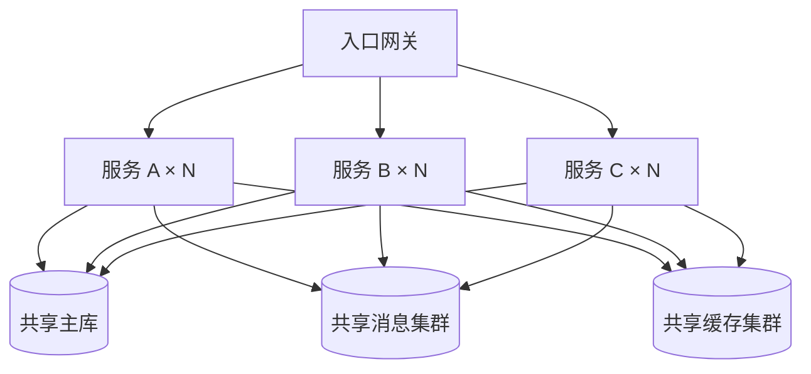
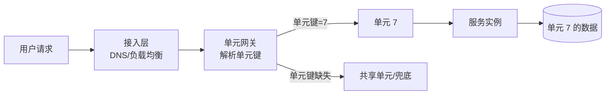

# 单元化架构：把爆炸半径关进格子

> 拆分解决的是「系统太大改不动」，单元化解决的是「系统太大，坏一次就全坏」。前者是开发效率问题，后者是生存问题。

> **验证入口**：本仓库无可运行实现｜**证据边界**：来自生产系统演进经验的架构方法，阈值需按业务校准。

---

## 一、问题：你其实只有一个故障域

微服务之后，团队常有一种错觉：服务拆开了，风险也就拆开了。但把部署图往下翻一层，通常是这样：



服务是 N 个，数据层是 1 个。**故障域的大小不由服务数量决定，由最底层共享资源的粒度决定。**

于是出现几种典型场景：

- 一次慢查询把主库连接池占满，所有服务一起超时；
- 消息集群一个分区异常，全站消费停滞；
- 一次误操作删错分片，影响的是「全部用户」而不是「一部分用户」；
- 单集群容量到顶，扩容只能停机迁移。

单元化要解决的就是这件事：**让一次故障最多影响 1/N 的用户，并让 N 可以原地增加。**

---

## 二、什么是单元

一个单元（cell / unit）是**一个能独立承载一部分流量的完整切片**：

```
单元 = 计算（无状态服务实例）
     + 数据（该切片独占的库/表/分区）
     + 路由标识（这一份流量属于哪个单元）
```

三个条件缺一不可。只有计算分片、数据仍共享，叫**分区部署**，不叫单元化——它挡不住数据层故障，也挡不住跨分片的相互影响。

判断一个系统是不是真单元化，只问一句：

> **拔掉一个单元的电源，会影响多少比例的用户？**

答案是「1/N，且其余单元自动接管或干脆不受影响」，才是单元化；答案是「全部」，就还是单故障域。

---

## 三、什么时候值得单元化

单元化不是免费的：N 倍数据副本、N 倍中间件、N 倍运维负担、跨单元查询变复杂。四种情况下它划算：

| 触发条件 | 说明 | 典型阈值（示例） |
|---|---|---|
| **容量到顶** | 单库/单集群无法再纵向扩，横向分片不可避免 | 单库写入接近上限，扩容窗口 > 一个季度 |
| **故障成本高** | 一次全站故障的损失 >> 单元化成本 | 全站不可用 1 小时的业务损失可量化 |
| **数据驻留要求** | 数据必须留在特定地域/环境内 | 有明确的合规或客户合同约束 |
| **租户隔离** | 大客户要求独占资源与故障边界 | 单租户贡献收入占比高 |

反过来说，下面这些情况**先别做**：

- 系统还在快速变需求，边界每周都在改——先把边界稳定下来；
- 团队 < 10 人，没有平台能力——单元化会把运维复杂度放大到无法承受；
- 真实瓶颈是代码质量或发布流程——单元化不会让烂代码变好。

---

## 四、单元怎么划

划分维度只有四种，选择即取舍：

| 维度 | 优点 | 代价 |
|---|---|---|
| **按用户**（ID 哈希/取模） | 分布均匀，扩容简单，最常用 | 业务语义弱，迁移用户要搬数据 |
| **按地域** | 就近访问，天然满足数据驻留 | 分布不均，小地域单元资源浪费 |
| **按租户/业务线** | 隔离彻底，大客户可独占 | 大租户撑爆单元，小租户浪费 |
| **按渠道** | 与组织边界对齐 | 渠道间流量差异大，跨渠道场景难处理 |

实践中最常见的是**两级**：先按地域（合规与延迟），地域内按用户哈希（均匀与扩容）。租户隔离作为叠加规则，给少数大客户单独开单元。

### 4.1 单元键（unit key）

无论怎么划，必须选出一个**单元键**：一个在请求入口就能确定、且在整个调用链中不变的字段。

- 按用户：用户 ID；
- 按地域：注册地/接入地；
- 按租户：租户 ID。

单元键的三条纪律：

1. **入口确定，全程透传**——每经过一跳都不能丢；
2. **不可变性**——同一业务实体在生命周期内不能换单元键，否则数据会分裂到两个单元；
3. **缺省有主**——拿不到单元键的请求必须有明确的兜底单元（通常是共享单元），不能随机落。

---

## 五、路由：一条请求怎么找到自己的单元



四层各有职责，不能混：

| 层 | 职责 | 常见错误 |
|---|---|---|
| 接入层 | 就近接入、粗粒度分流 | 在这里做业务路由 |
| 单元网关 | 解析单元键、选择单元、注入标记 | 单元键解析失败时随机路由 |
| 服务层 | **识别并透传**单元标记，绝不重新计算 | 某跳重新算了一次，算出不同单元 |
| 数据层 | 按单元键定位分片 | 用非单元键查询，不得不跨单元 |

**「绝不重新计算」是最容易被违反的一条。** 只要有一跳自己算了一次单元键（比如用另一个字段哈希），就会出现「服务在 7 号单元、数据落在 3 号单元」的错位，而且往往只在边界数据上出现，很难复现。

---

## 六、数据单元化

### 6.1 基本原则

- **分片键 = 单元键**：数据落在哪个单元，由它属于谁决定；
- **单元内自洽**：单个单元的读写不依赖其他单元；
- **全局数据只读复制**：字典、配置、商品目录这类全局表，复制到每个单元，只读；
- **写操作只有一个归属单元**：不允许两个单元同时写同一份业务数据。

### 6.2 跨单元查询怎么办

这是单元化最现实的难点。三种处理方式，按优先级：

1. **消灭它**：把查询改成带单元键的查询（最常见的是补上用户维度）；
2. **异步投影**：把跨单元统计做成异步汇总表，接受最终一致；
3. **聚合服务**：由上层并发调用 N 个单元再合并，**只用于低频、非核心、可超时的场景**。

反模式：在单元之上再挂一个「全局库」来支持跨单元查询——这等于把单点又请回来了，故障域重新变成 100%。

### 6.3 数据迁移

单元之间搬数据（扩容、缩容、租户搬迁）需要四步：

```
影子写入（双写，新单元为准）
  → 全量回填（历史数据）
  → 增量追平（校验差异，追到 0）
  → 切读（路由切换，观察）
  → 停旧写（保留回滚窗口后清理）
```

路由切换前必须能回答：**切错了怎么切回去？** 切不回去的迁移不是迁移，是单程票。

---

## 七、跨单元调用与消息

### 7.1 同步调用

跨单元同步调用会把两个单元的可用性绑在一起。允许，但要满足三个条件：

- **低频**：不在核心链路上，或调用比例 < 1%；
- **有超时**：明确超时时间，且超时后走降级而不是重试风暴；
- **有兜底**：目标单元不可用时，返回可用结果（缓存/默认值），而不是阻塞。

违反任意一条，就应该改成异步或重新划边界。

### 7.2 消息

消息的单元亲和比同步调用更难，因为生产者和消费者是解耦的：

| 方案 | 做法 | 优点 | 代价 |
|---|---|---|---|
| **单元独立主题/队列** | 每个单元一组 topic | 隔离彻底，消费互不影响 | 主题数量 × N，运维成本高 |
| **分区绑定** | 单元键作为分区键，消费者只订阅本单元分区 | 隔离较好，主题数不变 | 需要控制分区分配，扩缩容时重平衡复杂 |
| **消息内携带单元标记** | 统一主题，消费端过滤 | 实现简单 | 过滤在消费端，错误隔离弱；积压时难处理 |

无论哪种，都要回答：**消费者升级期间，旧版本消息由谁消费？回滚后，新版本已投递的消息怎么办？** 没有答案就不要上灰度消息。

---

## 八、故障隔离验证

单元化最危险的状态是「看起来是单元化，实际还是全局」：某个共享组件被遗漏，故障依然全站扩散。验证方法只有一个——**真的拔一次**。

| 验证项 | 做法 | 通过标准 |
|---|---|---|
| 单单元故障 | 停掉一个单元全部实例 | 影响面 ≈ 1/N，其余单元 SLO 不降 |
| 单单元数据故障 | 断开一个单元的数据连接 | 该单元降级，其他单元正常 |
| 单元网关故障 | 停掉网关一个实例 | 自动切换，路由正确率 100% |
| 单元键丢失 | 构造无单元键请求 | 全部落到兜底单元，不随机扩散 |
| 扩容 | 新增一个单元并迁入流量 | 路由正确，无跨单元脏读 |

建议把「单单元故障」做成季度例行演练，并记录**实际影响面比例**——这个数字比任何架构图都有说服力。

---

## 九、成本与边界

单元化的成本经常被低估：

- **资源**：每个单元一套中间件与冗余，整体资源利用率下降；
- **运维**：发布、监控、告警、排障都要乘 N；
- **复杂度**：路由错误、数据错位、跨单元一致性，都是新增的故障类型；
- **组织**：需要有人对「单元路由正确性」负责，否则没人会发现错位。

因此有三条边界：

1. **单元化不等于多活**。单元化解决爆炸半径，多活解决地域级容灾，两者可以叠加但互不替代；
2. **单元数不是越多越好**。3–8 个单元通常足够；单元太多，单单元容量太小，冗余成本超过收益；
3. **先有单元级 SLO，再谈单元化收益**。没有单元维度的监控，你无法证明隔离生效。

---

## 十、渐进落地路径


每一步都能独立产生价值，也都能停下来：

- 第 1 步做完，至少具备了「按用户分流」的能力；
- 第 2 步做完，能看见「到底是谁坏了」；
- 第 3 步做完，才真正缩小了故障域；
- 第 4–6 步是平台化，团队规模不够时不必强推。

---

## 十一、诚实边界

- 本篇讲的是**单元化的判断与骨架**，不涉及具体中间件的分片实现；
- 单元数、阈值、比例均为示例，需按业务量校准；
- 单元化在中小规模系统上通常不划算，判断依据是「故障成本 vs 冗余成本」，不是「大厂都这么做」；
- 单元化不能替代限流、熔断、降级——它是最后一道隔离，不是第一道防线。
