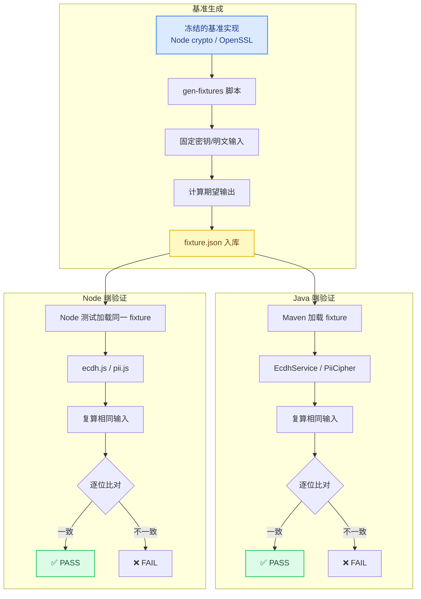

# Cross-Language Contract Testing: 跨语言契约测试方法论

> 用"仓外裁判"模式验证多语言实现的一致性：冻结基准实现、生成 fixture、双端逐位对拍。

---

## 架构总览



---

## 问题描述

多语言系统中，同一算法在不同语言的实现必须产出一致的结果。典型场景：

| 场景 | 语言对 | 算法 |
|------|--------|------|
| ECDH 密钥协商 | Node（前端/工具） ↔ Java（后端） | 椭圆曲线 Diffie-Hellman |
| PII 加密 | Node（迁移脚本） ↔ Java（生产） | AES-GCM |
| 签名验证 | 前端 ↔ 后端 | HMAC / RSA |
| 日期处理 | JS ↔ Java | 时区、格式化 |

**核心挑战**：
1. 两种语言的库实现可能有细微差异（字节序、编码、精度）
2. 修复一个 bug 可能破坏另一个语言的兼容性
3. 没有统一的"正确答案"参照

**传统做法的问题**：
- 各写各的单元测试 — 只验证"自己觉得自己对"
- 人工对拍 — 低效、易遗漏、不可回归

## 设计决策

### 决策 1：仓外裁判（Outside-the-Repo Arbiter）

**核心原则**：选择一个独立于两种语言实现的"基准"，用它生成期望值。

```
选择基准的标准：
1. 使用标准库（非自研代码）
2. 实现成熟、被广泛验证
3. 与两种语言都独立

常见选择：
- Node crypto（OpenSSL）→ 验证 Java 的 BouncyCastle
- OpenSSL CLI → 验证 Node 和 Java
- Python cryptography → 验证 Node 和 Java
```

**为什么需要仓外裁判？**
- 如果用 Node 代码验证 Java 代码，谁验证 Node 代码？
- 基准是"已知正确"的参照，不需要被验证
- 类似于度量衡中的"国际千克原器"

### 决策 2：Fixture 文件入库（克隆即绿）

```json
// ecdh-fixture.json
{
  "serverPriv": "a1b2c3...",
  "vectors": [
    {
      "curve": "prime256v1",
      "devicePub": "d4e5f6...",
      "expected": {
        "raw": "789abc...",
        "sha256": "def012..."
      }
    }
  ]
}
```

**为什么 fixture 入库？**
- 克隆仓库后直接跑测试，不需要先运行生成器
- fixture 是"冻结的契约"，改动需要明确的 commit
- CI 环境不需要额外依赖

**为什么生成器也入库？**
- 可复现 — 需要升级基准时，改生成器后重新生成
- 可审计 — review fixture 变更时能看到生成逻辑

### 决策 3：固定密钥派生（确定性）

```javascript
// 固定私钥：标签 → SHA-256 → 合法标量
function fixedPriv(label) {
  for (let i = 0; i < 1000; i++) {
    const hex = crypto.createHash('sha256').update(`${label}:${i}`).digest('hex')
    const d = BigInt('0x' + hex)
    if (d > 0n && d < curveOrder) return hex
  }
}
```

**为什么不用随机密钥？**
- 随机密钥每次生成不同 fixture，无法入库
- 固定派生保证相同输入 → 相同输出 → 稳定的测试基线

**为什么需要重试？** SHA-256 输出可能超出曲线阶 n，概率约 2^-32，重试即可。

### 决策 4：随机 IV 场景验证"可解密"而非"字节相等"

```java
// PII 加密测试：随机 IV，同一明文每次密文不同
@Test
void decryptNodeCiphertext() {
    // fixture 中的密文是 Node 用随机 IV 加密的
    String cipherText = fixture.nodeCipherText;
    String plainText = piiCipher.decrypt(cipherText);
    assertEquals("13800138000", plainText);  // 验证能解出，不验证字节
}
```

**原则**：
- 固定输入（密钥、IV）→ 验证字节相等
- 随机输入（随机 IV）→ 验证功能正确（能解密）

## 代码实现

### Fixture 生成器（Node 端）

```javascript
// scripts/gen-fixtures.js
const crypto = require('crypto')
const ecdh = require('../lib/ecdh')  // 基准实现

const CURVES = ['prime256v1', 'secp256k1']

function fixedPriv(label) {
  for (let i = 0; i < 1000; i++) {
    const hex = crypto.createHash('sha256').update(`${label}:${i}`).digest('hex')
    const d = BigInt('0x' + hex)
    if (CURVES.every(c => d > 0n && d < BigInt('0x' + ecdh.CURVES[c].n))) {
      return hex
    }
  }
}

function buildFixture() {
  const serverPriv = fixedPriv('fixture-server-v1')
  const devicePriv = fixedPriv('fixture-device-v1')

  const vectors = CURVES.map(curve => {
    const devicePub = ecdh.pubFromPriv(devicePriv, curve)
    return {
      curve,
      devicePub,
      expected: {
        raw: ecdh.derive(serverPriv, devicePub, curve, 'raw'),
        sha256: ecdh.derive(serverPriv, devicePub, curve, 'sha256')
      }
    }
  })

  return { serverPriv, devicePriv, vectors }
}

fs.writeFileSync(
  'backend/src/test/resources/ecdh-fixture.json',
  JSON.stringify(buildFixture(), null, 2)
)
```

### Java 端测试

```java
@TestFactory
Stream<DynamicNode> ecdhFixtureTest() throws IOException {
    // 加载 fixture
    Fixture fixture = loadFixture("ecdh-fixture.json");

    return fixture.vectors().stream().map(vector ->
        DynamicTest.dynamicTest(
            "[" + vector.curve() + "] derive matches Node baseline",
            () -> {
                // 用 Java 实现复算
                String raw = ecdhService.derive(
                    fixture.serverPriv(),
                    vector.devicePub(),
                    vector.curve(),
                    DeriveMode.RAW
                );
                String sha256 = ecdhService.derive(
                    fixture.serverPriv(),
                    vector.devicePub(),
                    vector.curve(),
                    DeriveMode.SHA256
                );

                // 逐位比对
                assertEquals(vector.expected().raw(), raw);
                assertEquals(vector.expected().sha256(), sha256);
            }
        )
    );
}
```

### Node 端测试（双向验证）

```javascript
// tests/ecdh.test.js
const crypto = require('crypto')

for (const curve of ['prime256v1', 'secp256k1']) {
  // 用 Node 标准库生成随机密钥
  const nodeA = crypto.createECDH(curve)
  nodeA.generateKeys()
  const privA = nodeA.getPrivateKey('hex')
  const pubA = nodeA.getPublicKey('hex', 'uncompressed').slice(2)

  const nodeB = crypto.createECDH(curve)
  nodeB.generateKeys()
  const privB = nodeB.getPrivateKey('hex')
  const pubB = nodeB.getPublicKey('hex', 'uncompressed').slice(2)

  const sharedAB = nodeA.computeSecret(Buffer.from('04' + pubB, 'hex')).toString('hex')

  test(`[${curve}] derive == Node computeSecret`, () => {
    // 与 Node 标准库实时对拍（非 fixture）
    assert.strictEqual(ecdh.derive(privA, pubB, curve, 'raw'), sharedAB)
    assert.strictEqual(ecdh.derive(privB, pubA, curve, 'raw'), sharedAB)
  })
}
```

### 一键运行脚本

```javascript
// scripts/run-all-tests.js
const steps = [
  { name: 'ecdh-node', cmd: 'node tests/ecdh.test.js' },
  { name: 'ecdh-java', cmd: 'mvn test -pl backend-java -Dtest=EcdhServiceTest' },
  { name: 'pii-java', cmd: 'mvn test -pl backend-java -Dtest=PiiCipherTest' },
]

for (const step of steps) {
  console.log(`\n=== ${step.name} ===`)
  execSync(step.cmd, { stdio: 'inherit' })
}
```

## 三层验证策略

```
第一层：fixture 对拍（离线）
├── 生成器用基准实现计算期望值
├── 双端加载同一 fixture
└── 验证：Java 能复现 Node 的输出

第二层：实时对拍（同进程）
├── Node 测试中直接调用 Node crypto
├── 与本仓库的 Node 实现比对
└── 验证：Node 实现与标准库一致

第三层：端到端契约（需要服务）
├── 启动 Java 后端
├── 发送请求验证响应
└── 验证：完整链路正确
```

**为什么需要三层？**
- 第一层验证跨语言一致性
- 第二层验证 Node 实现本身正确
- 第三层验证集成正确（序列化、网络、数据库）

## Trade-offs

| 选择 | 代价 | 缓解 |
|------|------|------|
| fixture 入库 | 文件可能过期 | 生成器也入库，可随时重新生成 |
| 固定密钥 | 测试密钥可能被误用 | 仅用于测试，生产用随机密钥 |
| 逐位比对 | 对 hex 格式敏感 | 统一小写 hex，测试中 normalize |
| 三层验证 | 测试时间增加 | 第三层可选，CI 可跳过 |

## 相关文档

- [PII 加密与脱敏](pii-encryption.md) — 跨语言加密对拍的实例
- [Production Guardrails](../case-studies/production-guardrails/) — 契约测试锁定接口语义
