# PII Encryption: 个人数据加密与脱敏模式

> 对手机号等个人数据实施 AES-GCM 加密落库，配合 HMAC 检索键和统一脱敏，满足 GDPR / PIPL 合规要求。

---

## 架构总览

```mermaid
flowchart TB
    subgraph 写入链路
        A[业务代码] -->|明文手机号| B[PiiCipher.encrypt]
        B --> C{PII_KEY 已配置?}
        C -->|是| D[AES/GCM/NoPadding 加密]
        D --> E["enc:v1:iv:tag:cipherText"]
        C -->|否| F[明文落库 + warn 日志]
    end

    subgraph 检索链路
        G[业务查询] -->|明文手机号| H[PiiCipher.lookupKey]
        H --> I["HMAC-SHA256(key, 'pii:'+value)"]
        I --> J[截断 32hex]
        J --> K[WHERE lookup_key = ?]
    end

    subgraph 读取链路
        L[查出密文] --> M[PiiCipher.decrypt]
        M --> N{enc:v1: 前缀?}
        N -->|是| O[AES/GCM 解密]
        N -->|否| P[视为历史明文，原样返回]
    end

    subgraph 展示链路
        Q[返回给前端] --> R[PiiCipher.mask]
        R --> S["138****5678"]
        T[审计日志] --> U[PiiCipher.mask]
        U --> V["[pii] 手机号访问 action=xxx mobile=138****5678"]
    end

    style C fill:#f9f,stroke:#333,stroke-width:2px
    style E fill:#9f9,stroke:#333
```



---

## 问题描述

任何面向 C 端用户的系统都会收集手机号。手机号是 PII（Personally Identifiable Information），受 GDPR / PIPL 等法规约束。

直接明文落库的问题：

| 风险 | 后果 |
|------|------|
| 数据库泄露 | 所有用户手机号暴露 |
| 内部人员导出 | 未经授权获取用户隐私 |
| 审计困难 | 无法证明"谁在什么时候访问了手机号" |
| 合规审计 | 无法通过 PIPL / GDPR 审计 |

核心挑战：
1. **加密后无法直接查询** — 需要支持"按手机号查用户"
2. **不能影响业务代码** — 加密/解密/脱敏应对业务透明
3. **需要降级路径** — 开发环境不应强制配置密钥
4. **审计要可追溯** — 每次手机号访问都要有日志

## 设计决策

### 决策 1：AES-GCM 而非 AES-CBC

```java
Cipher cipher = Cipher.getInstance("AES/GCM/NoPadding");
cipher.init(Cipher.ENCRYPT_MODE, key, new GCMParameterSpec(128, iv));
```

**为什么选 GCM？**
- GCM 自带完整性校验（128-bit tag），解密失败即知密文被篡改
- CBC 需要额外的 HMAC 才能达到同等安全级别
- GCM 在现代 JVM 中性能与 CBC 相当

**为什么 NoPadding？** GCM 使用 CTR 模式，不需要填充。

### 决策 2：密文格式 `enc:v1:iv:tag:cipherText`

```
enc:v1:a1b2c3...（12字节IV hex）:d4e5f6...（16字节tag hex）:789abc...（密文hex）
```

**为什么加前缀？**
- 区分新密文和历史明文 — 无前缀的值按明文处理（兼容存量数据）
- 版本号 `v1` 为未来算法升级预留空间
- 自描述格式，便于排障时一眼识别

**为什么 IV 和 Tag 分开存储？** GCM 的 Tag 是认证标签，与密文分开存储便于调试和日志记录。

### 决策 3：HMAC 检索键解决"加密后无法查询"

```java
// 写入时同时计算 lookup_key
String lookupKey = HMAC-SHA256(key=SHA-256(PII_KEY), msg="pii:" + mobile).substring(0, 32);
// 查询时
SELECT * FROM user WHERE lookup_key = #{lookupKey}
```

**原理**：相同明文 + 相同密钥 → 相同 HMAC。将 HMAC 值存为独立列，查询时计算 HMAC 再匹配。

**为什么截断到 32 hex？** 完整 HMAC-SHA256 是 64 hex。截断到 32 hex（128 bit）在实际场景中碰撞概率可忽略，且节省存储。

**为什么加 `"pii:"` 前缀？** 域分隔符。防止不同用途的 HMAC 值碰撞（如密码哈希 vs 手机号检索键）。

### 决策 4：无密钥降级 + StartupGuard fail-fast

```
dev/test 环境：
  - 未配置 PII_KEY → 明文落库 + warn 日志（方便本地开发）
  
生产环境：
  - 未配置 PII_KEY → StartupGuard 拒绝启动
  - 错误信息："bms.pii.key（缺失时手机号明文落库且检索键无盐）"
```

**为什么这样设计？** 开发体验和生产安全的平衡。开发环境不需要真实加密，但生产环境必须强制。

### 决策 5：统一脱敏 + 审计日志

```java
// 展示脱敏
public String mask(String value) {
    if (s.length() < 7) return "****";
    return s.substring(0, 3) + "****" + s.substring(s.length() - 4);
}

// 审计日志
public void audit(String action, Long uid, String mobile) {
    log.info("[pii] 手机号访问 action={} uid={} mobile={}", action, uid, mask(mobile));
}
```

**原则**：日志中永远不出现明文手机号。审计日志记录"谁访问了哪个脱敏后的手机号"。

## 代码实现

### PiiCipher 完整实现

```java
@Component
public class PiiCipher {

    private static final String PREFIX = "enc:v1:";
    private static final int IV_LEN = 12;
    private static final int TAG_BITS = 128;

    private final BmsProperties props;
    private final SecureRandom random = new SecureRandom();
    private volatile boolean warned = false;

    /** 加密：AES/GCM/NoPadding + 随机 IV */
    public String encrypt(String value) {
        if (value == null || value.isEmpty()) return "";
        byte[] key = keyBytes();
        if (key == null) { warnOnce(); return value; }  // dev 降级

        byte[] iv = new byte[IV_LEN];
        random.nextBytes(iv);
        Cipher cipher = Cipher.getInstance("AES/GCM/NoPadding");
        cipher.init(Cipher.ENCRYPT_MODE, new SecretKeySpec(key, "AES"),
                    new GCMParameterSpec(TAG_BITS, iv));
        byte[] out = cipher.doFinal(value.getBytes(UTF_8));
        byte[] cipherText = Arrays.copyOf(out, out.length - 16);  // 去掉 tag
        byte[] tag = Arrays.copyOfRange(out, out.length - 16, out.length);
        return PREFIX + Hex.toHex(iv) + ":" + Hex.toHex(tag) + ":" + Hex.toHex(cipherText);
    }

    /** 解密：无前缀视为历史明文 */
    public String decrypt(String value) {
        if (value == null || value.isEmpty()) return "";
        if (!value.startsWith(PREFIX)) return value;  // 兼容历史明文
        byte[] key = keyBytes();
        if (key == null) return "";
        // ... 解密逻辑
    }

    /** 脱敏：138****5678 */
    public String mask(String value) {
        String s = value == null ? "" : value;
        if (s.length() < 7) return "****";
        return s.substring(0, 3) + "****" + s.substring(s.length() - 4);
    }

    /** 检索键：HMAC-SHA256 截断 32hex */
    public String lookupKey(String value) {
        String message = "pii:" + (value == null ? "" : value);
        byte[] key = keyBytes();
        if (key == null) {
            // dev 降级：无盐 SHA-256
            return Hex.toHex(SHA-256(message)).substring(0, 32);
        }
        Mac mac = Mac.getInstance("HmacSHA256");
        mac.init(new SecretKeySpec(key, "HmacSHA256"));
        return Hex.toHex(mac.doFinal(message.getBytes(UTF_8))).substring(0, 32);
    }

    /** 密钥：SHA-256(PII_KEY) 固定为 32 字节 */
    private byte[] keyBytes() {
        String key = props.pii() == null ? null : props.pii().key();
        if (key == null || key.isBlank()) return null;
        return MessageDigest.getInstance("SHA-256").digest(key.getBytes(UTF_8));
    }
}
```

### 数据库表结构

```sql
CREATE TABLE app_user (
    id          BIGINT PRIMARY KEY,
    mobile_enc  VARCHAR(512) NOT NULL COMMENT '加密手机号 enc:v1:...',
    lookup_key  VARCHAR(32)  NOT NULL COMMENT 'HMAC 检索键',
    INDEX idx_lookup_key (lookup_key)
);
```

### 业务代码使用

```java
// 写入
String enc = piiCipher.encrypt(mobile);
String key = piiCipher.lookupKey(mobile);
userMapper.insert(new User(mobileEnc: enc, lookupKey: key));

// 查询
User user = userMapper.selectByLookupKey(piiCipher.lookupKey(mobile));

// 展示
String masked = piiCipher.mask(piiCipher.decrypt(user.getMobileEnc()));
// 或直接返回脱敏值，不解密
```

## 跨语言对拍

Node 和 Java 实现必须产出相同的密文（固定 IV）或能互相解密（随机 IV）。

```
Node (基准)                    Java (现役)
    │                              │
    ├─ 固定密钥 test-key           │
    ├─ 固定 IV（fixture 用）       │
    ├─ encrypt("13800138000")      │
    │  → enc:v1:fixedIv:...        │
    │                              │
    └──────────────────────────────┘
           fixture.json
                │
    Java 加载 fixture → decrypt → 应得到 "13800138000"
```

**注意**：生产使用随机 IV，同一明文每次加密结果不同。对拍测试只验证"能否解出明文"，不验证字节相等。

## Trade-offs

| 选择 | 代价 | 缓解 |
|------|------|------|
| AES-GCM | 需要 JDK 8+ | 现代 JVM 标配 |
| 随机 IV | 同一明文密文不同 | 检索靠 lookup_key，不靠密文相等 |
| HMAC 截断 32hex | 理论碰撞可能 | 128-bit 空间实际碰撞概率可忽略 |
| 无密钥降级 | dev 环境明文落库 | StartupGuard 生产 fail-fast 兜底 |
| lookup_key 独立列 | 表结构多一列 | 换取 O(1) 查询能力 |

## 相关文档

- [管理端 RBAC 模型](admin-rbac.md) — `sensitive` 权限码控制手机号明文访问
- [审计日志与合规记录](audit-and-compliance.md) — PII 访问审计的落点
- [Production Guardrails](../case-studies/production-guardrails/) — StartupGuard fail-fast 模式
