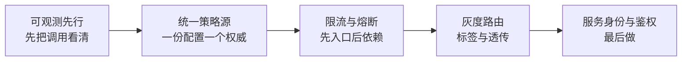

# 服务治理的三种形态：SDK、Agent、Sidecar

> 服务治理的能力清单各家都一样：发现、路由、负载均衡、限流、熔断、重试、超时、鉴权、灰度、可观测。真正拉开差距的不是「支持什么」，而是**这些能力以什么形态进入进程**。

> **验证入口**：本仓库无可运行实现｜**证据边界**：三种形态的工程取舍总结，不构成选型基准。

---

## 一、先明确：治理能力清单

无论选哪种形态，要覆盖的能力是固定的：

| 能力 | 说明 | 是否核心 |
|---|---|---|
| 服务发现 | 实例上下线、健康状态 | 核心 |
| 负载均衡 | 轮询/最少连接/一致性哈希 | 核心 |
| 超时与重试 | 单次调用边界 | 核心 |
| 限流 | 入口与依赖两个方向 | 核心 |
| 熔断与降级 | 依赖故障时快速失败 | 核心 |
| 路由与灰度 | 按标签、版本、单元路由 | 进阶 |
| 鉴权 | 服务间身份与授权 | 进阶 |
| 可观测 | 指标、链路、日志上下文 | 核心 |

形态的选择，本质是回答：**这些能力由谁维护、在哪里升级、故障时算谁的。**

---

## 二、三种形态

### 2.1 SDK：能力在代码里

治理逻辑以库的形式被应用依赖，进程内直接调用。

```
应用进程
 ├── 业务代码
 └── 治理 SDK（发现/路由/熔断/埋点）
```

**优点**

- 性能最好：无额外网络跳转；
- 能力最全：能拿到进程内全部上下文（线程、连接、序列化）；
- 排障直接：异常栈、指标都在应用内。

**代价**

- **语言绑定**：每种语言一套实现，多语言团队要么重复建设，要么能力不一致；
- **升级绑定**：升级 SDK = 改依赖 + 重新发布，版本碎片化几乎不可避免；
- **故障在进程内**：SDK 的 bug 会直接影响业务进程，且难以单独熔断。

### 2.2 Agent：能力在进程内，字节码层注入

以 Java Agent 为代表：启动时挂载，通过字节码增强把治理逻辑织入目标方法，业务代码零改动。

```
应用进程
 ├── 业务代码（无治理依赖）
 └── Agent（字节码增强 + 治理逻辑）
```

**优点**

- **业务零侵入**：存量系统接入成本最低；
- **统一升级**：改挂载参数即可，不必改代码；
- **对 JVM 生态覆盖好**：中间件、框架的拦截点成熟。

**代价**

- **语言受限**：基本只适用于有成熟字节码生态的语言（JVM 为主）；
- **调试复杂**：出问题时栈里多一层，且增强逻辑对开发者不可见；
- **兼容性风险**：框架升级可能破坏增强点，需要持续适配；
- **启动耦合**：Agent 异常可能影响应用启动，必须有「Agent 失败不阻断启动」的开关。

### 2.3 Sidecar：能力在进程外，独立代理

每个应用实例旁挂一个代理，所有进出流量经过它；代理由控制面统一下发配置。

```
应用 Pod
 ├── 业务容器
 └── Sidecar 代理  ◀── 控制面（配置下发）
```

**优点**

- **语言无关**：任何语言、任何框架，只要走网络就受治理；
- **独立升级与独立故障**：代理挂了可以摘除，不必改业务；
- **边界清晰**：治理是平台能力，业务团队不必关心。

**代价**

- **多一跳**：延迟增加（通常亚毫秒到数毫秒，但对高 QPS 低延迟场景不可忽略）；
- **资源开销**：每实例一个代理，内存与 CPU 乘以实例数；
- **控制面成为新单点**：配置下发延迟、控制面故障会导致全网策略陈旧；
- **进程外上下文丢失**：线程池、本地调用、序列化细节代理看不见，某些治理能力会打折。

---

## 三、决策矩阵

没有最优形态，只有与团队约束匹配的形态。按权重打分（1–5，越高越适合）：

| 维度 | SDK | Agent | Sidecar |
|---|---:|---:|---:|
| 单语言团队 | 5 | 4 | 2 |
| 多语言团队 | 1 | 2 | 5 |
| 存量系统接入 | 2 | 5 | 4 |
| 极致低延迟 | 5 | 4 | 2 |
| 独立升级诉求 | 1 | 4 | 5 |
| 平台团队成熟度要求 | 低 | 中 | 高 |
| 故障隔离能力 | 2 | 2 | 5 |
| 可观测完整度 | 5 | 4 | 3 |

三类团队的实际选择：

- **10 人以内、单语言、服务 < 20 个**：SDK 或干脆不做统一治理。此时引入平台是负债，不是资产；
- **中大型、JVM 为主、存量多**：Agent 是性价比最高的接入方式，用于「让老系统先被看见」；
- **多语言、Kubernetes 化、有平台团队**：Sidecar + 控制面，把治理变成基础设施。

---

## 四、混合是常态，但要划清边界

真实系统很少纯一种形态，常见组合：

| 组合 | 适用 | 注意事项 |
|---|---|---|
| Agent + SDK | 存量 Agent 接入，新服务用 SDK 拿全量能力 | 两套策略源必须统一，否则同一服务两套规则 |
| Sidecar 在边界 + SDK 在进程内 | 跨语言入口用 Sidecar，核心服务用 SDK 降延迟 | 明确「哪一层做限流」，避免双重限流 |
| Agent 作为 Sidecar 的过渡 | 先 Agent 统一可观测，再逐步迁移 | 迁移期要有能力对照表，防止能力倒退 |

**划边界的原则：同一项治理能力，只能有一个权威执行点。** 入口限流和进程内限流同时开，阈值会互相抵消，故障时无法判断是谁在拒绝请求。

---

## 五、控制面与数据面

只要形态是 Agent 或 Sidecar，就必然有控制面。控制面负责：策略存储、下发、版本管理、灰度生效。

四个容易忽略的问题：

1. **下发延迟**：策略变更到全量生效的时间是多少？故障时这是止血时间的一部分；
2. **控制面故障**：控制面挂了，数据面应沿用最后一份配置继续工作，而不是全部失效；
3. **配置漂移**：某实例长时间未连上控制面，策略是旧的——需要「配置版本」指标；
4. **策略回滚**：策略本身也是变更，必须能回滚，且回滚要有时限。

一句话：**控制面是配置系统，不是普通服务。它宕机时系统要能「带病运行」。**

---

## 六、选型时的五个反问

1. 团队里谁负责这套治理的升级与排障？没有 owner 的形态一定会腐烂；
2. 出问题时，故障算业务还是算平台？边界不清会导致互相等待；
3. 升级一次需要多久、影响多少服务？超过一个发布周期就说明形态选重了；
4. 有没有「治理组件故障但业务继续」的开关？没有就是给自己加了单点；
5. 能不能用一句话说清「限流在哪一层做」？说不清就是双重执行。

---

## 七、渐进路径



顺序不是随意的：**看不见调用关系时做治理，等于蒙眼调参**；策略源不统一时做限流，等于给自己制造随机故障。

---

## 八、与仓库其他内容的呼应

- 灰度路由的实现细节见 [全链路灰度深水区](../playbooks/production-operations/deep-dives/full-link-canary.md)；
- 「策略不靠自觉靠机制」与 [生产护栏](../case-studies/production-guardrails/) 同源；
- 治理组件本身也是系统，它的变更同样适用 [变更与灰度规范](../playbooks/production-operations/templates/02-change-and-canary.md)。

---

## 九、诚实边界

- 本篇不比较具体产品，产品差异在版本迭代中变化太快，判断框架比选型结论更持久；
- 矩阵中的分数是**示例权重**，团队应按自己的约束重新打分；
- Agent 与 Sidecar 的能力边界会随生态演进变化，结论有保鲜期；
- 小团队「不做统一治理」是合理选择，不是能力缺陷——治理的收益随服务数量非线性增长，在此之前它只是成本。
