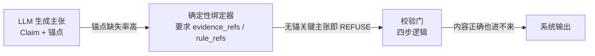

# 组件正确 ≠ 系统有效：一个校验门的端到端失败复盘

> 离线校验 100% 通过，端到端期望匹配率只有 30.8%–46.2%。两个数字都是真的。
> 这一篇讲它们为什么同时为真，以及怎么在你自己的系统里建立能防住这类落差的评测口径制度。

---

## 一、落差本身

本篇的证据来自 [GroundedRAG](https://github.com/StevenTsai/grounded-rag)（MIT，声明级校验门的 RAG 参考实现，[模式详解见另一篇](claim-level-verifier.md)）。它在 v1.0.0 发布时同时存在两组评测数据：

| 维度 | 确定性校验（Verify 模式） | 端到端（E2E 模式） |
|------|------|------|
| 用例数 | 34 组 | 13 组 |
| 主张数 | 42 条 | ~30 条 |
| LLM 依赖 | 无（主张由评测集显式给出） | 高（LLM 调用率 84.6%–100%，其余为规则直出） |
| 通过率 | **100%** | 15% |
| 期望匹配率 | — | **30.8%–46.2%**（4–6/13，多次采样范围） |
| 判决分布 | — | refuse=10–12，pass=1–2 |

来源：[e2e_eval_analysis.md](https://github.com/StevenTsai/grounded-rag/blob/v1.0.0/docs/e2e_eval_analysis.md)（pin `v1.0.0`，2026-09）。

这两组数字在仓库 README 里也是并存的：首屏徽章写着确定性评测集三指标 1.0，评测文档里写着 E2E 期望匹配率三成出头。**引用任何一组而不用另一组限定，都会夸大系统的真实能力。**

大多数团队只发布左边那列。这里把右边一并公开：一份结构清晰、可审计、可有限重跑的系统级失败记录。

---

## 二、根因：断在锚点，不在逻辑

E2E 失败案例逐条归因后，图案高度一致：

| 用例 | 期望 | 实际 | 原因 |
|------|------|------|------|
| #1 EGFR 一线 | pass | refuse | LLM 生成了**临床正确**的主张，但未绑定 rule_refs |
| #2 T790M 二线 | pass | refuse | 同上 |
| #4 RAS 野生型 | pass | refuse | 同上 |
| #5 ALK 一线 | pass | refuse | 同上 |
| #10 剂量 | refuse | pass | LLM 正确回答且锚点完整；期望标签本身存疑（见诚实边界） |

机制上的断点：



校验门的规则对**关键主张**是硬的：没有 `rule_refs` → REFUSE，**即使内容正确**；没有 `evidence_refs` → REFUSE，**即使内容正确**。这叫"有据可依，无据可拒"：不信任 LLM 的自报内容，只认可溯源的锚点（非关键主张在同场景下降为 ANNOTATE 附未核验标注，拒答的强制力集中在关键主张上）。

于是问题精确化了：**校验门在这些案例上"错"了吗？没有。它正确地拒绝了一条无法验证的主张，哪怕碰巧是真的。** 系统"错"的地方在上游一跳：链路依赖 LLM 产出可用锚点，而 LLM 不保证做到。流水线里其实已有一个确定性绑定器（`_bind_anchors`，字符串匹配 + token 交叉，不依赖 LLM）尝试为无锚主张回收绑定，但真实 E2E 下的绑定覆盖率不足以闭合缺口。回收不了的主张或被丢弃，或以无锚状态撞上引用完整性检查被拒。每一个组件单独看都在正确执行自己的职责，组合起来的契约处漏水。

这就是"组件正确 ≠ 系统有效"的解剖图：

- **组件级测试**证明：在已覆盖的输入空间内，未发现契约内的逻辑回归（Verify 模式 34 组全过，证明的是这个：测试证明"已覆盖行为符合预期"，不证明"无缺陷"）；
- **系统级评测**证明：真实链路上，组件之间的契约（"LLM 会给出可用锚点"）是一个**假设**，而不是一个保证。

RAG 系统、Agent 系统、任何"LLM + 确定性外壳"的架构，都会在同一个位置遇到这个问题。它很少被公开，因为公开它等于承认首屏指标不完整。

---

## 三、为什么拒答是正确行为

13 组里 10–12 组被拒答。从"通过率"看这是灾难，从风险面看这是**系统在正确工作**：

- 场景是高风险域（医疗推荐）。宁可拒答，不交付无据内容。这是设计目标，不是故障；
- 对照另一侧：同一批检索资料下，裸模型对"缓解率有多高"这类资料外问题，8 次采样有 **3 次（37.5%）**从参数记忆补出资料外数值（"ORR 通常 70%–80%""FLAURA 研究约 77%–80%"，均不在本次检索证据里），5 次主动拒答（[control_experiment_live.md](https://github.com/StevenTsai/grounded-rag/blob/v1.0.0/docs/control_experiment_live.md)）；
- 关键不在 3/8，而在 **3/8 和 5/8 出自同一个模型、同一批资料、同一段提示**。裸输出的"安全"是概率性的，不可复现。

校验门不能提高模型答对的概率，但能保证无据的关键主张不会进入最终答案：资料里没有缓解率锚点，LLM 若硬产出数值主张 → `citation_incomplete` → 必拒，每次一致。确定的边界要说清楚：确定的是**判决**，不是端到端输出。LLM 产不产那条主张仍随采样波动（这正是期望匹配率在 30.8%–46.2% 浮动的原因），系统能保证的只是"产了就过不了门"。

所以落差的正确读法是：**E2E 的 30–46% 不是"系统只有三成对"，而是"系统正确地拒绝了七成它无法证明为有据的输出"。** 真正的缺陷是其中一批拒绝本可通过（上游补齐锚点就通过）。这决定了改进方向在上游，不在放松校验门。

---

## 四、方法论提炼：双口径制度

这次复盘沉淀下来的方法论，适用于一切"确定性组件 + 概率性上游"的系统：

### 4.1 一个指标只测一件事

GroundedRAG 的三个头条指标各管一段，拒绝合并：

| 指标 | 管什么 | 不管什么 |
|------|------|------|
| 引用完整性率 | 有据主张是否带完整可解析的锚点 | 内容对不对 |
| 表面一致率 | 好主张有没有被误拒 | 语义是否真实成立 |
| 拒答正确率 | 该拒的有没有拒 | 该答的答得好不好 |

其[评测口径文档](https://github.com/StevenTsai/grounded-rag/blob/v1.0.0/docs/metrics.md)里有一句话值得所有评测文档抄走：

> 如果某套评测把这三项打包称为"真实支持率/准确率"，那是在夸大确定性校验的能力边界。

指标命名即架构声明。一个把三者打包叫"准确率"的系统，已经在用命名掩盖它的能力边界。

### 4.2 组件口径与系统口径必须成对存在

- **组件口径**：离线、确定性、无 LLM、可大规模跑（34 组可以跑几百次）；
- **系统口径**：端到端、含生成器、小而真（13 组，每组都走真实链路）。

两条铁律：

1. **报告时成对引用。** 任何单独出现的组件指标，都必须标注"这是组件口径"；
2. **回归时一起跑。** 组件口径绿了不代表系统口径没退化。本例中组件口径从来都是绿的。

### 4.3 覆盖率是组件指标，不是系统指标

v1.0.0 的 247 个测试、95% 覆盖率是真实的（可复现验证）。它证明的是**代码被执行过**，不证明**系统有效**。把覆盖率当系统健康度，等于用体检报告证明运动员能赢比赛。

### 4.4 失败按根因分三类归档

这次的归因框架可以直接复用：

| 类别 | 定义 | 本例中的实例 | 修哪 |
|------|------|------|------|
| 组件错 | 给定契约内输入，输出错误 | 无（Verify 全过） | 修组件 |
| 契约断 | 组件间假设不成立 | LLM 不保证输出可用锚点 | 修链路/上游 |
| 上游劣化 | 输入本身漂移 | 提示变化导致锚点行为变化 | 修工程约束 |

不匹配项（13 组中的 7–9 组，随采样浮动）几乎全部落在"契约断"。**归因错了修法就会错**：把契约断当组件错去改校验门（放松锚点要求），指标会变好，系统会变危险。

---

## 五、在自己的系统里落地

对任何"确定性校验 + LLM 生成"的系统，最小可行清单：

1. **先建组件口径**：把校验逻辑从链路里剥出来，做成无 LLM 可独立运行的评测（主张由评测集显式给出）；
2. **再建系统口径**：哪怕只有 10–20 组，也要有走真实链路的端到端集，且每组标注期望判决；
3. **失败逐条归因**到上表三类，按类归档而不是按现象；
4. **发布口径成对**：对外报告、README 徽章、论文数字，组件指标与系统指标永远同时出现；
5. **回归双跑**：CI 里组件口径挡逻辑回归，系统口径挡契约漂移。

---

## 六、工程注记

复盘中顺带确认的两个教训，一并记录：

1. **跨平台文本 I/O 必须显式指定编码。** v1.0.0 的 [runner.py](https://github.com/StevenTsai/grounded-rag/blob/v1.0.0/src/groundedrag/eval/runner.py) 中 `NamedTemporaryFile(mode="w")` 未指定 `encoding="utf-8"`：中文 Windows 默认 GBK 写入、随后按 UTF-8 读取，触发 `UnicodeDecodeError`；Linux CI 全绿掩盖了这一点。**CI 全绿 ≠ 跨平台绿。**
2. **依赖工作区状态的测试不是测试，是环境快照。** 仓库根目录出现未跟踪文件会让"干净仓库退出码"类检查失败。这类检查应该显式声明它检查的是什么，而不是隐式扫描。

---

## 七、诚实边界

- 复盘对象是一个**公开参考实现**（合成数据驱动、真实评测集不分发），不是生产系统。数字 pin 在 `v1.0.0`（`0f8930c`）；仓库演进后请以 `docs/` 当前值为准；
- E2E 集只有 13 组、单一模型（mimo-v2.5-pro）、单一域。30.8%–46.2% 是多次采样的范围，不是统计置信区间。不要外推成"这类系统普遍三成"；
- 截至 v1.0.0，确定性锚点绑定器 `_bind_anchors` **已存在**并部分回收无锚主张，但真实 E2E 下的绑定覆盖率仍未闭合。写的是已验证的失败，不是"绑定器尚未出现"，也不是已修复的问题；
- E2E 集的 ground truth 本身仍需审计：例如剂量题期望 `refuse`、系统给出正确剂量后判 `pass`，源分析却称该例为"正确回答"。期望标签与答案语义存在争议，匹配率不能当作系统质量的无争议真值；
- 本篇不主张"裸 RAG 必然幻觉"。对照实验自己的结论也是不主张：3/8 补数是被录到的真实失败，5/8 诚实拒答同样真实。这里的核心主张只有一个：**裸输出的安全不可复现，校验的价值在于把它变成确定的。**

---

## 证据与复现

- 仓库：[StevenTsai/grounded-rag](https://github.com/StevenTsai/grounded-rag)（MIT）
- 引用版本：`v1.0.0`（`0f8930c8455f0f67611767d6702dc714cb21e82c`，2026-09-18）
- 证据文件：[docs/e2e_eval_analysis.md](https://github.com/StevenTsai/grounded-rag/blob/v1.0.0/docs/e2e_eval_analysis.md) · [docs/control_experiment_live.md](https://github.com/StevenTsai/grounded-rag/blob/v1.0.0/docs/control_experiment_live.md) · [docs/metrics.md](https://github.com/StevenTsai/grounded-rag/blob/v1.0.0/docs/metrics.md)
- 复现（确定性口径，无需 API）：

  ```bash
  git clone https://github.com/StevenTsai/grounded-rag && cd grounded-rag
  git checkout v1.0.0
  pip install -e .
  python -m groundedrag.eval --json     # 三指标 + 逐组明细
  ```

  E2E 口径需要 LLM API，步骤与历史结果见 `docs/e2e_eval_analysis.md`。
