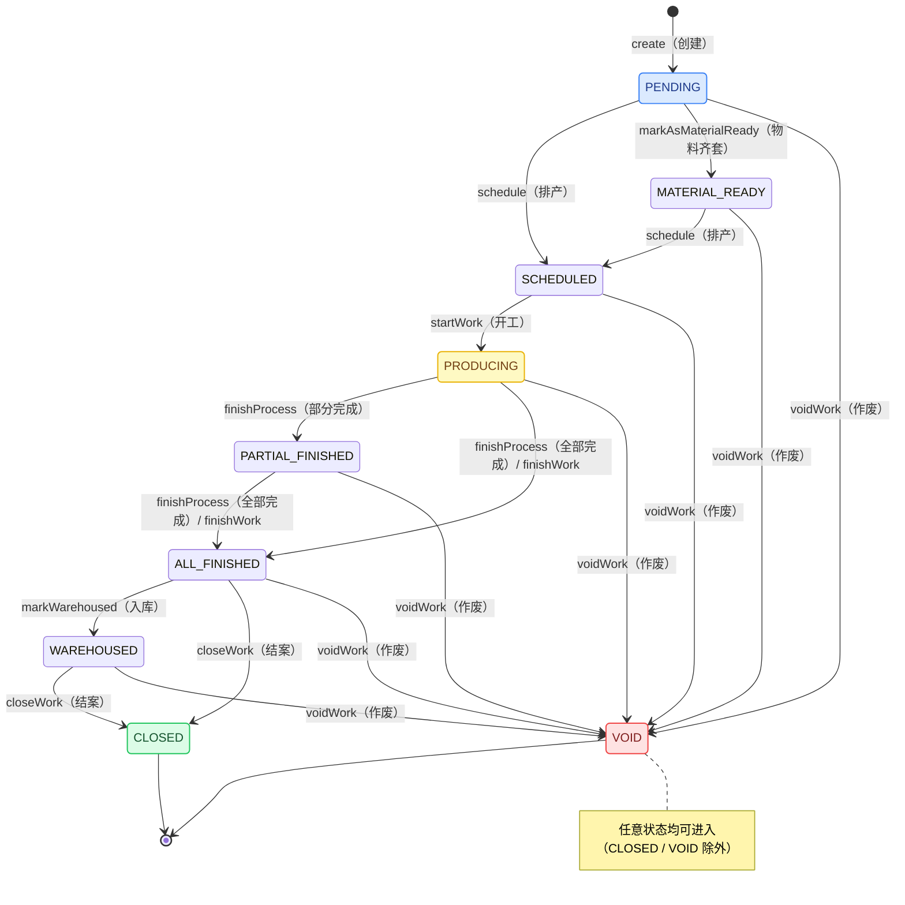

# 实战案例：MTO 工单引擎

一个从生产级珠宝 ERP 系统中提炼出的通用按订单生产（MTO）工作流引擎。

## 这是什么

本实战案例演示如何将领域特定的工作流引擎抽象为可复用、与行业无关的组件。原始实现管理珠宝生产订单，包含 17 道固定工序（铸造、镶嵌、抛光、电镀……）。本版本使用可配置的 YAML 工艺路线和通用模型，可适用于家具、电子、服装等其他制造行业。

## 背景

原始珠宝 ERP 系统（`jewelry`）包含：
- 6 个模块中的 **152 个 API 端点**
- **44 张数据库表**
- **909 个测试用例**
- 在真实珠宝加工业务中经过**生产验证**

MTO 工单引擎是其生产模块的核心，管理生产订单的完整生命周期。

## 状态机



### 状态转换

| 转换 | 守卫条件 | 副作用 |
|------|---------|--------|
| `create()` | — | 接收调用方传入的工单号，按路线配置构建工艺路线 |
| `schedule()` | PENDING 或 MATERIAL_READY | 分配工作中心 + 工人 |
| `startWork()` | SCHEDULED | 记录实际开工日期 |
| `finishProcess()` | PRODUCING 或 PARTIAL_FINISHED | 自动检测是否所有工序均已完成 |
| `reworkProcess()` | PRODUCING、PARTIAL_FINISHED 或 ALL_FINISHED | 工序打回返工；工单若已 ALL_FINISHED 则回退 PARTIAL_FINISHED |
| `resumeFromRework()` | PRODUCING 或 PARTIAL_FINISHED | 返工工序 REWORK → IN_PROGRESS，可再次完工 |
| `finishWork()` | PRODUCING 或 PARTIAL_FINISHED | 将所有工序标记为完成 |
| `markWarehoused()` | ALL_FINISHED | 成品入库，转 WAREHOUSED |
| `closeWork()` | ALL_FINISHED 或 WAREHOUSED | 归档工单 |
| `voidWork()` | 非 CLOSED，非 VOID | 记录取消原因 |

## 关键设计模式

### 1. 通过 YAML 配置定义工艺路线

不再将工序 ID 以逗号分隔的字符串形式存储在数据库中（原始做法），而是在 YAML 中定义路线：

```yaml
mto:
  routes:
    - name: "standard-furniture"
      processes:
        - code: "CUT"
          name: "Cutting"
          plannedHours: 2.0
        - code: "SAND"
          name: "Sanding"
          plannedHours: 1.5
```

### 2. 工序完成自动检测

当一道工序完成时，引擎会检查所有同级工序。若没有未完成的工序，工单会自动推进到 ALL_FINISHED。这一模式在珠宝系统中至关重要——那里的 17 道工序可能以任意顺序完成。

### 3. 基于接口的库存查询

物料齐套检查通过 `InventoryQueryService` 与具体的库存实现解耦。原始实现与黄金、宝石库存表紧密耦合。

### 4. 事件驱动的副作用

原始的 `finishWork()` 会直接创建成品库存记录。本版本只做状态转换；副作用应由事件监听器处理（事件模式参见 `distribution-architecture/architecture/commission-pipeline.md`）。

## 项目结构

```
src/main/java/com/distribution/casestudy/mto/
├── model/
│   ├── WorkOrder.java              # 核心工单实体
│   ├── WorkOrderProcess.java       # 工单内的工序
│   ├── WorkOrderStatus.java        # 九状态生命周期枚举
│   ├── ProcessStatus.java          # 四状态工序枚举
│   ├── MaterialRequirement.java    # 物料需求跟踪
│   ├── Quantity.java               # 值对象：数量 + 单位
│   ├── Worker.java                 # 通用工人模型
│   └── WorkCenter.java             # 生产工作中心模型
├── service/
│   ├── WorkOrderStateMachine.java  # 状态机核心
│   ├── MaterialCheckService.java   # 物料齐套检查
│   └── InventoryQueryService.java  # 库存查询接口
└── config/
    └── ProcessRouteConfig.java     # YAML 路线配置
```

## 抽象映射

| 珠宝（原始） | 通用（本案例） | 行业示例 |
|--------------------|--------------------------|--------------------|
| 17 道固定工序（铸造、镶嵌……） | 可配置的 YAML 路线 | 切割、SMT、缝纫 |
| 黄金 / 宝石 / 辅料 | MaterialCategory + MaterialName | 木材、PCB、面料 |
| 克 / 克拉 | `Quantity(amount, unit)` | kg、pcs、米 |
| 师傅 / 工匠 | `Worker(workerId, name, skillType)` | 操作员、技术员 |
| 车间 + 班组 | `WorkCenter(id, name, location)` | 生产线、单元 |
| goldLoss / stoneLoss | `materialLoss`（通用） | 损耗、废料 |
| styleNo | `productCode` | SKU、部件号 |
| material / purity / color | `productSpec`（Map） | 可配置属性 |

## 如何使用

### 1. 在 YAML 中定义工艺路线

```yaml
mto:
  routes:
    - name: "my-production-route"
      processes:
        - code: "STEP1"
          name: "First Step"
          plannedHours: 1.0
        - code: "STEP2"
          name: "Second Step"
          plannedHours: 2.0
```

### 2. 创建并管理工单

```java
// 从 YAML 路线创建
WorkOrderStateMachine stateMachine = new WorkOrderStateMachine(routeConfig);
WorkOrder wo = stateMachine.create("WO-001", "my-production-route");

// 排产
stateMachine.schedule(wo, new WorkCenter(1L, "Line A"), new Worker(1L, "Alice"));

// 开始生产
stateMachine.startWork(wo);

// 逐道完成工序
stateMachine.finishProcess(wo, processId);

// 所有工序完成后 → 自动转为 ALL_FINISHED
// 然后结案
stateMachine.closeWork(wo);
```

## 相关文档

- [数据权限模型](../../architecture/data-permission-model.md) — 原始系统中使用的权限模式
- [佣金流转流水线](../../architecture/commission-pipeline.md) — 事件驱动的副作用模式
- [MyBatis 模式](../../architecture/mybatis-patterns.md) — 原始实现中使用的 SQL 模式
- [开源发布纪律](../../playbooks/open-source-compliance.md) — 本次抽取背后的策略

## 来源

抽取自 `jewelry` 生产 ERP 系统（私有仓库）。原始代码已在真实业务环境中验证，包含 152 个 API 端点和 44 张数据库表。
