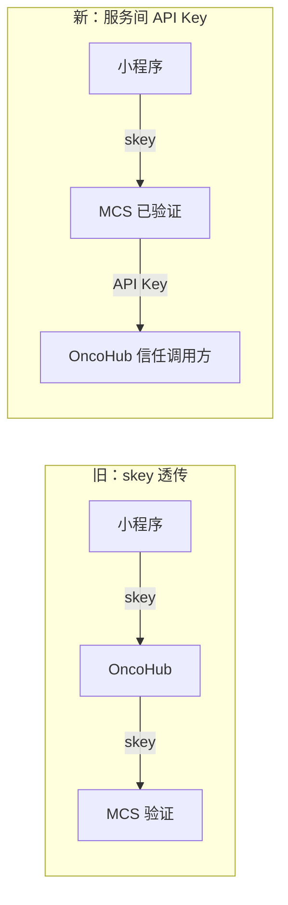
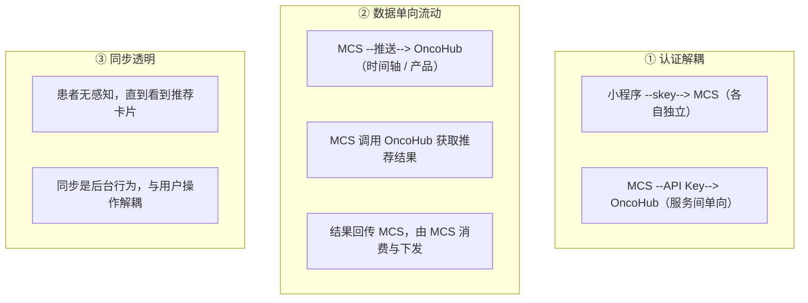

# OncoHub 架构演进：一份设计文档被改了 8 次

> 好的架构不是一开始就画出来的，是被现实一次次修正出来的。本文记录一个四系统集成需求的设计文档从 v1.0 改到 v2.8 的过程，以及每一轮修正背后的判断。
>
> 案例来自个人项目复盘，首发于个人主页；系统名与数字为该项目实录，业务数据未收录。

---

## 一、背景：四个系统与两天写完的文档

一个需求：把四个独立系统打通，做肿瘤患者的智能推荐闭环。四个系统都已独立交付并运行：陪诊小程序（用户入口）、核心业务系统（下称 MCS）、分销后台（商品与履约）、OncoHub 决策中台（规则引擎 + 知识图谱 + 推荐引擎）。

听起来不难：能力都有，差的只是"连起来"。于是两天写完一份设计文档，架构清晰、数据模型完整、API 定义详细，还画了降级方案。评审被怼了六个问题，其中三个是"这个外部依赖你协调不下来怎么办"，当时的回答是"应该能协调下来吧"。

这句话就是问题的开始。文档从 v1.0 改到 v2.8，前后 8 稿。

---

## 二、画图之前先读代码

第一版的直觉是让 OncoHub 做中间人：左手接小程序的数据，右手调分销平台的接口。认证方案是让 OncoHub 也支持小程序的 skey 验证，调 `verify-skey` 接口拿 user_id。

直到去读代码，才发现架构图是错的：

```text
Medical-chaperon-server
├─ MiniappApplication（端口 9010）
└─ OpsApplication（端口 9020）   ← 同一工程的两个应用，共享 MySQL + Redis
```

小程序后端和分销后台**根本不是两个系统**，而是同一个工程的两个应用，用构建 Profile 打了两个包。此前画的"四个方框、两套对接方案、两个认证通道"全部作废：只需要对接一个后端。"产品数据格式需要猜"的假设也不成立，工程里已有完整的产品 CRUD API。

**画了一张错的架构图，然后基于这张图设计了整套方案。** 修正后的教训：在白板上画架构之前，先把既有系统的代码读一遍。不用读完，看目录结构、配置文件、Controller 目录，30 分钟就够，而这 30 分钟能纠正大部分假设。

---

## 三、认证解耦：消灭依赖优于复杂降级

第一版认证方案写了半页三级降级：`verify-skey` 接口不可用 → 只读库直查 → 服务端白名单密钥。看起来很严谨。

评审问了一个问题："MCS 已经验证过用户身份了，为什么 OncoHub 还要再验证一次？"

确实。用户在小程序里的每个操作都已经过 MCS 的拦截器校验，`user_id` 已在服务端上下文里。OncoHub 再验一次 skey，是在**重复做别人已经做过的事**，且带来三个代价：需要对方提供验证接口（外部依赖）、需要理解 skey 的存储与过期逻辑（耦合）、skey 泄露可伪造身份（安全风险）。

正确方向是让 MCS 作为调用方，带着已验证的用户 ID 调 OncoHub；OncoHub 只验证一个服务间 API Key，本地比对、零网络延迟。三级降级方案不需要了，因为依赖本身被消灭了：



判断标准可以推广：**最好的容错设计是让降级成为不必要的。** 如果发现自己在写复杂的降级逻辑，先想想能不能消灭那个依赖。

---

## 四、同步透明：删掉"同步按钮"

第一版在小程序时间轴页放了一个"同步到壹鹿康行"按钮：用户授权，数据同步，技术上很合理。

换位想：一个化疗期的患者记录完用药，看到一个他不认识的"同步"按钮，他会点吗？他的心智模型是"我在管理我的病历"，不是"我在把数据发给另一个系统"。**"同步按钮"是把技术实现细节暴露给了用户。**

正确做法是删掉按钮、加后台异步调用：MCS 异步推送 → OncoHub 解析上下文 → 触发推荐；患者唯一感知到 OncoHub 的时刻，是打开推荐页看到基于自己病程生成的卡片。技术复杂度内聚在服务端，用户体验保持简单。

---

## 五、数据流向跟随数据所有权

原方案是 OncoHub 定时从分销平台拉取产品数据（6 小时刷新）。但谁最清楚产品什么时候变了？是 MCS：价格调了、状态改了、新品上架了，它第一个知道。

**数据应该从变更方流向消费方。** 改成推送后，延迟消除，代码量从约 100 行（拉取客户端 + 错误处理 + 缓存刷新）降到约 30 行（接收推送 + 写入缓存），且 OncoHub 不再需要理解 MCS 的 API 格式。

---

## 六、"不改什么"清单

设计文档写到一半，发现改动范围描述自相矛盾：一边写"MCS 不新增接口、不改业务逻辑"，同一段又要求它新增推送钩子、工具类和字段。这不是"不改"，是"改了不少"。

于是对四个系统加合作方门户做全量代码审阅，逐系统列出改什么、不改什么：

| 系统 | 改什么 | 不改什么 |
|------|--------|---------|
| 陪诊小程序 | 推荐卡片页面（新增） | 时间轴 CRUD、患者管理、订单支付 |
| MCS 后端 | 异步推送钩子、source 字段 | 现有 API 路径、业务逻辑 |
| OncoHub | 3 个新模块 + 5 张新表 | 76 个现有 API、规则引擎 / 知识图谱 / 推荐引擎 |
| 分销管理后台 | 无 | 完全透明 |
| 合作方门户 | 无 | 完全透明 |

**"不改什么"是系统独立性的证明。** 如果一个系统需要大量改动才能集成，说明架构设计有问题。

---

## 七、接口路径是最后一公里

文档到 v2.7 时架构已经清晰，联调时却出了问题：同一接口在两节里写了两个不同路径，且端点在目标系统里根本不存在，实际端点是另一个。

画了再漂亮的架构图、定义了再精妙的数据模型，接口路径错了，一切白费。**接口路径是设计文档的最后一公里**，它不是细节，是可执行性的最低门槛。v2.8 把全文路径统一，并补了调用来源归因字段，形成闭环。

---

## 八、灰度：数据到了才往下走

闭环跑通之后，上线分四个阶段，每阶段有验收标准和回滚条件：

| 阶段 | 范围 | 门槛 |
|---|---|---|
| 0 内部验证 | 3–5 人 | 准确率 100%，任何报错立即停止 |
| 1 小范围灰度 | 100 用户 | 准确率 ≥ 80%，点击率 ≥ 10%，每天人工抽样复核 |
| 2 扩大灰度 | 500 用户 | 准确率 ≥ 80%，点击率 ≥ 15%，开启转化追踪 |
| 3 全量上线 | 1000+ 用户 | 完整闭环可运行，全链路监控 |

验收标准是"数据到了才往下走"，而非"感觉差不多了就往下走"。

---

## 九、八次修订与三条边界

回头看，每一轮修改都在做同一件事：**把假设变成事实**。

| 版本 | 发现了什么 | 改了什么 |
|------|-----------|---------|
| v1.0 | 凭直觉画架构 | 起点 |
| v2.2 | 认证方案过度设计 | skey 透传 → 服务间 API Key |
| v2.4 | 同步按钮不合理 | 用户主动 → 后台异步 |
| v2.5 | 数据流方向反了 | 拉取 → 推送 |
| v2.6 | 事实性错误（端口、事件类型） | 基于代码库盘点修正 |
| v2.7 | 缺可视化与灰度策略 | 补 ER 图、序列图、灰度四阶段 |
| v2.8 | 接口路径不一致 | 全文统一 + 来源归因闭环 |

最终设计收敛为三条边界：



---

## 十、诚实边界

- 单项目复盘：评分（7.9 → 9.5）是团队设计评审 10 分制的主观评价，覆盖该团队当时关心的五个维度，不是通用度量；
- 灰度阈值（准确率 ≥ 80% 等）来自该项目对推荐质量的业务判断，迁移时必须按自己的风险面重定；
- 本文展示的是**演进方法**（读代码纠假设、消灭依赖、改动范围清单、数据流向所有权），不是该系统的完整架构文档；
- 四系统均为已交付运行的个人项目，业务数据、患者数据与内部配置未收录。

## 证据边界

- 首发：个人主页文章 [一份设计文档被改了 8 次，每次都觉得自己是对的](https://steven.caxcz.xin/blog/oncohub-architecture-evolution)（2026-04-11 发表）
- 本文为该文的知识库改写版，补充了与本仓库方法论的关联；关键数字（8 稿修订、76 个现有 API、灰度四阶段）为原文实录

## 相关文档

- [DDD 七步落地](../playbooks/enterprise-architecture/ddd-seven-step-landing.md) — 统一语言、限界上下文与"边界说明书"
- [事件驱动状态机](../architecture/commission-pipeline.md) — 事件作为已发生的业务事实
- [模板 02 变更与灰度发布](../playbooks/production-operations/templates/02-change-and-canary.md) — 灰度阶段与回滚条件的通用模板
- [架构组合治理](../playbooks/system-portfolio-governance/00-methodology.md) — 系统群的盘点与处置
