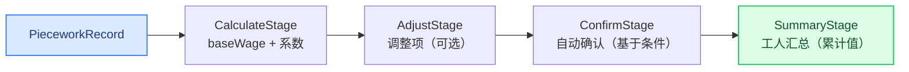

# 实战案例：计件工资计算引擎

一个采用流水线（Pipeline）模式的通用计件工资计算引擎，抽取自生产环境中的珠宝 ERP，并泛化为适用于任何制造业。

## 这是什么

本实战案例演示如何构建一个可配置的计件工资计算引擎。原始珠宝 ERP 只有简单的 `piecePrice × quantity` 公式。这个通用版本引入了难度系数和质量系数，并使用流水线（Pipeline）模式承载结算流程。

## 背景

珠宝 ERP 的 `BizPieceworkWageServiceImpl`（142 行）负责：

- 单工序工资计算
- 按工单批量计算
- 手动调整
- 确认流程
- 月度汇总

原始公式很简单：`wageAmount = piecePrice × totalQty`

本实战案例将其扩展为：`wage = unitPrice × quantity × difficultyCoeff × qualityCoeff`

## 计算公式

```
baseWage     = unitPrice × completedQuantity
adjustedWage = baseWage × difficultyCoefficient × qualityCoefficient
finalAmount  = adjustedWage + Σ adjustmentAmount
```

**舍入规则**：中间计算（baseWage、adjustedWage）保留全精度不舍入，只有 `finalAmount` 在最后统一 `HALF_UP` 舍入到 2 位小数——避免「先截断再乘系数」的双重舍入误差。

**调整项为累加语义**：`adjust()` 是「追加一笔调整」而不是「设置调整总额」。先 `adjust(+50)` 再 `adjust(+30)`，调整合计为 +80，前一笔不会被静默吞掉。

### 质量系数逻辑

| 合格率 | 质量系数 | 效果 |
|-------------------|--------------------|----|
| ≥ 95%（阈值） | 1.0 | 全额支付 |
| < 95% | 0.8（扣减系数） | 按 80% 支付 |

可按工序配置 —— 不同工序可以有不同的阈值和扣减系数。

## 结算流水线



### 流水线阶段

| 阶段 | 作用 | 是否可配置？ |
|-------|---------|--------------|
| `CalculateStage` | 计算基础工资并应用系数（复用 `WageSettlement` 的计算方法，公式只有一处实现） | 固定逻辑 |
| `AdjustStage` | 追加手动/自动调整项（走 `adjust()` 累加语义） | 通过 `AdjustmentProvider` |
| `ConfirmStage` | 满足条件时自动确认 | 通过 `AutoConfirmCriteria` |
| `SummaryStage` | 按工人汇总工资 | 副作用收集器 |

`processAll()` 单条失败不阻断其他记录：失败项以 `error` 级别写日志，并收集到 `pipeline.getFailures()` 返回给调用方——结果可见，不会静默缩减。

### 为什么采用流水线（Pipeline）？

原始珠宝 ERP 采用的是一系列线性的方法调用。流水线（Pipeline）模式：

- **可扩展**：无需修改现有阶段即可新增税额计算、合规检查等
- **可测试**：每个阶段可以独立测试
- **可配置**：不同行业使用不同的阶段组合

## 项目结构

```
src/main/java/com/distribution/casestudy/wage/
├── WageCalculator.java              # 核心计算引擎
├── WageSettlementPipeline.java      # 流水线编排器
├── model/
│   ├── PieceworkRecord.java         # 生产记录（报工单）
│   ├── WageConfig.java              # 工序工资配置
│   ├── WageSettlement.java          # 最终结算记录
│   └── WageStatus.java              # 生命周期状态枚举
└── pipeline/
    ├── SettlementStage.java         # 阶段接口
    ├── CalculateStage.java          # 基础工资 + 系数
    ├── AdjustStage.java             # 手动/自动调整项
    ├── ConfirmStage.java            # 自动确认
    └── SummaryStage.java            # 工人汇总聚合
```

## 关键设计决策

### 1. 可配置的系数

原始实现没有难度/质量系数。引入这些系数是为了：

- 奖励承担高难度工序的工人（难度 > 1.0）
- 对质量不佳的产出进行扣减（质量系数 < 1.0）
- 支持按工序配置

### 2. BigDecimal 精度

所有金额计算均使用 `BigDecimal`，并遵循：

- `HALF_UP` 舍入模式（标准财务舍入）
- 最终金额 `finalAmount` 统一舍入到 2 位小数（货币精度）；中间金额不舍入
- 合格率等比率中间计算保留 4 位小数

### 3. 不可变的计算

`WageSettlement` 的计算方法（`calculateBaseWage`、`applyCoefficients`、`calculateFinalAmount`）是显式步骤，而不是在字段变更时自动计算。这让计算顺序清晰且便于调试。

### 4. 状态守卫

状态转换受到守卫约束：

- 只有 PENDING 状态的结算单可以调整或确认
- 只有 CONFIRMED 状态的结算单可以标记为已支付
- PAID 状态的结算单不能取消

## 使用方式

### 1. 配置计件单价

```java
WageConfig config = new WageConfig(1L, "Stone Setting", new BigDecimal("5.00"));
config.setDifficultyCoefficient(new BigDecimal("1.2"));   // 难度高 20%
config.setQualityThreshold(new BigDecimal("0.95"));       // 合格率 95%
config.setQualityPenaltyFactor(new BigDecimal("0.8"));    // 低于阈值时按 80% 支付
```

### 2. 计算单条工资

```java
WageCalculator calculator = new WageCalculator();
PieceworkRecord record = new PieceworkRecord(101L, "Alice", "Stone Setting", 100, 98);
WageSettlement settlement = calculator.calculate(record, config);

// settlement.getBaseWage()      = 500.00 (5 × 100)
// settlement.getAdjustedWage()  = 600.00 (500 × 1.2 × 1.0)
// settlement.getFinalAmount()   = 600.00
```

### 3. 通过流水线处理

```java
WageSettlementPipeline pipeline = new WageSettlementPipeline()
    .addStage(new CalculateStage())
    .addStage(new AdjustStage(s -> new AdjustmentResult(new BigDecimal("50"), "bonus")))
    .addStage(new ConfirmStage())
    .addStage(new SummaryStage());

List<WageSettlement> results = pipeline.processAll(settlements);
```

## 抽象映射

| 珠宝（原始） | 通用（本实战案例） | 行业示例 |
|--------------------|--------------------------|--------------------|
| `BizPieceworkWage` | `WageSettlement` | 任意计件记录 |
| `BizProcessReport` | `PieceworkRecord` | 报工单、工时表 |
| `piecePrice` | `unitPrice` | 每件/每单位单价 |
| `masterId` / `masterName` | `workerId` / `workerName` | 员工、操作工 |
| `goldLoss` / `stoneLoss` | （已移除——物料损耗在其他地方跟踪） | — |
| `wageMonth` | `settlementPeriod` | 薪资周期 |
| 简单的 `piecePrice × qty` | `unitPrice × qty × difficulty × quality` | 可配置系数 |
| 线性方法调用 | 流水线（Pipeline）模式 | 可扩展阶段 |

## 生产落地注意

本案例是**纯内存教学项目**，没有持久层，因此没有实现结算幂等。若在生产环境落地（报工记录重复推送到结算流水线、结算任务重跑等场景），**必须**为结算单加幂等键：

- 唯一约束：`workOrderId + processId + workerId`（一条报工在一个工序上只允许产生一条生效结算单）
- 落库前先按幂等键查重 / 依赖数据库 `UNIQUE` 约束兜底，重复推送直接跳过或合并，而不是再算一遍
- 批量结算任务（如按月跑批）应以「幂等键 + 结算期」为单位做断点续跑

## 相关文档

- [工单工作流引擎（MTO）](../mto-workflow-engine/) — 生成计件记录的工单状态机
- [Spring 事件](../spring-events-decoupling/) — 跨模块工资通知的事件驱动模式
- [佣金流水线](../../architecture/commission-pipeline.md) — 用于佣金计算的类似流水线模式

## 来源

抽取自 `jewelry` 生产 ERP 系统。原始的 `BizPieceworkWageServiceImpl` 共 142 行，采用简单的 `piecePrice × quantity` 公式。这个通用版本增加了可配置系数和流水线（Pipeline）模式，以提升可扩展性。
