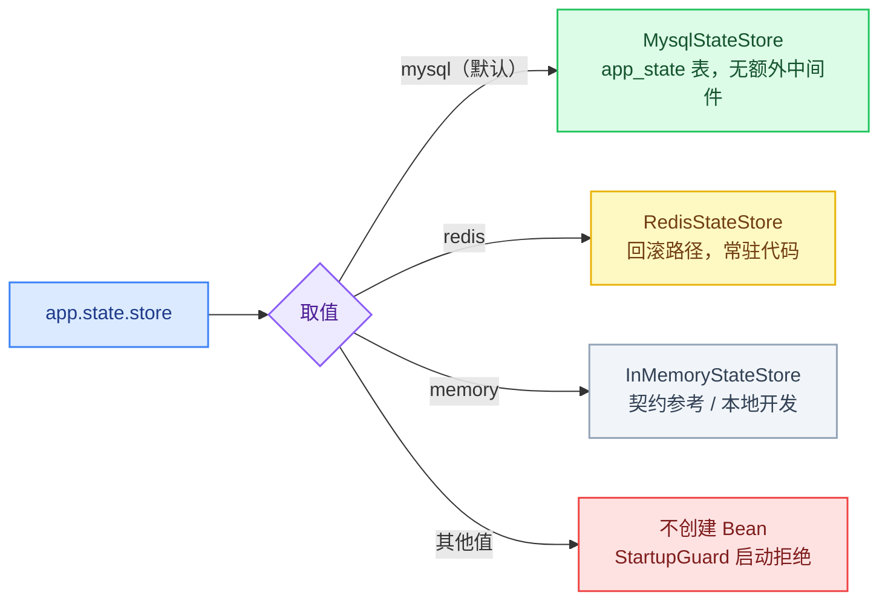

# 实战案例：生产护栏

两个生产护栏提炼自一个在运行的 IoT 设备管理后端：一个是**快速失败的启动护栏**（宁可拒绝启动，也不降级运行），另一个是**可插拔的状态存储**——它将生产环境必需的中间件从两个组件缩减为一个，同时保留了一条零代码改动的回滚路径。

## 这是什么

两个护栏针对的是同一类故障：**在生产中静默失败、事后才大张旗鼓暴露的配置错误**。一个把配置违规转化为启动失败；另一个把中间件选型变成一次配置切换，并附带一条经过测试的逃生通道。

## 背景

源系统是一个 Spring Boot 后端，服务于一个 IoT 设备平台（约 60 万注册用户的容量包络）。在收敛之前，它的短生命周期状态（验证码、token 拒绝名单、握手材料）托管在 MySQL 旁边的 Redis 上。访问模式分析显示出三个共同属性——短 TTL、键级原子性、数据可重新生成——以及数百 QPS 的峰值，而单张 MySQL 表就能以 15–50 倍的余量吸收。问题于是变成：*常驻的 Redis 值得吗？*

完整的决策叙述记录在 ADR 中；本实战案例是它们背后的**可运行代码**：

- [ADR：MySQL 中的状态存储，Redis 可选](../../decisions/why-redis-optional.md)
- [ADR：选择 Spring Boot 单轨而非 NestJS](../../decisions/why-spring-boot-not-nestjs.md)

## 护栏 1：StartupGuard —— 配置错误时快速失败

`@PostConstruct` 执行一次检查；在非 dev/test 的 profile 中，任何违规都会**中止上下文启动**，而不是让应用降级运行：

| 检查项 | dev/test | prod | 拒绝消息中陈述的后果 |
|---|---|---|---|
| `app.state.store` ∈ {mysql, redis, memory} | 拒绝（始终） | 拒绝（始终） | 拼写错误会导致完全没有 `StateStore` 被装配 |
| `app.jwt.secret` 占位符（`change-me*`） | 警告，放行 | **拒绝** | 任何人都可以伪造 token |
| `app.sms.debug=true` | 放行 | **拒绝** | 验证码只打印到日志，永远不会送达 |
| `app.storage.base-url` 缺失 | 放行 | **拒绝** | 下载 URL 回退到请求的 Host 头（Host 注入攻击面） |

两个值得复制的设计要点：

1. **每条拒绝消息都点名后果**（"否则会发生……"），因此凌晨三点看启动日志就能自解释——无需翻 wiki。
2. **护栏之所以有效，是因为框架保证了语义**：`@PostConstruct` 失败 = bean 创建失败 = 应用永远不会启动。这正是做出 Spring Boot 单轨决策的机制层原因（见 ADR）。

**生产档判定：含 `prod`/`production` 即严格模式**——dev/test 豁免仅在完全不含生产档时生效。混合 profile（如 `prod,test`）按严格档处理，防止「把 prod 和 test 一起激活」整体旁路红线；占位密钥的 `change-me` 前缀比较忽略大小写（`Change-Me` 变体同样拒绝）。两条规则均由 `StartupGuardTest` 的混合 profile 用例锁定。

## 护栏 2：StateStore —— 中间件从 2 到 1，附带零代码回滚



六个原语（`set` / `get` / `setIfAbsent` / `delete` / `exists` / `increment`），配有一份成文的语义契约；JSON 值；宽容读取（损坏的值视为缺失并删除）。

MySQL 实现让原子性**在 SQL 中可见**——没有需要审计的 ORM flush 时机：

```sql
-- setIfAbsent：主键冲突 = key 仍然存活，天然原子
INSERT IGNORE INTO app_state (state_key, state_value, expire_time, update_time) VALUES (?, ?, ?, ?);

-- increment：单语句行锁自增，并用 LAST_INSERT_ID(expr) 把新值登记到会话——
-- 随后同连接 SELECT LAST_INSERT_ID() 读回的必然是本次自增值，
-- 即使并发事务在两条语句之间继续自增，读回值也不重不漏（与 Redis INCR 语义对齐）
INSERT INTO app_state (state_key, state_value, expire_time, update_time)
VALUES (?, LAST_INSERT_ID('1'), ?, ?)
ON DUPLICATE KEY UPDATE
  state_value = CASE WHEN expire_time <= ? THEN LAST_INSERT_ID('1')
                     ELSE LAST_INSERT_ID(CAST(state_value AS BIGINT) + 1) END,
  expire_time = CASE WHEN expire_time <= ? THEN ? ELSE expire_time END;
```

Redis 回切档的 `increment` 同样是一段 Lua 脚本原子完成「INCR + 首建时写 TTL + 整数校验」——两步分开时并发下存在「自增成功但键永不过期」的泄漏窗口。

三实现对齐的两条契约细节：**TTL 一律毫秒语义**（亚秒 TTL 有效，MySQL 档 expire_time 存毫秒时间戳）；**计数键当前值非整数时拒绝**（抛 `IllegalStateException`，而非静默归零）。

**时钟归属**（相对生产原版的一次演进）：每次读/写路径的过期判断都使用**应用传入的 `now` 参数**——单一时钟域，不在 SQL 中混用 `UNIX_TIMESTAMP()`，并且可以针对 H2 做契约测试。生产变体及其推理差异记录在 [docs/from-production-to-generic.md](docs/from-production-to-generic.md)。

## 契约测试套件 —— 如实记录的空白

生产系统交付这套抽象时**没有契约测试**（它的 javadoc 引用的测试类并不存在）。本实战案例补上了缺失的那一块：

| 套件 | 锁定什么 | 数量 |
|---|---|---|
| `StateStoreContractTest`（抽象） | 六原语语义：JSON 往返、宽容读取、过期（含亚秒 TTL）、setIfAbsent、并发原子自增（各调用方所得值互不重复、最终值精确）、非整数计数键拒绝 | 15 个断言用例 × 2 个实现 |
| `InMemoryStateStoreContractTest` | 参考实现——语义争议的第一裁判 | 15 |
| `MysqlStateStoreContractTest` | 针对 H2 `MODE=MySQL` 的真实 SQL（`INSERT IGNORE`、`ON DUPLICATE KEY UPDATE`、`LAST_INSERT_ID`）；多连接池（HikariCP）承载，并发用例每线程独立连接——跨连接行锁/会话语义才真正被测到 | 15 |
| `StateStoreWiringTest` | 条件 → 实现的映射；非法值**什么都不装配**（无静默回退） | 5 |
| `StartupGuardTest` | 完整的拒绝矩阵，每条生产红线对应一个可执行断言；含混合 profile（`prod,test` 不旁路红线）与占位密钥大小写变体 | 16 |

**51 个测试，零外部服务。** Redis 语义由接口契约、Lua 脚本和一致的 JSON 处理固定；针对真实 Redis 的契约测试列在"未包含内容"下。

## 项目结构

```
src/main/java/com/distribution/casestudy/guardrails/
├── config/
│   ├── GuardProperties.java          # app.* 配置面（刻意保持领域中性）
│   └── StartupGuard.java             # @PostConstruct 快速失败检查
└── state/
    ├── StateStore.java               # 接口 + 成文的语义契约
    ├── InMemoryStateStore.java       # 契约参考（memory 模式）
    ├── MysqlStateStore.java          # 默认：app_state，原子 SQL 可见
    ├── RedisStateStore.java          # 回滚路径：配置切换，零代码改动
    └── StateStoreConfig.java         # @ConditionalOnProperty 装配（3 行选择逻辑）
src/main/resources/
└── app-state-schema.sql              # app_state DDL（双方言：H2 MySQL 模式 + MySQL）
src/test/java/.../
├── config/StartupGuardTest.java      # 拒绝矩阵
└── state/
    ├── StateStoreContractTest.java   # 抽象共享断言
    ├── InMemoryStateStoreContractTest.java
    ├── MysqlStateStoreContractTest.java
    └── StateStoreWiringTest.java     # ApplicationContextRunner 装配锁定
```

## 如何运行

```bash
cd case-studies/production-guardrails
mvn test        # JDK 17+；无需 MySQL，无需 Redis
```

## 未包含内容

有意排除在范围之外——每一项都给出理由：

- **过期行清理任务**（生产系统每 10 分钟分批清理 `app_state`）：没有它语义仍然正确（读路径过滤使过期行不可见）；只是表会增长。物理清理属于运维关切。
- **可运行的 Spring Boot 应用**：这是一个库式实战案例。把 `StateStoreConfig` + `StartupGuard` 装配进你的应用，并启用 `@ConfigurationProperties` 绑定（`@ConfigurationPropertiesScan` 或 `@EnableConfigurationProperties(GuardProperties.class)`）。
- **真实 Redis 的契约测试**：需要运行中的 Redis；接口 javadoc 加上一致的 JSON/序列化行为，在本仓库零外部服务的测试预算内承载了契约。

## 权衡

| 选择 | 成本 | 缓解措施 |
|---|---|---|
| 用 H2 `MODE=MySQL` 做 SQL 测试 | 与真实 MySQL 并非逐位一致（方言角落存在差异） | 契约测试锁定的是*语义*，而非某个方言版本；SQL 只使用广泛支持的构造 |
| 应用时钟的 `now` 参数 | 应用时钟漂移现在会影响过期判断 | 单一时钟域严格优于两个；漂移处理属于 NTP/基础设施，不应混入 SQL 内与应用时钟 |
| `memory` 模式（未用于生产） | 多一个需要与契约保持一致的实现 | 它*就是*契约的第一个参考——对齐负担正是重点 |
| `state_value` 用 `VARCHAR(2048)` 而非 `TEXT` | JSON 上限小于生产的 TEXT | 适合演示的值大小；schema 中已注明，供任何提升该模式的人参考 |

## 相关文档

- [ADR：MySQL 中的状态存储，Redis 可选](../../decisions/why-redis-optional.md) —— 护栏 2 背后的决策
- [ADR：选择 Spring Boot 单轨而非 NestJS](../../decisions/why-spring-boot-not-nestjs.md) —— 为什么 `@PostConstruct` 快速失败能够实现
- [审计快照模式](../../architecture/audit-and-compliance.md) —— 同样的快速失败哲学应用于审计写入（fail-open / fail-closed 分级）
- [提炼叙述：从生产到通用](docs/from-production-to-generic.md)

## 来源

提炼自一个私有生产 IoT 设备管理后端（电池遥测领域）。仅迁移通用架构模式——不包含客户名称、品牌、协议细节、凭据或业务字段语义。容量数字是数量级包络，而非实测生产指标。
