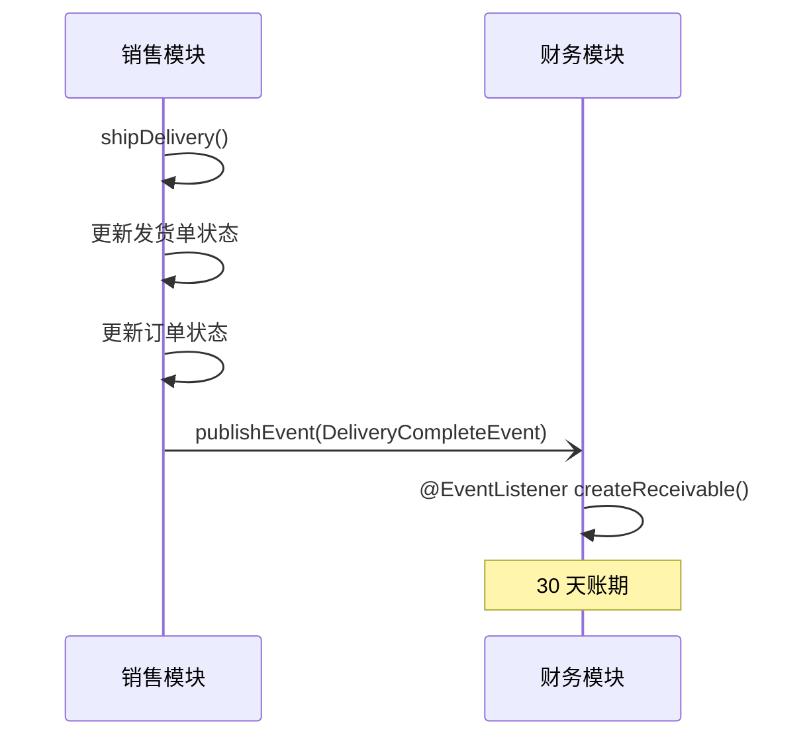
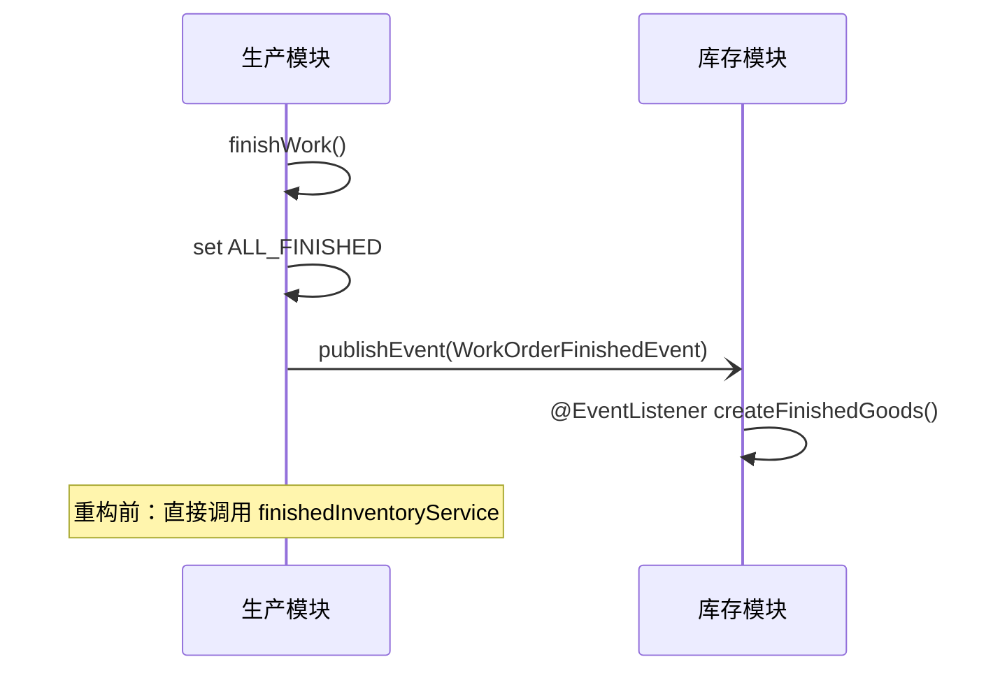
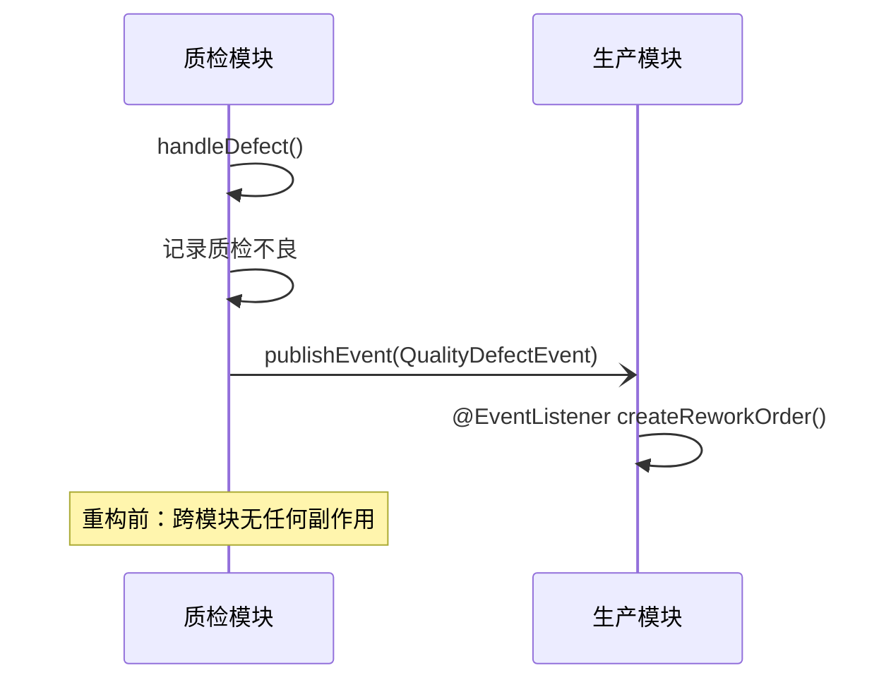

# 实战案例：Spring Events 跨模块解耦

演示如何使用 Spring Events 解耦跨模块交互。该模式提取自一个生产环境的珠宝 ERP 系统，并做了通用化处理，适用于任何行业。

## 这是什么

本实战案例展示三种事件驱动模式，用于替代模块之间直接的同步服务调用。在原始的珠宝 ERP 中，各模块紧耦合——生产模块直接调用库存服务，质检模块直接调用生产服务。本案例将这些调用重构为事件，使每个模块彼此独立。

## 背景

珠宝 ERP 包含 6 个模块（`jewelry-sales`、`jewelry-production`、`jewelry-quality`、`jewelry-finance`、`jewelry-inventory`、`jewelry-system`）。跨模块交互是耦合的主要来源。

**在原系统中发现的耦合模式：**

| 交互 | 原实现方式 | 本实战案例 |
|------------|-----------------|-----------------|
| 发货 → 应收账款 | ✅ 已经使用 `@EventListener` | 提取并通用化 |
| 工单 → 库存 | ❌ 直接调用 `finishedInventoryService.createInventory()` | 重构为事件 |
| 质检不良 → 返工 | ❌ 直接调用 `workOrderService.updateById()` | 重构为事件 |

## 三种事件模式

### 1. 发货 → 应收账款



**来源：** 来自 `jewelry-finance/DeliveryEventListener.java` 的真实模式

### 2. 工单 → 成品入库



**来源：** 重构自 `jewelry-production/BizWorkOrderServiceImpl.finishWork()`，该方法原先直接调用 `finishedInventoryService.createInventory()`。

### 3. 质检不良 → 返工工单



**来源：** 重构自 `jewelry-quality/BizQualityServiceImpl.handleDefect()`，该方法原先只插入一条不良记录，不会触发返工。

## 关键设计模式

### 1. 发后即忘与错误隔离

所有监听器都用 try/catch 包裹自身逻辑。失败会被记录日志，但绝不会向上抛给发布方。这样可以避免下游失败导致上游事务回滚。

```java
@EventListener
@Async("eventAsyncExecutor")
public void onDeliveryComplete(DeliveryCompleteEvent event) {
    try {
        // ... 创建应收账款
    } catch (Exception e) {
        log.error("Failed: {}", e.getMessage(), e);
        // 不向上抛出 —— 发后即忘
    }
}
```

### 2. 面向可测试性的回调接口

每个监听器接收一个回调接口，而不是具体的服务类。这让单元测试变得非常简单——无需 Spring 上下文，也无需 mock 框架。

```java
public class DeliveryToReceivableListener {
    private final AccountsReceivableCallback receivableCallback;

    public interface AccountsReceivableCallback {
        void createReceivable(...);
    }
}
```

### 3. 使用 @Async 实现非阻塞处理

`@Async("eventAsyncExecutor")` 注解确保监听器在线程池中运行，不会阻塞发布方的事务。同时需要结合 `@TransactionalEventListener` 来考虑事务感知的处理。

### 4. 专用线程池

提取自珠宝 ERP 的 `AsyncConfig`（core 2、max 8、queue 100、CallerRunsPolicy）。CallerRunsPolicy 提供了背压能力——当线程池饱和时，由发布方线程自己处理事件，从而避免事件丢失。

## 项目结构

```
src/main/java/com/distribution/casestudy/events/
├── event/
│   ├── DeliveryCompleteEvent.java      # 发货完成 → 触发应收账款
│   ├── WorkOrderFinishedEvent.java     # 工单完工 → 触发成品入库
│   └── QualityDefectEvent.java         # 质检不良 → 触发返工工单
├── listener/
│   ├── DeliveryToReceivableListener.java   # 发货 → 应收账款
│   ├── WorkOrderToInventoryListener.java   # 完工 → 成品入库
│   └── QualityToReworkListener.java        # 不良 → 返工工单
└── config/
    └── EventConfig.java              # 异步线程池 + 监听器注册
```

## 使用方法

### 1. 定义事件

```java
public class DeliveryCompleteEvent extends ApplicationEvent {
    private final Long deliveryId;
    private final Long orderId;
    // ... 其他字段
}
```

### 2. 发布事件

```java
@Service
@RequiredArgsConstructor
public class DeliveryService {
    private final ApplicationEventPublisher eventPublisher;

    public void shipDelivery(Long id) {
        // ... 更新状态
        eventPublisher.publishEvent(new DeliveryCompleteEvent(
                this, delivery.getId(), order.getId(),
                order.getOrderNo(), order.getCustomerId(), order.getAmount()));
    }
}
```

### 3. 监听事件

```java
@Slf4j
public class DeliveryToReceivableListener {
    @EventListener
    @Async("eventAsyncExecutor")
    public void onDeliveryComplete(DeliveryCompleteEvent event) {
        try {
            receivableCallback.createReceivable(...);
        } catch (Exception e) {
            log.error("Failed", e);
        }
    }
}
```

## 迁移指南：从直接调用到事件

### 改造前（紧耦合）

```java
// 生产模块直接依赖库存模块
@Service
public class WorkOrderServiceImpl {
    private final FinishedInventoryService inventoryService;

    public void finishWork(Long woId) {
        wo.setStatus("ALL_FINISHED");
        updateById(wo);
        // 直接的跨模块依赖！
        inventoryService.createInventory(finished);
    }
}
```

### 改造后（已解耦）

```java
// 生产模块 —— 不依赖库存模块
@Service
public class WorkOrderServiceImpl {
    private final ApplicationEventPublisher eventPublisher;

    public void finishWork(Long woId) {
        wo.setStatus("ALL_FINISHED");
        updateById(wo);
        eventPublisher.publishEvent(new WorkOrderFinishedEvent(this, ...));
    }
}

// 库存模块 —— 独立监听
@Slf4j
public class WorkOrderToInventoryListener {
    @EventListener
    @Async("eventAsyncExecutor")
    public void onWorkOrderFinished(WorkOrderFinishedEvent event) {
        finishedGoodsCallback.createFinishedGoods(...);
    }
}
```

## 相关文档

- [MTO 工单引擎](../mto-workflow-engine/) — 发布 `WorkOrderFinishedEvent` 的工单状态机
- [佣金流转流水线](../../architecture/commission-pipeline.md) — 佣金计算的事件驱动模式
- [数据权限模型](../../architecture/data-permission-model.md) — 横切关注点的模式

## 来源

提取自 `jewelry` 生产 ERP 系统。发货→应收账款事件是其中唯一真正采用 Spring Event 的实现；另外两种模式则由直接服务调用重构而来，用于演示事件驱动的思路。
