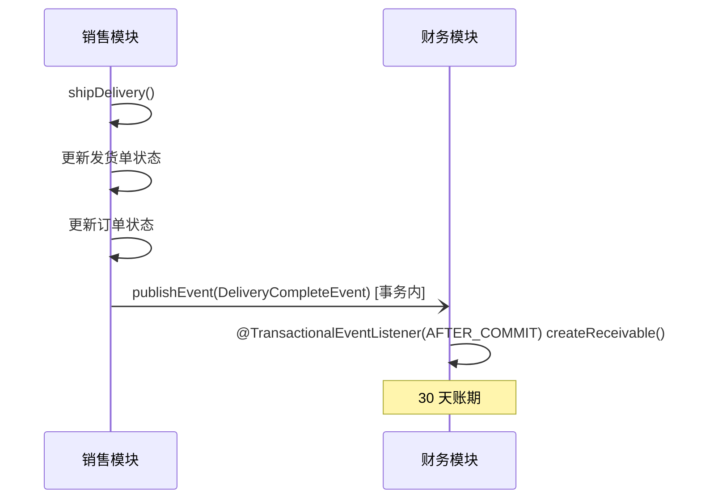
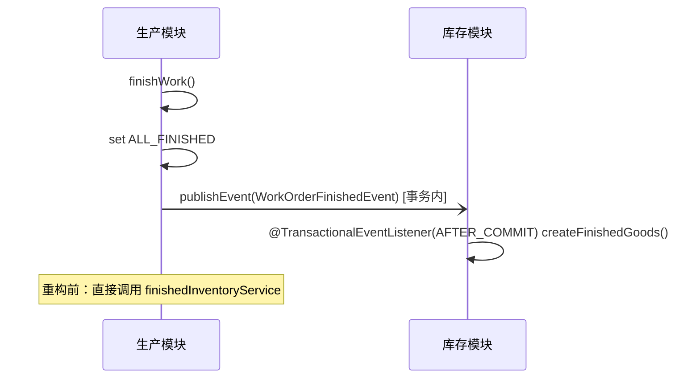
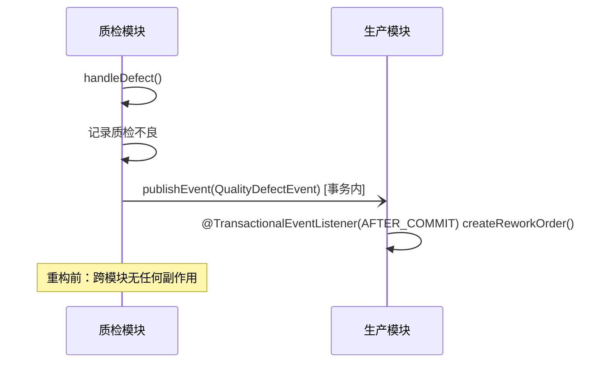

# 实战案例：Spring Events 跨模块解耦

演示如何使用 Spring Events 解耦跨模块交互。该模式提取自一个生产环境的珠宝 ERP 系统，并做了通用化处理，适用于任何行业。

## 这是什么

本实战案例展示三种事件驱动模式，用于替代模块之间直接的同步服务调用。在原始的珠宝 ERP 中，各模块紧耦合——生产模块直接调用库存服务，质检模块直接调用生产服务。本案例将这些调用重构为事件，使每个模块彼此独立。

## 背景

珠宝 ERP 包含 6 个模块（`jewelry-sales`、`jewelry-production`、`jewelry-quality`、`jewelry-finance`、`jewelry-inventory`、`jewelry-system`）。跨模块交互是耦合的主要来源。

**在原系统中发现的耦合模式：**

| 交互 | 原实现方式 | 本实战案例 |
|------------|-----------------|-----------------|
| 发货 → 应收账款 | ✅ 已经使用 `@EventListener` | 提取并通用化 |
| 工单 → 库存 | ❌ 直接调用 `finishedInventoryService.createInventory()` | 重构为事件 |
| 质检不良 → 返工 | ❌ 直接调用 `workOrderService.updateById()` | 重构为事件 |

## 三种事件模式

### 1. 发货 → 应收账款



**来源：** 来自 `jewelry-finance/DeliveryEventListener.java` 的真实模式

### 2. 工单 → 成品入库



**来源：** 重构自 `jewelry-production/BizWorkOrderServiceImpl.finishWork()`，该方法原先直接调用 `finishedInventoryService.createInventory()`。

### 3. 质检不良 → 返工工单



**来源：** 重构自 `jewelry-quality/BizQualityServiceImpl.handleDefect()`，该方法原先只插入一条不良记录，不会触发返工。

## 关键设计模式

### 1. 事务提交后触发 + 发后即忘

所有监听器都声明为 `@TransactionalEventListener(phase = AFTER_COMMIT)`：只有发布方事务**提交成功后**才触发，回滚不会留下幽灵记录（若用 `@EventListener + @Async`，异步线程可能在事务提交前就落库，回滚后产生孤儿应收/库存/返工记录）。

触发后进入 try/catch：失败会被记录日志（带完整业务键与「需人工补偿/对账」字样），但绝不会向上抛给发布方。这样可以避免下游失败导致上游事务回滚。

```java
@TransactionalEventListener(phase = TransactionPhase.AFTER_COMMIT)
@Async("eventAsyncExecutor")
public void onDeliveryComplete(DeliveryCompleteEvent event) {
    try {
        // ... 创建应收账款（日期取事件字段，不用 now()）
    } catch (Exception e) {
        // 不向上抛出 —— 发后即忘；但绝不静默：带业务键，供人工补偿/对账
        log.error("创建应收失败，需人工补偿/对账：deliveryId={}, orderId={}, amount={}",
                event.getDeliveryId(), event.getOrderId(), event.getOrderAmount(), e);
    }
}
```

### 2. 面向可测试性的回调接口

每个监听器接收一个回调接口，而不是具体的服务类。这让单元测试变得非常简单——无需 Spring 上下文，也无需 mock 框架。

```java
public class DeliveryToReceivableListener {
    private final AccountsReceivableCallback receivableCallback;

    /** 实现方必须以 orderId 做幂等（同一事件可能被投递多次） */
    public interface AccountsReceivableCallback {
        void createReceivable(...);
    }
}
```

### 3. 使用 @Async 实现非阻塞处理

`@Async("eventAsyncExecutor")` 注解确保监听器在线程池中运行，不会阻塞发布方的事务。与 `@TransactionalEventListener(AFTER_COMMIT)` 组合后：事务提交 → 提交后回调把事件投递到线程池 → 监听器在异步线程执行，发布方既不回滚连带、也不被阻塞。

### 使用前提：必须在事务内发布

`AFTER_COMMIT` 语义决定了使用前提：**事件发布点必须处于活跃事务中**（发布方方法标注 `@Transactional`，或由 `TransactionTemplate` 包裹）。无事务发布时 Spring 会**静默丢弃**事件（`fallbackExecution` 默认为 `false`），监听器不会执行——这是特性而非缺陷：它保证「监听器执行 ⇔ 发布方事务提交成功」。

`EventConfigWiringTest` 用两条用例把该前提钉死：事务内发布 → 提交后触发；无事务发布 → 不触发。

### 4. 专用线程池

提取自珠宝 ERP 的 `AsyncConfig`（core 2、max 8、queue 100、CallerRunsPolicy）。CallerRunsPolicy 提供了背压能力——当线程池饱和时，由发布方线程自己处理事件，从而避免事件丢失。

## 项目结构

```
src/main/java/com/distribution/casestudy/events/
├── event/
│   ├── DeliveryCompleteEvent.java      # 发货完成 → 触发应收账款
│   ├── WorkOrderFinishedEvent.java     # 工单完工 → 触发成品入库
│   └── QualityDefectEvent.java         # 质检不良 → 触发返工工单
├── listener/
│   ├── DeliveryToReceivableListener.java   # 发货 → 应收账款
│   ├── WorkOrderToInventoryListener.java   # 完工 → 成品入库
│   └── QualityToReworkListener.java        # 不良 → 返工工单
└── config/
    └── EventConfig.java              # 异步线程池 + 监听器注册
```

## 使用方法

### 1. 定义事件

```java
public class DeliveryCompleteEvent extends ApplicationEvent {
    private final Long deliveryId;
    private final Long orderId;
    // ... 其他字段
}
```

### 2. 发布事件（必须在事务内）

```java
@Service
@RequiredArgsConstructor
public class DeliveryService {
    private final ApplicationEventPublisher eventPublisher;

    /* @Transactional 是 AFTER_COMMIT 监听器的使用前提，不是可选项 */
    @Transactional
    public void shipDelivery(Long id) {
        // ... 更新状态
        eventPublisher.publishEvent(new DeliveryCompleteEvent(
                this, delivery.getId(), order.getId(), order.getOrderNo(),
                order.getCustomerId(), order.getAmount(), LocalDate.now()));
    }
}
```

### 3. 监听事件

```java
@Slf4j
public class DeliveryToReceivableListener {
    @TransactionalEventListener(phase = TransactionPhase.AFTER_COMMIT)
    @Async("eventAsyncExecutor")
    public void onDeliveryComplete(DeliveryCompleteEvent event) {
        try {
            receivableCallback.createReceivable(...);
        } catch (Exception e) {
            log.error("创建应收失败，需人工补偿/对账：orderId={}", event.getOrderId(), e);
        }
    }
}
```

## 迁移指南：从直接调用到事件

### 改造前（紧耦合）

```java
// 生产模块直接依赖库存模块
@Service
public class WorkOrderServiceImpl {
    private final FinishedInventoryService inventoryService;

    public void finishWork(Long woId) {
        wo.setStatus("ALL_FINISHED");
        updateById(wo);
        // 直接的跨模块依赖！
        inventoryService.createInventory(finished);
    }
}
```

### 改造后（已解耦）

```java
// 生产模块 —— 不依赖库存模块
@Service
public class WorkOrderServiceImpl {
    private final ApplicationEventPublisher eventPublisher;

    public void finishWork(Long woId) {
        wo.setStatus("ALL_FINISHED");
        updateById(wo);
        eventPublisher.publishEvent(new WorkOrderFinishedEvent(this, ...));
    }
}

// 库存模块 —— 独立监听
@Slf4j
public class WorkOrderToInventoryListener {
    @TransactionalEventListener(phase = TransactionPhase.AFTER_COMMIT)
    @Async("eventAsyncExecutor")
    public void onWorkOrderFinished(WorkOrderFinishedEvent event) {
        finishedGoodsCallback.createFinishedGoods(...);
    }
}
```

### 接入方式：回调 bean 缺失 = 启动失败（fail-fast）

`EventConfig` 的三个 `@Bean` 方法**直接声明对回调接口的依赖**（方法参数注入）。接入方忘记注册任一回调 bean 时，上下文启动立即失败（`NoSuchBeanDefinitionException`），错误在部署阶段暴露——监听器绝不会「静默不注册」。装配行为由 `EventConfigWiringTest` 锁定（回调齐全 → 三个 listener 注册；缺失任一 → 启动失败）。

## 已知边界

本案例是**教学版**，刻意从简的部分必须在生产落地前补齐：

| 边界 | 本案例现状 | 生产落地需要 |
|---|---|---|
| 失败投递 | catch 落 error 日志（带完整业务键 +「需人工补偿/对账」字样）后丢弃 | **outbox 表 + 重试队列**：失败事件持久化，按退避策略重投 |
| 对账 | 无 | **定时对账任务**：比对发货单/工单/质检记录与下游应收/库存/返工记录，差异告警 |
| 投递语义 | at-most-once（AFTER_COMMIT 后一次性异步执行） | at-least-once + **回调方幂等**（接口 javadoc 已写明：实现方需以 orderId/workOrderId 做幂等） |
| 监听丢失 | fail-fast 启动检查（回调缺失拒绝启动） | 同左 + 事件类型注册清单的 CI 校验 |

**为什么教学版不做完整 outbox：** outbox 需要一张持久化表、一个轮询/通知泵、重试与死信策略——这套基础设施会淹没本案例真正要讲的东西（事务感知的事件解耦本身）。完整 outbox 方案见主仓库架构文档；此处只做到「诚实」：失败不静默（日志带全量业务键与补偿指引），前提写明（必须在事务内发布），语义有测试锁定（`EventConfigWiringTest`）。

## 相关文档

- [MTO 工单引擎](../mto-workflow-engine/) — 发布 `WorkOrderFinishedEvent` 的工单状态机
- [佣金流转流水线](../../architecture/commission-pipeline.md) — 佣金计算的事件驱动模式
- [数据权限模型](../../architecture/data-permission-model.md) — 横切关注点的模式

## 来源

提取自 `jewelry` 生产 ERP 系统。发货→应收账款事件是其中唯一真正采用 Spring Event 的实现；另外两种模式则由直接服务调用重构而来，用于演示事件驱动的思路。
