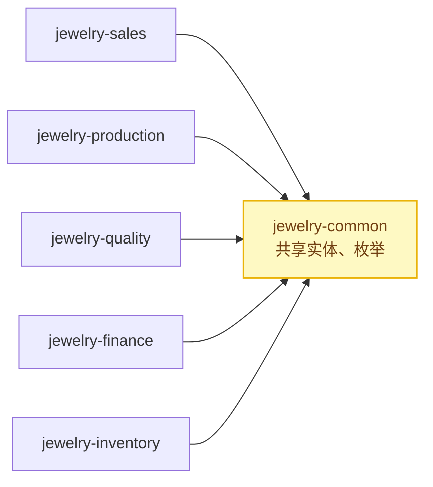

# 从珠宝系统到通用方案：Spring Events 解耦

本文说明三种跨模块交互模式是如何从珠宝 ERP 中提取并重构为一个通用的 Spring Events 实战案例的。

## 原始系统的耦合

珠宝 ERP 包含 6 个需要相互通信的模块：



发现的跨模块交互：

| 来源 | 目标 | 交互 | 模式 |
|------|----|-------------|---------|
| sales | finance | 发货完成 → 创建应收账款 | ✅ Spring Event（唯一一处！） |
| production | inventory | 工单完工 → 创建成品 | ❌ 直接服务调用 |
| quality | production | 质检不良 → 创建返工工单 | ❌ 无跨模块动作 |

## 改动内容

### 模式 1：发货 → 应收账款（原样提取）

**原始来源：** `jewelry-finance/.../DeliveryEventListener.java`

这是珠宝系统中唯一真实的 Spring Event。提取并做了通用化：

| 珠宝系统（原始） | 通用方案（本实战案例） |
|--------------------|--------------------------|
| `BizReceivable` 实体 | 回调接口参数 |
| `BizFinanceService.createReceivable()` | `AccountsReceivableCallback.createReceivable()` |
| `@Async("asyncExecutor")` | `@Async("eventAsyncExecutor")` |
| `DeliveryShippedEvent` | `DeliveryCompleteEvent` |

**关键决策：** 原始监听器使用 `@Async` 实现非阻塞处理。这一点至关重要——财务模块不应阻塞销售模块的发货确认。此处原样保留。

### 模式 2：工单 → 库存（由直接调用重构而来）

**原始来源：** `jewelry-production/.../BizWorkOrderServiceImpl.finishWork()`

原始代码直接调用 `finishedInventoryService.createInventory()`：

```java
// 原始实现：生产模块直接依赖库存模块
public void finishWork(Long woId) {
    wo.setStatus("ALL_FINISHED");
    updateById(wo);

    // 直接的跨模块依赖！
    BizFinishedInventory finished = new BizFinishedInventory();
    finished.setWoId(woId);
    finished.setOrderId(wo.getSalesOrderId());
    finishedInventoryService.createInventory(finished);
}
```

**问题：** 生产模块对库存模块存在编译期依赖。如果库存服务变更 API，生产模块就会编译失败。如果想在完工时追加其他动作（例如通知销售、更新统计），就必须修改生产模块。

**重构后：** 生产模块发布 `WorkOrderFinishedEvent`，库存模块独立监听。

### 模式 3：质检不良 → 返工（由无跨模块动作重构而来）

**原始来源：** `jewelry-quality/.../BizQualityServiceImpl.handleDefect()`

原始代码只插入一条不良记录：

```java
// 原始实现：没有任何跨模块副作用
public void handleDefect(BizDefectHandle defect) {
    BizQualityDefect entity = new BizDefectHandle();
    // ... 设置字段
    defectHandleMapper.insert(entity);
    // 结束 —— 没有事件，也没有通知生产模块
}
```

**问题：** 发现不良后，必须有人手工创建返工工单。质检模块没有任何办法自动通知生产模块。

**重构后：** 质检模块发布 `QualityDefectEvent`，生产模块监听并自动创建返工工单。

## 保留的部分

1. **Spring 原生事件机制** —— 保留注解驱动的事件模型；监听器升级为 `@TransactionalEventListener(AFTER_COMMIT)`（见「事务相关考量」）
2. **监听器上的 `@Async`** —— 非阻塞、发后即忘模式
3. **监听器内的 try/catch** —— 失败只记录日志（带完整业务键与人工补偿指引），绝不向上抛出（避免上游回滚）
4. **线程池配置** —— core 2、max 8、queue 100、CallerRunsPolicy（来自原始的 `AsyncConfig`）
5. **`ApplicationEvent` 基类** —— 承载事件数据，支持事件层次结构

## 新增的部分

1. **回调接口** —— 原始监听器直接注入服务 Bean。本版本使用回调接口（`AccountsReceivableCallback`、`FinishedGoodsCallback`、`ReworkOrderCallback`），用于：
   - 无需 Spring 上下文即可进行单元测试
   - 松耦合（监听器无需知道具体的服务实现）
   - 灵活性（不同环境可使用不同实现）

2. **`QualityDefectEvent`** —— 原系统中并不存在。新增用于演示将直接调用重构为事件的模式。

3. **`WorkOrderFinishedEvent`** —— 原系统中并不存在。新增用于演示将直接调用重构为事件的模式。

4. **可配置的账期** —— 原始系统将 30 天账期硬编码。本版本将其作为构造函数参数传入。

## 事务相关考量

原始的 `DeliveryShippedEvent` 是在 `@Transactional` 方法中发布的。原始实现的时序问题：

- **原始行为（`@EventListener + @Async`）：** 监听器在独立线程中运行，可能在发布方事务提交**之前**执行——若发布方随后回滚，下游已落库的记录成为幽灵数据。
- **本案例的修复（`@TransactionalEventListener(AFTER_COMMIT) + @Async`）：** 事件在发布方事务**提交成功后**才投递到异步线程。「监听器执行 ⇔ 事务提交成功」由框架保证。代价是使用前提：发布点必须处于活跃事务内，无事务发布会被静默丢弃（`fallbackExecution` 默认为 `false`）。

这些副作用仍然接受最终一致性（发后即忘），这对以下场景是合适的：
- 应收账款创建（可以重试）
- 成品入库（可以对账修正）
- 返工工单创建（可以人工触发）

生产落地还需 outbox/重试/对账，教学版从简的原因见 README「已知边界」。

## 经验总结

1. **从真实代码出发：** 三种模式中只有 1 种真正使用了事件，另外 2 种是直接调用。本案例的价值在于展示如何从直接调用迁移到事件。

2. **事件不能替代事务：** 事件用于跨模块通信，而不是模块内部的业务逻辑。发货状态更新仍留在同一个事务中，只有应收账款创建是事件驱动的。

3. **发后即忘往往是正确的：** 在分布式系统中，试图让所有环节都同步且事务化，会导致紧耦合和糟糕的韧性。try/catch + 日志的模式务实且经过生产验证。

4. **回调接口优于具体服务：** 原始监听器直接注入了 `BizFinanceService`。回调接口让测试变得简单，也使本案例聚焦于事件模式本身，而不是服务实现。
