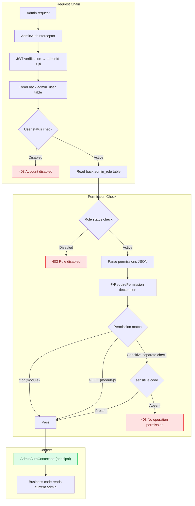

# Admin RBAC: Module-Level Permission Model for the Admin Console

[中文](../../architecture/admin-rbac.md) | English

> Permission-code-based access control for the admin console, supporting module-level read/write separation, independent authorization for sensitive operations, and role changes that take effect immediately.

---

## Architecture Overview



---

## Problem Statement

The admin console is the most sensitive entry point in the system. Unlike customer-facing APIs, the admin console requires:

1. **Fine-grained permissions** — different administrators can only operate different modules
2. **Read/write separation** — viewing the device list is not the same as deleting devices
3. **Independent control of sensitive operations** — viewing plaintext mobile numbers requires additional authorization
4. **Immediate effect** — once an administrator is disabled, the very next request must be rejected

Problems with traditional RBAC:
- Permission checks are scattered across every Controller method
- Role changes require a restart to take effect
- Sensitive operations and ordinary operations use the same permission set, so they cannot be controlled independently

## Design Decisions

### Decision 1: Annotation Declarations + Unified Interceptor Validation

```java
@RequirePermission("device")      // Write operation: requires module code
@GetMapping("/devices")
public R<List<Device>> list() { ... }

@RequirePermission("device")      // Write operation: requires module code
@DeleteMapping("/devices/{id}")
public R<Void> delete(@PathVariable Long id) { ... }
```

**Why annotations?** Permission declarations live alongside the business code, so they are visible at a glance during review. Less prone to omission than manually calling `checkPermission()` at the start of every method.

**Why a unified interceptor?** All admin console requests go through the same interceptor. Permission logic is centralized in one place, with no need for every Controller to reimplement it.

### Decision 2: Three-Tier Permission Code System

```
*                    → Super admin (all permissions)
{module}             → Module admin (read + write)
{module}:r           → Module read-only
sensitive            → Sensitive operations (independent of *)
```

**Module list**:
```
device      Device management
schematic   Schematics
ota         Firmware upgrade
comm        Communication data
user        User management
system      System settings
admin       Administrator management
audit       Audit log
```

**Matching rules**:
| HTTP Method | Accepted Permission Codes |
|-------------|---------------------------|
| GET / HEAD | `*` / `{module}` / `{module}:r` |
| POST / PUT / DELETE | `*` / `{module}` |

### Decision 3: sensitive Is Independent of *

```java
// Viewing plaintext mobile requires the sensitive code; * does not cover it
@GetMapping("/users/{id}/mobile")
@RequirePermission("sensitive")
public R<String> getMobile(@PathVariable Long id) {
    String mobile = userMapper.selectMobileById(id);
    piiCipher.audit("view_mobile", currentAdminId(), mobile);  // Audit
    return R.ok(piiCipher.decrypt(mobile));
}
```

**Why is sensitive independent of *?**
- Super administrators do not necessarily need to see plaintext mobile numbers
- Follows the principle of least privilege — grant it only to accounts that truly need it
- Audit requirements — sensitive operations must be traceable and auditable

### Decision 4: Read the Database on Every Request (Immediate Effect)

```java
// AdminAuthInterceptor.preHandle()
AdminUser user = adminUserMapper.selectById(token.adminId());  // Read back user
AdminRole role = adminRoleMapper.selectById(user.roleId);       // Read back role
Set<String> permissions = parsePermissions(role.permissions);  // Parse permissions
```

**Why not carry permissions in JWT claims?**
- JWT is stateless and cannot be modified after issuance
- If permissions are carried in the JWT, then after an account is disabled or a role is changed, the old token remains valid until it expires
- Admin console traffic is low (vs. customer-facing traffic), so the performance cost of reading the database on every request is acceptable

**Immediate-effect scenarios**:
| Operation | Traditional JWT Approach | This Approach |
|-----------|--------------------------|---------------|
| Disable administrator | Wait for JWT expiry (12h) | Rejected on the next request |
| Change role permissions | Wait for JWT expiry | Takes effect on the next request |
| Reset password | Wait for JWT expiry | Revoked immediately (jti blacklist) |

### Decision 5: ThreadLocal Context + Cleanup in afterCompletion

```java
// Store
AdminAuthContext.set(principal);

// Read in business code
AdminPrincipal current = AdminAuthContext.get();
Long adminId = current.adminId();

// Clean up when the request ends
@Override
public void afterCompletion(...) {
    AdminAuthContext.clear();
}
```

**Note the order**: validate permissions first, then write to the ThreadLocal. If preHandle throws when permission is denied, afterCompletion will not execute, so the ThreadLocal is not polluted.

## Code Implementation

### RequirePermission Annotation

```java
@Target({ElementType.METHOD, ElementType.TYPE})
@Retention(RetentionPolicy.RUNTIME)
public @interface RequirePermission {
    String value();  // Module name or "sensitive"
}
```

### AdminAuthInterceptor Core Logic

```java
@Component
public class AdminAuthInterceptor implements HandlerInterceptor {

    @Override
    public boolean preHandle(HttpServletRequest request, HttpServletResponse response, Object handler) {
        // 1. JWT verification
        String authorization = request.getHeader("Authorization");
        if (authorization == null || !authorization.startsWith("Bearer ")) {
            throw new UnauthorizedException("Missing access token");
        }
        AdminToken token = jwtService.verify(authorization.substring(7).trim());

        // 2. Read back user and role
        AdminUser user = adminUserMapper.selectById(token.adminId());
        if (user == null) throw new UnauthorizedException("Account does not exist");
        if (user.status != 1) throw new ForbiddenException("Account disabled");

        AdminRole role = adminRoleMapper.selectById(user.roleId);
        if (role == null || role.status != 1) throw new ForbiddenException("Role disabled");

        // 3. Parse permissions
        Set<String> permissions = parsePermissions(role.permissions);
        AdminPrincipal principal = new AdminPrincipal(
            user.id, user.username, user.name, user.roleId,
            role.code, role.name, permissions,
            user.mustChangePassword == 1, token.jti()
        );

        // 4. Validate permissions (validate first, then write ThreadLocal)
        checkPermission(request, handler, principal);
        AdminAuthContext.set(principal);
        return true;
    }

    private void checkPermission(HttpServletRequest request, Object handler, AdminPrincipal principal) {
        if (!(handler instanceof HandlerMethod method)) return;

        RequirePermission required = method.getMethodAnnotation(RequirePermission.class);
        if (required == null) {
            required = method.getBeanType().getAnnotation(RequirePermission.class);
        }
        if (required == null) return;  // Not declared = no auth required (login is enough)

        String module = required.value();
        Set<String> permissions = principal.permissions();

        // Global admin or module admin
        if (permissions.contains("*") || permissions.contains(module)) return;

        // GET/HEAD accept the read-only code
        boolean read = "GET".equalsIgnoreCase(request.getMethod())
                    || "HEAD".equalsIgnoreCase(request.getMethod());
        if (read && permissions.contains(module + ":r")) return;

        throw new ForbiddenException("No operation permission");
    }

    @Override
    public void afterCompletion(HttpServletRequest request, HttpServletResponse response,
                                Object handler, Exception ex) {
        AdminAuthContext.clear();  // Must clean up
    }
}
```

### Role Permission Data Structure

```json
// admin_role.permissions field
{
  "permissions": ["device", "device:r", "ota", "audit:r", "sensitive"]
}
```

**Permission codes are stored as a JSON array** and parsed into a Set for matching.

### Relationship with Data Permissions

| Layer | Model | Controls |
|-------|-------|----------|
| Functional permissions | Admin RBAC (this document) | Which endpoints can be accessed |
| Data permissions | [Row-Level Data Permission Model](data-permission-model.md) | Which data rows can be seen |

The two are independent and are usually used together. For example:
- `@RequirePermission("device")` → can access device endpoints
- `dataScope = OWN_DISTRIBUTOR` → can only see devices of the current distributor

## Trade-offs

| Choice | Cost | Mitigation |
|--------|------|------------|
| Read the database on every request | 2 extra queries per request | Admin console traffic is low, acceptable |
| ThreadLocal | Requires cleanup in afterCompletion | Handled uniformly by the interceptor, transparent to business code |
| Annotation declaration | Not declared = no auth required (may be missed) | Code review + integration test coverage |
| sensitive independent | More complex role configuration | Follow the principle of least privilege |
| JSON-stored permissions | Permission codes cannot be queried directly via SQL | The admin console does not search by permission, so there is no such requirement |

## Related Documents

- [Row-Level Data Permission Model](data-permission-model.md) — Data scope control
- [PII Encryption and Masking](pii-encryption.md) — Plaintext access controlled by the `sensitive` permission
- [Audit Log and Compliance Records](audit-and-compliance.md) — Admin console operation auditing
