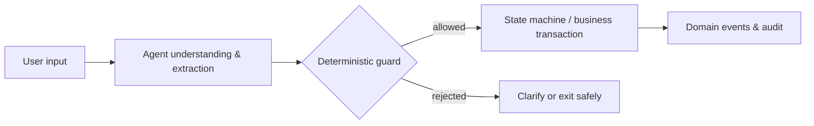

# AI Agent Architecture: Choosing Between Declarative Orchestration and Imperative State Machines

[中文](../../architecture/agent-architecture-patterns.md) | English

> The core problem of an Agent system is not "is the model smart enough", but **who holds the executable state, and who can stop an error before it happens**.
>
> This article compares two paradigms—declarative orchestration and imperative state machines—and offers a risk-tiered hybrid. The examples are abstracted engineering structures; no real business data is included.

> **Verification entry**: no runnable implementation in this repository ｜ **Evidence boundary**: abstracted from the engineering structure of high-risk AI applications; implementations and thresholds are generalized and do not constitute industry benchmarks.

---

## 1. Separate Two Problems First

An Agent application usually contains two kinds of work:

1. **Understanding user intent**: extracting fields, classifying intent, generating candidate plans;
2. **Executing high-risk actions**: creating orders, submitting approvals, producing medical or legal conclusions, triggering payments.

The first kind tolerates probability; the second usually does not. Hand both to the same Prompt and the system acquires a hidden gap: **the model can both understand the business and decide whether it may override business constraints.**

The safer boundary looks like this:



The model proposes candidate actions; code decides whether the action is legal in the current state.

---

## 2. The Two Paradigms

| Dimension | Declarative orchestration | Imperative state machine |
|---|---|---|
| Where business rules live | Skill docs, tool descriptions, agent prompts | Code, types, transition tables |
| Who decides the next action | The agent | Current state + event |
| Flexibility | High | Lower |
| Testability | Depends on model output and prompts | Deterministic tests per state transition |
| High-risk boundary | Prone to "documented but not enforced at execution" | No guard pass, no transition |
| Fit | Low risk, linear flows, fast iteration | Compliance, heavy branching, strict preconditions |

### 2.1 Declarative Orchestration

The declarative approach writes business constraints into Skills and tool descriptions:

```text
Only after the user has explicitly selected a product may the confirm-order tool be called.
Never infer internal IDs from natural language.
Never tell the user a payment succeeded before the payment API returns success.
```

The agent reads these descriptions and decides call order itself. Its strengths are fast onboarding and flexible tool composition—good for prototypes, content Q&A, low-risk shopping assistance, and linear ordering flows.

Its boundary is equally clear: **prompts are probabilistic constraints, not runtime guarantees.** The model may miss, misread, or forget across turns. Critical actions—payment, medical triage, permission changes—must not rest on "the model will follow instructions".

### 2.2 Imperative State Machine

The imperative approach defines legal states and transitions first:

```text
awaiting_input
  -> validated
  -> compliance_passed
  -> completed
```

Every transition carries preconditions, permission checks, idempotency keys, and side effects. The agent's output is only a "candidate intent"; it must pass the guard before entering the state machine.

```text
candidate intent + current state
  -> is the state transition legal?
  -> does the operator have permission?
  -> are business invariants satisfied?
  -> execute the transaction and record the event
```

What the state machine buys is testability and auditability; the price is that every new branch must be modeled explicitly.

---

## 3. Tier by Risk, Don't Pick One

Real systems are usually hybrids:

| Pipeline | Recommended paradigm | Reason |
|---|---|---|
| Education, search, content recommendation | Declarative | Errors are retractable; experience first |
| Standard ordering, booking | Declarative or lightweight state machine | Short flows, few constraints |
| Identity confirmation, quotas, approvals | State machine | Preconditions and permission boundaries are non-negotiable |
| Medical, financial, legal conclusions | State machine + deterministic verification | Error cost is high; must be traceable |

Recommended layering:

1. **Understanding layer**: let the agent do intent recognition, entity extraction, and candidate generation;
2. **Decision layer**: state transition tables, policy engines, and rule checks decide whether execution may proceed;
3. **Execution layer**: business transactions, idempotency, events, and audit use ordinary backend engineering;
4. **Expression layer**: the agent may compose explanatory language, but may not tamper with execution results.

The hybrid is not a compromise on high-risk pipelines; it is letting the model carry only the part it is good at.

---

## 4. Interface Granularity: Atomic or Business-Aggregate

Declarative systems favor atomic tools:

```text
search resources -> view details -> select resource -> confirm order -> pay
```

Atomic interfaces are flexible, but the agent must understand the full dependency graph. The more interfaces, the more skipped steps, retries, and wrong parameter combinations.

High-risk pipelines can instead expose interfaces aggregated by business stage:

```text
submit application -> review application -> generate result
```

Aggregate interfaces encapsulate intermediate states server-side; the agent only sees the results it is allowed to see. This sacrifices some compositional freedom in exchange for two important guarantees:

- Intermediate states and sensitive judgments are never exposed to the model;
- Every step can be authenticated, made idempotent, and audited independently.

The selection criterion is not "fewer interfaces are better" but: **should the agent know about these intermediate steps at all?**

---

## 5. What Code Guards Must Cover

Checking only "does the target state exist" is not enough. A workable guard covers at least these four classes of constraint:

| Constraint | Example | Failure action |
|---|---|---|
| State preconditions | Only pending-review applications may be approved | Reject and keep the original state |
| Operator permissions | Reviewer and applicant must differ | Record the privilege-escalation attempt |
| Business invariants | The same quota cannot be consumed twice | Reject or return idempotently |
| External facts | Verified credentials are issued server-side | Re-authenticate |

Guards should return stable error codes rather than letting the model freely interpret the failure reason. The UI may be friendly, but the underlying verdict must be deterministic.

Also hold to two principles:

1. **Model output cannot lower criticality**: it may upgrade to high-risk, never downgrade on its own;
2. **Model output is not fact**: IDs, amounts, credential status, and time must come from system queries or server-issued attestation.

---

## 6. Streaming Output ≠ Streaming Execution

Streaming responses improve the waiting experience, but "generating" on screen must not become "succeeded" in the business sense.

Recommended: split streamed content into three classes:

- **Process notices**: safe to stream, e.g., "extracting materials";
- **Candidate results**: may stream, but must carry a "pending confirmation" state;
- **Final facts**: shown only after the server-side transaction succeeds and events are persisted.

If the UI shows "payment successful" before the payment API returns, that is not a copywriting problem—it is a missing monotonic constraint in the state machine.

---

## 7. Decision Matrix

Score with the questions below; do not judge only by "development speed":

| Question | Leans declarative | Leans state machine |
|---|---|---|
| Can errors be cheaply rolled back | Yes | No |
| Do users frequently drop out of the current flow | Rarely | Often |
| Are there strict preconditions | No | Yes |
| Must the same flow be reused across channels | Weakly | Strongly |
| Must every step be provably legal | Weakly | Strongly |
| May the model orchestrate sensitive interfaces | Yes | No |
| Are business rules already stable | Stable | Still changing fast |

While business rules are still changing quickly, you do not need to build the full state machine at once. Fix the boundaries first, then migrate high-risk branches into explicit states incrementally.

---

## 8. Common Failures

1. **Treating Skill docs as runtime authorization**: docs can describe rules; they cannot replace authentication.
2. **Letting the agent both plan and execute**: planning results must pass a deterministic guard.
3. **Tools without idempotency keys**: the agent retries once, the business gets two records.
4. **Exposing every intermediate state to the model**: the model may skip checks the server should have performed.
5. **Treating streamed display as transaction completion**: the success the user sees must come from server-side facts.
6. **Tests covering only model answers**: state transitions, refusal paths, and audit trails need tests too.

---

## 9. Landing Checklist

- [ ] Define which pipelines may be probabilistic and which must be deterministic;
- [ ] The agent only outputs candidate intents; it never directly mutates critical business state;
- [ ] Every state transition has preconditions, permission checks, and failure codes;
- [ ] External identity and entity IDs come from server-side facts, never inferred from natural language;
- [ ] High-risk actions carry idempotency keys, audit events, and rollback strategies;
- [ ] Deterministic tests cover illegal transitions, duplicate submissions, and privilege escalation;
- [ ] Streaming UI and final transaction state use separate fields and copy;
- [ ] The model cannot downgrade a critical claim to non-critical on its own.

---

## 10. Honesty Boundary

- This article does not conclude "every agent should use a state machine". Declarative orchestration on low-risk, linear flows can significantly cut development cost;
- A state machine only guarantees that modeled transitions are legal; it cannot auto-fix business rules that were never written down;
- The model can still misclassify user intent. What the system guarantees is that a wrong intent cannot bypass the guard—not that the model never misclassifies;
- The examples here are generalized structures, not any single product's complete implementation.

## Related Articles

- [Event-Driven State Machine: The Commission Pipeline](commission-pipeline.md)
- [Admin RBAC](admin-rbac.md)
- [AI Engineering: Structured Output Governance](../../playbooks/ai-engineering/structured-output-governance.md) (Chinese)
- [Claim-Level Verification](claim-level-verifier.md)
