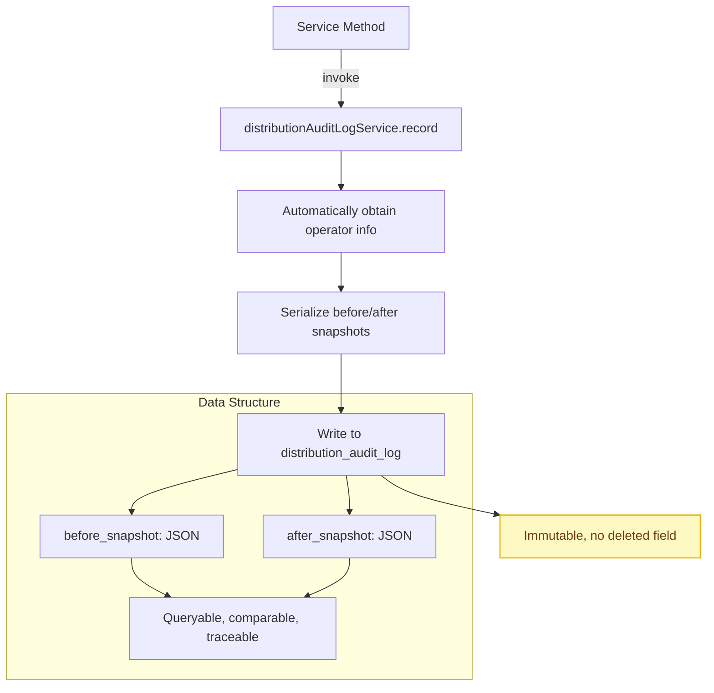
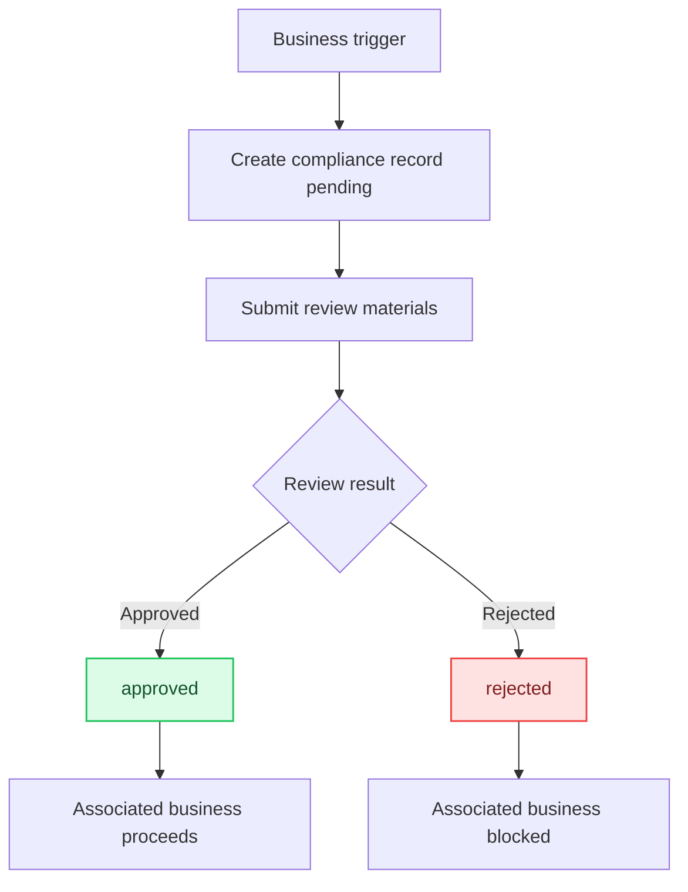
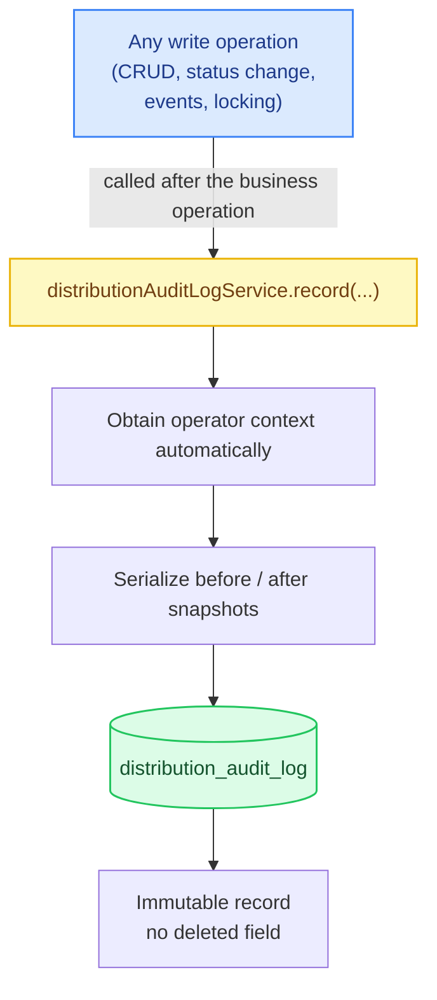
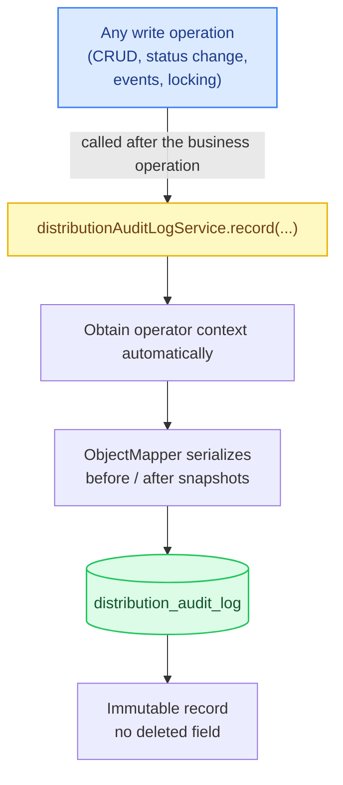
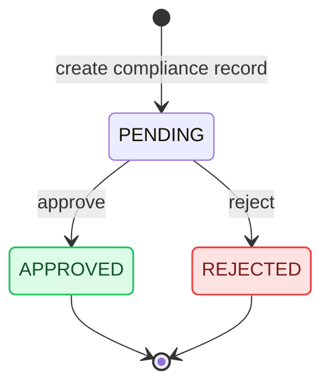

# Audit Snapshot: Audit Log and Compliance Record Pattern

[中文](../../architecture/audit-and-compliance.md) | English

> Use JSON snapshots to record the before and after state of every data change, together with a unified audit service entry point, to achieve zero-intrusion, full-chain operation traceability.

---

## Architecture Overview

**Audit Log (Passive Recording)**



**Compliance Record (Active Management)**



---

## Problem Statement

In regulated business systems (healthcare, finance, insurance, etc.), "who changed what data, when, and how" is not merely an operational requirement but a compliance requirement.

Traditional audit log approaches fall into two categories:

1. **Simple logging**: records only "Zhang San modified business order #1234 on 2026-06-15" — **lacks change details**
2. **Database triggers**: capture changes through triggers — **difficult to associate with operator context, and disconnected from business logic**

The core challenges are:
- How to record complete change snapshots with minimal code intrusion?
- How to distinguish "normal business operations" from "operations requiring compliance review"?
- How to make the audit log both efficient to write and capable of flexible querying and traceability?

## Design Decisions

### Decision 1: JSON Snapshots Instead of Field-Level Diffs

Each change records a complete snapshot of the object before and after the change (JSON-serialized), rather than recording "field A changed from X to Y".

```json
{
  "beforeSnapshot": {
    "id": 1234,
    "bizOrderNo": "DBO20260615143022",
    "status": "signed",
    "signedAmount": 50000,
    "receivedAmount": 0
  },
  "afterSnapshot": {
    "id": 1234,
    "bizOrderNo": "DBO20260615143022",
    "status": "first_paid",
    "signedAmount": 50000,
    "receivedAmount": 20000,
    "firstPaymentAt": "2026-06-15T14:35:00"
  }
}
```

**Why use a full snapshot instead of a diff?**
- **Simple to implement**: no diff algorithm needed; just serialize the object
- **Easy to trace back**: can restore the data state at any point in time
- **Flexible querying**: JSON functions can query the change history of specific fields
- **Acceptable storage cost**: with MySQL's `LONGTEXT` type plus compression, a single record is typically 1-5KB

**Trade-off**: storage space in exchange for implementation simplicity and query flexibility.

### Decision 2: Separate Audit Logs from Compliance Records

Split "operation auditing" and "compliance review" into two independent tables:

| Dimension | Audit Log (`distribution_audit_log`) | Compliance Record (`distribution_compliance_record`) |
|------|----------------------------------|------------------------------------------|
| Purpose | Record the change history of all operations | Record business actions requiring compliance review |
| Write timing | Automatically recorded on every write operation | Created when triggered by business events |
| Content | before/after JSON snapshots | Compliance content + attachments + review result |
| Review process | None (pure recording) | Pending → Approved/Rejected flow |
| Retention policy | Retained for N years per regulatory requirements | Retained for N years per regulatory requirements |

**Why separate?**
- Audit logs are "passive recording"; compliance records are "active management"
- Compliance records need an approval flow; audit logs do not
- Compliance records need associated attachments (e.g., qualification documents, scanned contracts); audit logs do not
- Query patterns differ: audit logs are queried by operation; compliance records are queried by review status

### Decision 3: Audit Service as the Single Entry Point

All audit logs are written through a single method, `DistributionAuditLogService.record()`, rather than each Service assembling log objects itself.



**Why a single entry point?**
- Guarantees a consistent log format
- Operator information is obtained automatically from context, so callers need not pass it
- Serialization logic is centralized in one place, making it easier to optimize (e.g., field masking, compression)

### Decision 4: Audit Logs Do Not Use `deleted` Soft Deletes

The audit log table has no `deleted` field; once written, records cannot be deleted. This is the key design difference between audit logs and ordinary business data.

```sql
CREATE TABLE distribution_audit_log (
  id BIGINT NOT NULL AUTO_INCREMENT,
  biz_type VARCHAR(32) NOT NULL,
  biz_id BIGINT NOT NULL,
  action VARCHAR(64) NOT NULL,
  before_snapshot LONGTEXT,
  after_snapshot LONGTEXT,
  operator_user_id BIGINT NOT NULL,
  operator_name VARCHAR(64),
  remark VARCHAR(500),
  create_time DATETIME NOT NULL DEFAULT CURRENT_TIMESTAMP,
  PRIMARY KEY (id),
  KEY idx_audit_log_biz_type_biz_id (biz_type, biz_id),
  KEY idx_audit_log_action (action),
  KEY idx_audit_log_create_time (create_time)
) ENGINE=InnoDB DEFAULT CHARSET=utf8mb4 COMMENT='Audit log table (non-deletable)';
```

### Decision 5: Business Type Enumeration Constraint

The `biz_type` field is constrained to legal values by the `DistributionAuditBizType` enum, preventing typos from making logs unqueryable.

```java
public enum DistributionAuditBizType {
    DISTRIBUTOR("distributor"),           // Distributor
    MEMBER("member"),                     // Member
    POLICY("policy"),                     // Policy
    LEAD("lead"),                         // Lead
    ATTRIBUTION("attribution"),           // Attribution
    BUSINESS_ORDER("business_order"),     // Business order
    COMMISSION("commission"),             // Commission
    SETTLEMENT("settlement"),             // Settlement
    COMPLIANCE("compliance"),             // Compliance
    PRODUCT("product"),                   // Product
    PRODUCT_LINE("product_line");         // Product line
}
```

### Decision 6: Closed Action Set — `<domain>.<verb>` + Catalog Endpoint

Decision 5 pulled **object types** into an enum; this decision pulls **actions** into a closed set as well. The two layers of closed sets follow the same discipline: no classification field that enters the audit table accepts free-form strings.

Three real problems with open strings:

| Problem | Consequence |
|---|---|
| Spelling drift (`update` vs `updata`) | Statistics for the same action split into two buckets |
| Set cannot be enumerated | Cannot answer "what audited actions exist in the system" |
| Frontend filters have no source | Dropdown options and actual backend writes are maintained separately |

The closed set is implemented with a constant class + ordered set + review gate:

```java
/** Closed set of audit actions; new actions require review. */
public final class AuditActions {
    public static final String AUTH_LOGIN = "auth.login";
    public static final String AUTH_PASSWORD_RESET = "auth.password_reset";
    public static final String DEVICE_CREATE = "device.create";
    public static final String DEVICE_UNBIND = "device.unbind";
    public static final String OTA_STATUS_CHANGE = "ota.status_change";
    public static final String USER_VIEW_MOBILE = "user.view_mobile";
    // ... 35 entries in total, arranged by subsystem

    public static final Set<String> ALL = new LinkedHashSet<>(ORDERED);
    private AuditActions() {}
}
```

Key points:

1. **Naming `<domain>.<verb>`**: domain is the subsystem (`auth` / `admin` / `device` / `ota` / `user` / `settings` …), verb is a snake_case verb. The domain prefix turns "aggregate statistics by subsystem" into a single `LIKE 'ota.%'` or an in-memory grouping, with no extra field needed.
2. **Catalog endpoint outputs the closed set**: `GET action-catalog` returns `ALL` directly to the frontend filter dropdown — **filter options and code constants are the same source of truth**, so adding an action requires zero frontend synchronization cost.
3. **New action = code change = review event**. The closed set turns "start auditing a new action" from a hidden string literal into an explicit constant append that can be blocked by review — precisely the only moment at which the audit surface should expand.
4. **Cross-referencing with Decision 5 yields the answerable universe**: object-type closed set × action closed set gives finite-enumeration answers to all three questions "who, on which type of object, did what".

### Decision 7: Masking PII When Writing the detail Snapshot (PII Red Line)

The audit log is the **longest-lived and most widely accessed** data in the entire database — compliance queries, operational troubleshooting, and export integrations all read it. It is therefore the highest-risk surface for secondary PII leakage: once a plaintext mobile number enters the audit detail, it follows that table for a decade.

This decision sets the red line at **write time** rather than read time:

```
Red line (forbidden in detail): plaintext password / token / openid / unionid / mobile number / key / Authorization
```

1. **Mask at write time, through a single entry point**. There are N read paths (admin queries, exports, third-party integrations); requiring each to remember to mask is equivalent to requiring none of them to fail — one miss is a leak. Write-time masking confines the red line to the single funnel of `record()`.
2. **Blacklist recursive masking**: after normalizing key names (lowercase + strip underscores), perform substring matching against the sensitive-word list; on a hit, replace the value with `[REDACTED]`, and recurse into nested Maps/Lists:

   ```java
   private static final List<String> SENSITIVE_KEYS = List.of(
           "password", "passwd", "newpassword", "oldpassword", "passwordhash",
           "token", "jwt", "openid", "unionid", "mobile", "secret", "privatekey", "authorization");

   private Object sanitize(Object value) {
       if (value instanceof Map<?, ?> map) {
           Map<String, Object> out = new LinkedHashMap<>();
           for (var entry : map.entrySet()) {
               String key = String.valueOf(entry.getKey());
               out.put(key, isSensitive(key) ? "[REDACTED]" : sanitize(entry.getValue()));
           }
           return out;
       }
       if (value instanceof List<?> list) { /* recurse over each element */ }
       return value;
   }
   ```

   Normalization + substring matching is deliberate: `new_password`, `oldPassword`, and `password_hash` all hit the `newpassword` / `oldpassword` / `passwordhash` stems, so there is no need to list a separate key for each variant.
3. **Replace wholesale when over the limit; do not truncate strings**. The detail limit is 16KB; when exceeded, the whole value is replaced with `{"truncated": true, "originalSize": N}`. Truncating a string produces half a JSON document (unparseable) and may cut right through a sensitive value — replacing preserves the fact that "truncation happened."
4. **Serialization failure must not blow up the audit row**: when detail serialization throws, degrade to writing `{"truncated": true}`, so a failure on a secondary surface does not escalate into a primary-flow exception.

**Blacklist vs. whitelist (an honest record)**: a whitelist is safer (deny by default), but the structure of audit detail varies by action type, and a missed whitelist entry silently loses audit information — and "missing audit information" is harder to notice than "one extra non-sensitive field stored." The blacklist's risk runs the other way: **unknown sensitive key names will be missed**. Mitigations: new detail fields go through review; naming standards require sensitive semantics to use stems from the word list; the word list itself is a code constant, so changes are reviewable.

### Decision 8: Tiered Failure Strategy — Fail-Open by Default, Fail-Closed for Sensitive Actions

What should happen when an audit write fails? A blanket "audit failure = business failure" (the original choice in Limitation #4 below) protects completeness but expands the audit surface's failure domain to all business operations. This decision evolves it into per-action tiers:

| Tier | On audit write failure | Applies to | Semantics |
|---|---|---|---|
| **fail-open** (default) | Log an error; the business operation completes as usual | Routine CRUD | Auditing is a secondary surface and should not expand the failure domain |
| **fail-closed** | Throw a business exception; **the operation is cancelled** | Password resets, key rotation, deletions | **If it cannot be recorded, it must not happen** |

failClosed is **passed explicitly at the call site**, not a global switch — the person who decides "is this action sensitive" must be the person writing this call, not someone configuring a line after the fact. This way every fail-closed decision comes with a code review, rather than with an environment variable that might be edited incorrectly.

## Code Implementation

### Overall Architecture



### Core Code: Unified Audit Recording Method

```java
// DistributionAuditLogServiceImpl.java

@Override
public void record(String bizType, Long bizId, String action,
                   Object beforeSnapshot, Object afterSnapshot, String remark) {
    // 1. Automatically obtain the current operator (from ThreadLocal)
    UserProfileEntity operator = distributionOperatorService.getCurrentOperatorUser();

    // 2. Build the audit log entity
    DistributionAuditLogEntity entity = new DistributionAuditLogEntity();
    entity.setBizType(bizType);
    entity.setBizId(bizId);
    entity.setAction(action);
    entity.setBeforeSnapshot(writeSnapshot(beforeSnapshot));
    entity.setAfterSnapshot(writeSnapshot(afterSnapshot));
    entity.setOperatorUserId(operator.getId());
    entity.setOperatorName(operator.getName());
    entity.setRemark(remark);

    // 3. Persist to the database
    distributionAuditLogMapper.insertSelective(entity);
}

private String writeSnapshot(Object snapshot) {
    if (snapshot == null) return null;
    try {
        return objectMapper.writeValueAsString(snapshot);
    } catch (JsonProcessingException e) {
        throw new IllegalStateException("Audit snapshot serialization failed", e);
    }
}
```

### Usage Patterns: Four Typical Service-Layer Uses

**Pattern 1: Create Operation**

```java
// First perform the business operation
distributionBusinessOrderMapper.insertSelective(entity);

// Then record the audit log (before = null, after = the new object)
distributionAuditLogService.record(
    DistributionAuditBizType.BUSINESS_ORDER.getCode(),
    entity.getId(),
    "create",
    null,                           // No data before creation
    getBusinessOrder(entity.getId()), // Complete object after creation
    "Create distribution business order"
);
```

**Pattern 2: Update Operation**

```java
// First obtain the pre-change snapshot
DistributionBusinessOrderDetailDTO beforeSnapshot = getBusinessOrder(id);

// Perform the update
distributionBusinessOrderMapper.updateByPrimaryKeySelective(update);

// Record the audit log (before = old object, after = new object)
distributionAuditLogService.record(
    DistributionAuditBizType.BUSINESS_ORDER.getCode(),
    id,
    "update",
    beforeSnapshot,                 // Before the change
    getBusinessOrder(id),           // After the change
    "Update distribution business order"
);
```

**Pattern 3: Status Change Operation**

```java
// action naming convention: event_ + event type
distributionAuditLogService.record(
    DistributionAuditBizType.BUSINESS_ORDER.getCode(),
    businessOrderId,
    "event_" + eventType,           // e.g. "event_signed", "event_first_payment"
    beforeSnapshot,
    getBusinessOrder(businessOrderId),
    "Advance business order event: " + eventType
);
```

**Pattern 4: Automatically Triggered Cascading Operation**

```java
// When a business order is cancelled, the attribution is deleted automatically and its audit log is recorded
distributionAuditLogService.record(
    DistributionAuditBizType.ATTRIBUTION.getCode(),
    attribution.getId(),
    "delete",
    attribution,                    // Complete object before deletion
    null,                           // No data after deletion
    "Business order cancelled, attribution deleted automatically"
);
```

### Action Naming Convention

The `action` field follows a unified naming convention for easy querying and statistics:

| Operation Type | action Value | Example |
|---------|----------|------|
| Create | `create` | `create` |
| Update | `update` | `update` |
| Delete (soft delete) | `delete` | `delete` |
| Status change | `event_` + event type | `event_signed`, `event_first_payment` |
| Review operations | `lock` / `approve` / `reject` | `lock`, `approve` |
| Reversal operations | `reverse` / `create_reverse` | `reverse`, `create_hang_reverse` |
| Receipt entry | `record_receipt` | `record_receipt` |

### Query Interfaces

```java
// Query change history by business object
PageResponseDTO<DistributionAuditLogDTO> listLogs(
    String bizType,     // e.g. "business_order"
    Long bizId,         // e.g. 1234
    String action,      // optional, e.g. "event_signed"
    Integer page,
    Integer pageSize
);

// Get a single log entry's detail (including the full snapshot)
DistributionAuditLogDetailDTO getLog(Long id);
```

### Compliance Record Design

Compliance records are the "upgraded version" of audit logs, adding an approval flow and attachment support:

```java
// DistributionComplianceRecordEntity.java
public class DistributionComplianceRecordEntity {
    private Long id;
    private String bizType;           // Associated business type
    private Long bizId;               // Associated business ID
    private String productLineCode;   // Product line
    private String recordType;        // Compliance record type
    private String status;            // pending / approved / rejected
    private String content;           // Compliance content
    private String attachmentsJson;   // Attachments JSON (qualification documents, scanned contracts, etc.)
    private Long reviewedBy;          // Reviewer
    private Date reviewedAt;          // Review time
    private String remark;
    // ... audit fields
}
```

Lifecycle of a compliance record:



## Applicable Scenarios

1. **Regulated industry systems**: healthcare, finance, insurance, and other systems that require operation traceability
2. **Multi-tenant SaaS**: tenants require visibility into "who changed what"
3. **Approval workflow systems**: snapshots need to be compared before and after approval
4. **Data recovery**: need to trace back to the data state at any point in time
5. **Security auditing**: need to track anomalous operations (e.g., frequent modifications, unauthorized access)

### Prerequisites

- The system has a clear notion of "operator" (a logged-in user)
- Data changes are low to medium frequency (no more than a few hundred writes per second)
- Complete change context must be recorded (rather than merely recording "a change happened")

### Not Applicable When

- High-frequency write scenarios (thousands per second or more): JSON serialization + database writes become the bottleneck
- Only counts/statistics are needed, not the specific change content
- Data volume is enormous and there are no compliance requirements: audit log storage costs become high

## Limitations

### 1. Storage Cost of JSON Snapshots

Every change records a complete object snapshot; if the object has many fields (e.g., a business order with 20+ fields), a single log entry can reach several KB. Over time, the audit log table may become the largest table in the database.

**Mitigation**:
- Periodic archiving: migrate logs older than N months to cold storage (e.g., OSS + Parquet)
- Field trimming: exclude unimportant fields when serializing (e.g., `createTime`, `modifyTime`)
- Compressed storage: enable MySQL row compression for the `LONGTEXT` field (`ROW_FORMAT=COMPRESSED`)

### 2. Snapshot and Actual Data Inconsistency

`beforeSnapshot` is obtained via `getXxx(id)` before the business operation, and `afterSnapshot` via a query after the operation. If there are concurrent modifications between the two queries, the snapshot may not exactly match the actual change.

**Mitigation**:
- Obtain before and after snapshots within the same transaction
- For high-concurrency scenarios, consider snapshotting directly at the Entity level (rather than re-querying)

### 3. Query Performance

`biz_type` + `biz_id` have a composite index, so querying history by business object is fast. But querying "all operations by operator" or "all changes within a time range" requires additional indexes.

**Suggested indexes**:
```sql
-- Query by operator
ALTER TABLE distribution_audit_log ADD INDEX idx_audit_log_operator (operator_user_id, create_time);
-- Query by time range (already exists)
-- idx_audit_log_create_time
```

### 4. Serialization Failure Handling

`writeSnapshot()` throws `IllegalStateException` on serialization failure, which rolls back the entire business operation. For a "secondary operation" like an audit log, whether it should affect the main business flow is a design choice.

**Current choice**: audit failure = business failure. This is a conservative strategy that guarantees audit log completeness.

**Alternative**: degrade on audit failure (e.g., record only bizType + bizId + action, with snapshot set to null), but this leads to incomplete audit data.

**Evolution**: this one-size-fits-all choice has since been refined in later systems into a per-action failure strategy — fail-open for routine actions, fail-closed for sensitive actions; see [Decision 8](#decision-8-tiered-failure-strategy--fail-open-by-default-fail-closed-for-sensitive-actions).

### 5. Masking

The current snapshot serializes the complete object directly and may contain sensitive information (e.g., contact mobile numbers, ID card numbers). The audit log itself also needs access control.

**Improvement directions**:
- Add field masking logic in `writeSnapshot()` (e.g., mask the middle 4 digits of mobile numbers)
- Or define an "audit view" at the DTO level that excludes sensitive fields

**Evolution**: write-time blacklist masking (recursive masking + 16KB over-limit replacement) has since been implemented in later systems; see [Decision 7](#decision-7-masking-pii-when-writing-the-detail-snapshot-pii-red-line). Two residual risks remain: the blacklist will miss unknown sensitive key names; and masking only protects the detail field, so the remaining columns such as `operator` and table-wide access control still require separate measures.

### 6. Association Between Compliance Records and Audit Logs

The two tables are loosely associated via `biz_type` + `biz_id`, with no foreign key constraint. To "view all operation history corresponding to a compliance record", business logic must join the queries.

**Improvement direction**: add an `audit_log_id` field to compliance records to establish a direct association.

---

*The pattern described in this document is implemented in the following code:*
- *Audit service interface: `service/distribution/DistributionAuditLogService.java`*
- *Audit service implementation: `service/distribution/impl/DistributionAuditLogServiceImpl.java`*
- *Audit log entity: `entity/distribution/DistributionAuditLogEntity.java`*
- *Compliance record entity: `entity/distribution/DistributionComplianceRecordEntity.java`*
- *Business type enum: `enums/distribution/DistributionAuditBizType.java`*
- *Audit log Mapper: `mapper/distribution/DistributionAuditLogEntityMapper.java` + XML*
