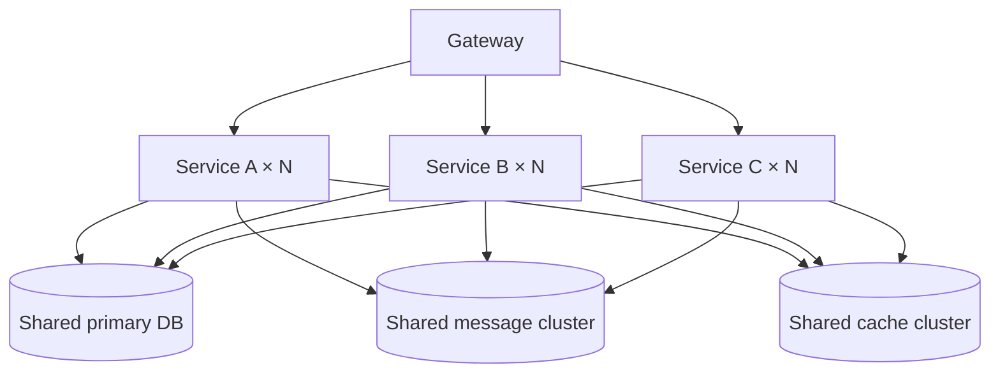
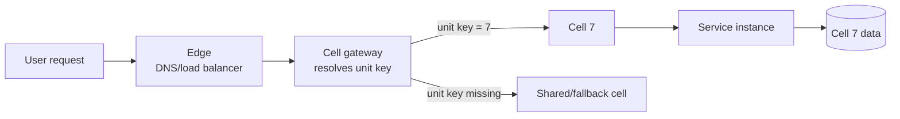
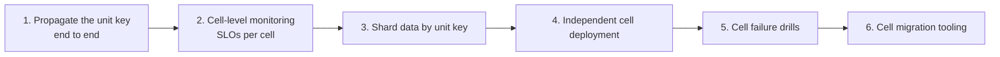

# Cell-Based Architecture: Confining the Blast Radius

[中文](../../architecture/cell-based-architecture.md) | English

> Splitting solves "the system is too big to change." Cell-based architecture solves "the system is so big that one failure takes everything down." The first is a productivity problem; the second is a survival problem.

---

## 1. The Problem: You Only Have One Failure Domain

After microservices, teams often assume that splitting services splits risk. Look one layer below the deployment diagram and it usually looks like this:



There are N services but only one data layer. **The size of your failure domain is not determined by the number of services; it is determined by the granularity of the lowest shared resource.**

The typical consequences:

- One slow query exhausts the primary DB connection pool and every service times out together;
- One abnormal partition stalls consumption across the whole site;
- One mistaken deletion affects "all users," not "some users";
- A single cluster hits its capacity ceiling and scaling requires downtime.

Cell-based architecture addresses exactly this: **cap any single failure at 1/N of users, and make N something you can increase in place.**

---

## 2. What Is a Cell

A cell (or unit) is **a complete slice that can independently carry a portion of traffic**:

```
Cell = compute (stateless service instances)
     + data (databases/tables/partitions dedicated to this slice)
     + routing identity (which cell this traffic belongs to)
```

All three are required. Compute sharded but data still shared is called **partitioned deployment**, not cell-based architecture—it protects against neither data-layer failure nor cross-shard interference.

To judge whether a system is truly cell-based, ask one question:

> **If you unplug one cell, what percentage of users is affected?**

If the answer is "1/N, and the other cells either take over or are unaffected," it is cell-based. If the answer is "everyone," it is still a single failure domain.

---

## 3. When Cell-Based Architecture Is Worth It

It is not free: N copies of data, N sets of middleware, N times the operational burden, and more complex cross-cell queries. It pays off in four situations:

| Trigger | Explanation | Example threshold |
|---|---|---|
| **Capacity ceiling** | A single database/cluster can no longer scale vertically; horizontal sharding is unavoidable | Writes approach the limit; the next scaling window is more than a quarter away |
| **High failure cost** | The loss from one site-wide outage far exceeds the cost of cells | One hour of full unavailability has a quantifiable business cost |
| **Data residency** | Data must remain in a specific region/environment | Explicit regulatory or contractual requirements |
| **Tenant isolation** | Large customers require dedicated resources and failure boundaries | A single tenant accounts for a large share of revenue |

Conversely, **do not do this yet** when:

- The system is still changing rapidly and boundaries move every week—stabilize the boundaries first;
- The team is under 10 people with no platform capability—cells multiply operational complexity beyond what you can absorb;
- The real bottleneck is code quality or the release process—cells will not make bad code good.

---

## 4. How to Draw the Cells

There are only four dimensions, and choosing one is a trade-off:

| Dimension | Advantages | Costs |
|---|---|---|
| **By user** (ID hash/modulo) | Even distribution, simple scaling, most common | Weak business semantics; migrating users means moving data |
| **By geography** | Locality and natural data residency | Uneven distribution; small regions waste resources |
| **By tenant/business line** | Strong isolation; large customers can be dedicated | A large tenant can overwhelm a cell; small tenants waste capacity |
| **By channel** | Aligns with organizational boundaries | Traffic differs wildly between channels; cross-channel scenarios are hard |

In practice the most common design is **two-level**: geography first (compliance and latency), then user hash within a region (evenness and scaling). Tenant isolation is layered on top, giving a few large customers their own cells.

### 4.1 The unit key

Whatever the split, you must choose a **unit key**: a field that can be determined at the entry point and does not change throughout the call chain.

- By user: user ID;
- By geography: registered/access region;
- By tenant: tenant ID.

Three rules for the unit key:

1. **Determined at entry, propagated end to end**—no hop may drop it;
2. **Immutable**—the same business entity cannot change its unit key during its lifetime, or its data will split across two cells;
3. **An explicit default**—requests without a unit key must have a defined fallback cell (usually a shared cell), never a random one.

---

## 5. Routing: How a Request Finds Its Cell



Each layer has a distinct responsibility and must not be conflated:

| Layer | Responsibility | Common mistake |
|---|---|---|
| Edge | Proximity access, coarse traffic splitting | Doing business routing here |
| Cell gateway | Resolve the unit key, select the cell, inject the marker | Random routing when resolution fails |
| Service layer | **Recognize and propagate** the marker; never recompute | One hop recomputes it and lands on a different cell |
| Data layer | Locate the shard by the unit key | Queries by non-key fields force cross-cell access |

**"Never recompute" is the rule most often broken.** If any hop computes the unit key itself (say, hashing a different field), you get "service in cell 7, data in cell 3." It tends to appear only on edge-case records and is very hard to reproduce.

---

## 6. Cell-Aware Data

### 6.1 Basic principles

- **Shard key = unit key**: data lands in the cell that owns it;
- **Cells are self-consistent**: reads and writes within a cell never depend on another cell;
- **Global data is read-only and replicated**: dictionaries, configuration, and catalogs are copied to every cell and read-only;
- **Writes have exactly one owning cell**: two cells must never write the same business record.

### 6.2 Cross-cell queries

This is the hardest practical problem. Three approaches, in priority order:

1. **Eliminate it**: rewrite the query to include the unit key (usually by adding the user dimension);
2. **Asynchronous projection**: build an aggregated table asynchronously and accept eventual consistency;
3. **Aggregation service**: call N cells concurrently and merge, **only for low-frequency, non-critical scenarios with a timeout**.

Anti-pattern: putting a "global database" above the cells to support cross-cell queries—that reintroduces the single point of failure and takes the failure domain back to 100%.

### 6.3 Data migration between cells

Moving data (scaling out, scaling in, tenant relocation) takes five steps:

```
Shadow write (dual write, new cell authoritative)
  → Backfill (historical data)
  → Catch up (replicate incrementally until the diff is zero)
  → Switch reads (routing change, observe)
  → Stop old writes (after the rollback window, then clean up)
```

Before switching routing you must be able to answer: **if we switch wrong, how do we switch back?** A migration you cannot reverse is not a migration; it is a one-way ticket.

---

## 7. Cross-Cell Calls and Messaging

### 7.1 Synchronous calls

Cross-cell synchronous calls tie two cells' availability together. They are allowed, but only with three conditions:

- **Low frequency**: not on the critical path, or under 1% of calls;
- **Bounded**: an explicit timeout, and degradation on timeout rather than a retry storm;
- **Fallback**: when the target cell is unavailable, return a usable result (cache/default) instead of blocking.

Violate any one and the call should become asynchronous or the boundary should be redrawn.

### 7.2 Messaging

Cell affinity for messages is harder than for synchronous calls because producers and consumers are decoupled:

| Approach | How | Advantages | Costs |
|---|---|---|---|
| **Per-cell topics/queues** | One topic set per cell | Complete isolation; consumption unaffected across cells | Topics × N; higher operational cost |
| **Partition binding** | Unit key as partition key; consumers subscribe only to their partitions | Good isolation, topic count unchanged | Requires partition assignment control; rebalancing is complex |
| **Unit marker in the message** | One topic, consumers filter | Simplest to implement | Filtering happens on the consumer side; weak fault isolation; backlog handling is hard |

Whichever you choose, answer: **during a consumer upgrade, who consumes messages from the old version? After a rollback, what happens to messages already delivered by the new version?** If you cannot answer, do not ship canary messaging.

---

## 8. Verifying Isolation

The most dangerous state is "looks cell-based, behaves globally": one overlooked shared component and the failure still spreads site-wide. There is only one way to verify—**actually unplug it**.

| Check | Method | Pass criteria |
|---|---|---|
| Single-cell failure | Stop all instances in one cell | Impact ≈ 1/N; other cells' SLOs unchanged |
| Single-cell data failure | Disconnect one cell's data store | That cell degrades; other cells normal |
| Gateway failure | Stop one gateway instance | Automatic failover; routing accuracy 100% |
| Missing unit key | Construct requests without a unit key | All land in the fallback cell; no random spread |
| Scaling out | Add a cell and move traffic in | Routing correct; no cross-cell dirty reads |

Run the single-cell failure test quarterly and record the **actual impact percentage**—that number is more persuasive than any architecture diagram.

---

## 9. Costs and Boundaries

The cost of cells is routinely underestimated:

- **Resources**: every cell needs its own middleware and redundancy; overall utilization drops;
- **Operations**: releases, monitoring, alerting, and troubleshooting all multiply by N;
- **Complexity**: routing errors, data misplacement, and cross-cell consistency are new failure types;
- **Organization**: someone must own "routing correctness," or misplacement will go unnoticed.

Three boundaries follow:

1. **Cell-based is not multi-active.** Cells shrink the blast radius; multi-active addresses regional disaster recovery. They compose, but neither replaces the other;
2. **More cells is not better.** Three to eight cells is usually enough; too many makes each cell too small and the redundancy cost exceeds the benefit;
3. **Define per-cell SLOs before claiming a benefit.** Without cell-level monitoring you cannot prove isolation works.

---

## 10. Incremental Path



Every step delivers value on its own and is a safe stopping point:

- After step 1, you can at least route traffic by user;
- After step 2, you can see *which* cell broke;
- After step 3, you have actually shrunk the failure domain;
- Steps 4–6 are platform work and can wait until the team is ready.

---

## 11. Honest Boundaries

- This chapter covers the **judgment and skeleton** of cell-based architecture, not vendor-specific sharding implementations;
- Cell counts, thresholds, and ratios are examples and must be calibrated to your traffic;
- For small and mid-sized systems, cells are usually not worth it. The criterion is "failure cost vs. redundancy cost," not "big companies do it";
- Cells do not replace rate limiting, circuit breaking, or degradation—they are the last line of isolation, not the first line of defense.
