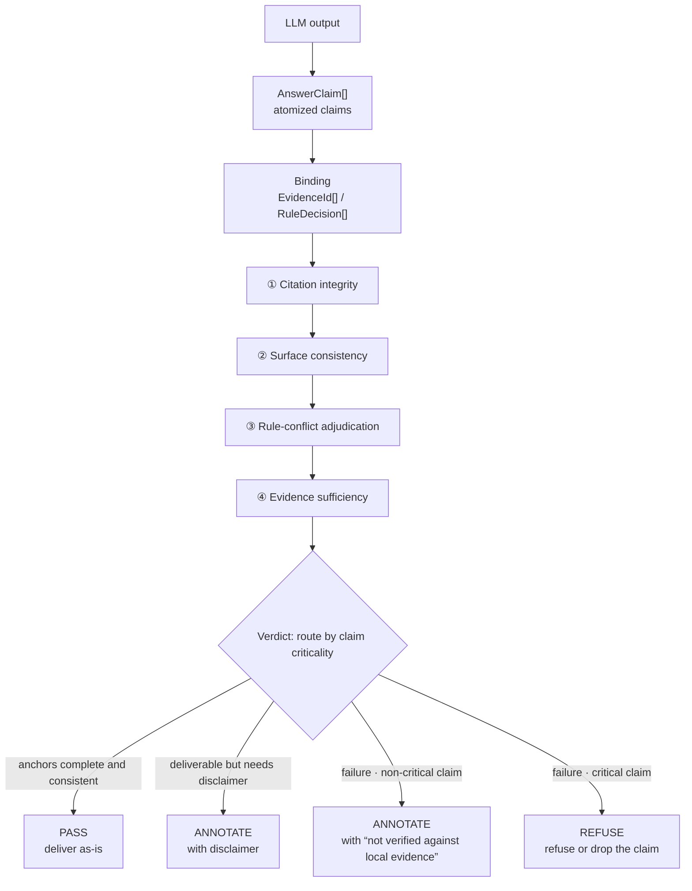

# Claim-Level Verification: Diminishing Untrusted Output into Decidable Assertions

[中文](../../architecture/claim-level-verifier.md) | English

> Whole-paragraph scoring only yields "relevance"; claim-level verification yields "can this be delivered".
> Granularity determines verifiability.

> **Verification entry**: [GroundedRAG v1.0.0](https://github.com/StevenTsai/grounded-rag/tree/v1.0.0) (247 unit tests, 95% coverage) ｜ **Evidence boundary**: driven by synthetic data; the real evaluation set is not distributed.

---

## 1. The Problem: Whole-Paragraph Scoring Cannot Catch Smuggled Fabrications

Traditional RAG evaluation and guardrails mostly operate at the "paragraph" granularity: compute one relevance score for the answer against the retrieved results, and pass it above a threshold.

This granularity has a structural blind spot: **a paragraph can look exactly like the retrieved results everywhere while smuggling in fabrication.** Relevance scores are global; hallucinations are local. Blocking a local defect with a global metric is like judging whether a patient has a fracture by average body temperature.

Reduce the answer:

```
Answer (one passage of natural language)
  └─▶ AnswerClaim[] (one = an independently decidable assertion)
        each claim bound to EvidenceId[] (evidence anchors) or RuleDecision[] (authoritative rules)
```

A claim is either verifiable-by-evidence, or ungrounded and downgraded (critical claims refused, non-critical ones downgraded to annotation). **"Looks plausible" is no longer a deliverable state at this granularity.**

---

## 2. Pattern Structure



All four gate steps are **pure logic**, zero LLM dependence. The verifier itself must be deterministic; otherwise it only relocates the untrusted part.

Evidence source: the `guardrail` module of [GroundedRAG](https://github.com/StevenTsai/grounded-rag) (`claims.py` for atomization, `verifier.py` for the four-step gate, `evidence.py` for anchor binding); [cloneable and reproducible](#evidence-and-reproduction).

---

## 3. The Four-Step Gate

### ① Citation Integrity

Decision: does each claim's `evidence_refs` / `rule_refs` exist, resolve, and point to real entries in the store?

This blocks "claims that assert grounding while their anchors dangle". The reason it runs first is that **the order cannot be swapped**: content comparison against unresolvable anchors is meaningless—running the later steps first only wastes decisions and pollutes statistics.

### ② Surface Consistency

Decision: do the entities, numbers, and units in the claim appear **verbatim** in the cited evidence's original text (text_span)?

Deliberately surface-only, never semantic: verbatim presence is decidable; semantic entailment is not. This cut removes the entire fuzzy zone of "relevance scoring" (the cost is the capability boundary in Section 6).

### ③ Rule-Conflict Adjudication

When authoritative rules contradict each other, the adjudication order is fixed:

```
filter stale versions → take the highest grade → take the latest updated_at → if still conflicting, declare the disagreement
```

Most systems' default is to silently pick one, because product-wise they cannot accept "both are right". But in medical, financial, and compliance scenarios, silent pick-one is the larger risk: when two grade-A authorities disagree, the system should deliver the disagreement itself as output and let a human adjudicate. Hence the last step is **"admit that you cannot choose"**.

Preconditions: conflicts are adjudicated only within "same condition domain + mutually exclusive option sets"; grade semantics must be uniform across the entire store, or the whole adjudication order is meaningless.

### ④ Evidence Sufficiency

Decision: is the anchored evidence **sufficient to support** this claim's existence (rather than merely not contradicting it)?

Passing all four produces a three-state verdict rather than a two-state one: PASS deliver as-is / ANNOTATE deliver with disclaimer / REFUSE refuse. Failure paths route by claim criticality: **critical claims REFUSE, non-critical claims downgrade to ANNOTATE** (displayed with "not verified against local evidence"; in the reference implementation every failure path is `REFUSE if effective_critical else ANNOTATE`). The problem three states solve: "deliverable but confidence boundary must be exposed" and "not deliverable" are two different things, and binarization pushes every intermediate state to one side.

---

## 4. Two Invariants

The four-step gate is the process; the invariants are the **fallback when the process fails to hold**.

### 4.1 Same-Source Invariant: Anti Cross-Evidence Assembly

The rule (v1.0.0 implementation caliber): numbers in a claim must fall **entirely** within the text_span of a **single** evidence item; entities must fall within a single evidence item by **surface hit ratio** (`element_ratio`, default 0.5); on the rules side a higher bar of `max(0.75, element_ratio)` applies, so a rule that is "high grade but content-mismatched" cannot be borrowed to meet the grade.

What it prevents is **cross-evidence assembly**, a class of hallucination that is hard to self-check in RAG:

```
entity from document A + number from document B + grade from document C
  → an answer that is "grounded everywhere" yet false as a whole
```

Ordinary citation checks cannot block this at all: every citation, taken alone, is true. The same-source invariant tightens the unit of judgment from "the citation set" to "anchoring within a single evidence item".

Boundary (must know): it only prevents assembly, not "same-source but semantically inverted". The latter depends on evidence-side negation detection patches (e.g., a negation-word window), which are heuristics: long sentences and complex phrasings will slip through.

### 4.2 Monotonic Authority: Metadata Is Untrusted, Authorization Can Only Tighten

The rule:

```
effective_critical = claim.critical  OR  is_critical_claim(text, type)
```

- The model may **upgrade** a claim to "critical"; upgrading is harmless;
- The model may **not downgrade**. When a claim self-labels "non-critical", the surface lexicon (mandatory recognition of high-risk phrasings) overrides it;
- The LLM's self-reported `type` field is always treated as untrusted metadata; the lexicon's judgment wins.

Generalized, this is a universal principle:

> **Authorization over untrusted inputs should be monotonic—it may only tighten, never loosen.**

Permission systems, risk flags, and content moderation follow the same rule. A large share of system vulnerabilities come from "trusting the model/external input when it says it is unimportant". Allowing the LLM to self-report "non-critical" to bypass strong verification destroys the criticality judgment itself.

Boundary: lexicon coverage has gaps; changing domains requires rewriting the lexicon, or "criticality" judgments will drift.

---

## 5. The Correct Semantics of grade

`grade` is **recommendation strength** (authority level), not an **evidence-sufficiency threshold**.

Confusing the two is a common design error: judging a low-grade recommendation as "insufficient evidence" and refusing it. The correct handling: output grade-C recommendations as normal, displaying the grade alongside. "This recommendation's authority is mediocre" and "this recommendation has no basis" are two orthogonal dimensions:

| | Grounded | Ungrounded |
|---|---|---|
| High recommendation strength | Deliver directly | Refuse |
| Low recommendation strength | Deliver and display grade | Refuse |

Mistaking "low strength" for "unanswerable" systematically silences a large volume of perfectly legitimate weak recommendations.

---

## 6. Capability Boundaries (Honesty Zone)

The pattern's boundaries matter as much as its usage. Every boundary below corresponds to code or docs in the reference implementation; boundaries first, usage second:

1. **Surface consistency ≠ semantic support.** A number that appears verbatim in the evidence but is semantically opposite to the claim will pass the surface-consistency check. Directional claims (negation, comparison, causality) cannot be verified while the semantic tier is off: critical claims are refused, non-critical ones downgraded to annotation (the source-code caliber is "refuse or annotate", not blanket refusal). This is an honest downgrade, with the cost that under v1.0 the deliverable portion of high-value semantic space is nearly empty;
2. **The implementation depends on context extraction.** The reference implementation's rule engine judges missing fields as False directly (silent non-match), with no skip semantics (missing ≠ false). Rule-direct coverage depends heavily on the context extractor, and its extractor leans medical-heuristic. The mechanism is portable; the adapters must be rewritten;
3. **Lexicons and thresholds are domain assets.** Keyword lexicons, the match threshold (0.75), and negation windows all need recalibration when the domain changes;
4. **Metric calibers cannot be bundled.** Citation integrity, surface consistency rate, and refusal correctness each own one segment; merging them under "accuracy" overstates the capability boundary (see the dual-caliber discipline in the [failure postmortem](verifier-failure-modes.md)).

---

## 7. When This Pattern Is Worth Adopting

| Scenario | Judgment |
|------|------|
| Output feeds directly into high-risk decisions (medical/finance/legal/compliance) | Worth it. Cost of hallucination >> cost of verification |
| Output faces the public but with human fallback | Half-worth it. Claim binding + citation integrity suffice; the four-step gate can be trimmed |
| Low-risk Q&A, low hallucination cost | Not worth it. Whole-paragraph citation plus human spot-checks is more economical |

Progressive path (each step independently valuable, stoppable at any point):

```
① Claim atomization + anchor binding → ② Citation integrity gate → ③ Surface consistency gate
  → ④ Authority conflict adjudication → ⑤ Semantic tier (always last, most expensive)
```

After step ① you can already answer "can this be traced?". Most teams get the main benefit at steps ②③. Do not build the semantic tier early: it is the only step that cannot offer a deterministic guarantee.

---

## Evidence and Reproduction

- Repository: [StevenTsai/grounded-rag](https://github.com/StevenTsai/grounded-rag) (MIT)
- Cited version: `v1.0.0` (`0f8930c8455f0f67611767d6702dc714cb21e82c`, 2026-09-18)
- Core implementation: [src/groundedrag/guardrail/verifier.py](https://github.com/StevenTsai/grounded-rag/blob/v1.0.0/src/groundedrag/guardrail/verifier.py) (four-step gate) · [claims.py](https://github.com/StevenTsai/grounded-rag/blob/v1.0.0/src/groundedrag/guardrail/claims.py) (atomization) · [evidence.py](https://github.com/StevenTsai/grounded-rag/blob/v1.0.0/src/groundedrag/guardrail/evidence.py) (same-source anchoring)
- Evaluation caliber: [docs/metrics.md](https://github.com/StevenTsai/grounded-rag/blob/v1.0.0/docs/metrics.md)
- Reproduction:

  ```bash
  git clone https://github.com/StevenTsai/grounded-rag && cd grounded-rag
  git checkout v1.0.0
  pip install -e .
  python -m groundedrag.eval --json     # three metrics on the deterministic eval set
  ```
