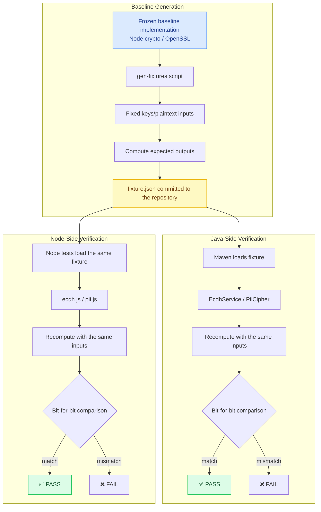

# Cross-Language Contract Testing: A Methodology for Multi-Language Consistency

[中文](../../architecture/cross-language-contract-testing.md) | English

> Use the "outside-the-repo arbiter" pattern to verify consistency across multi-language implementations: freeze a baseline implementation, generate fixtures, and perform bit-for-bit cross-implementation comparison on both ends.

---

## Architecture Overview



---

## Problem Statement

In multi-language systems, implementations of the same algorithm in different languages must produce identical results. Typical scenarios:

| Scenario | Language Pair | Algorithm |
|------|--------|------|
| ECDH key agreement | Node (frontend/tools) ↔ Java (backend) | Elliptic-curve Diffie-Hellman |
| PII encryption | Node (migration scripts) ↔ Java (production) | AES-GCM |
| Signature verification | Frontend ↔ Backend | HMAC / RSA |
| Date handling | JS ↔ Java | Time zones, formatting |

**Core challenges**:
1. Library implementations in the two languages may differ subtly (byte order, encoding, precision)
2. Fixing a bug in one language may break compatibility with the other
3. There is no unified "correct answer" reference

**Problems with the traditional approach**:
- Independent unit tests on each side — only verify "each side thinks it is right"
- Manual cross-implementation comparison — inefficient, easy to miss cases, not regression-testable

## Design Decisions

### Decision 1: Outside-the-Repo Arbiter

**Core principle**: choose a "baseline" independent of both language implementations and use it to generate expected values.

```
Criteria for choosing a baseline:
1. Use a standard library (not home-grown code)
2. Mature implementation, widely validated
3. Independent of both languages

Common choices:
- Node crypto (OpenSSL) → verify Java's BouncyCastle
- OpenSSL CLI → verify Node and Java
- Python cryptography → verify Node and Java
```

**Why is an outside-the-repo arbiter needed?**
- If Node code verifies Java code, who verifies the Node code?
- The baseline is a "known-correct" reference and needs no verification
- Analogous to the "international prototype of the kilogram" in metrology

### Decision 2: Fixture Files Committed to the Repository (Green on Clone)

```json
// ecdh-fixture.json
{
  "serverPriv": "a1b2c3...",
  "vectors": [
    {
      "curve": "prime256v1",
      "devicePub": "d4e5f6...",
      "expected": {
        "raw": "789abc...",
        "sha256": "def012..."
      }
    }
  ]
}
```

**Why commit fixtures to the repository?**
- Tests run immediately after cloning, without first running the generator
- Fixtures are a "frozen contract"; changes require an explicit commit
- The CI environment needs no extra dependencies

**Why commit the generator too?**
- Reproducible — when the baseline needs upgrading, modify the generator and regenerate
- Auditable — fixture change reviews can see the generation logic

### Decision 3: Fixed-Key Derivation (Determinism)

```javascript
// Fixed private key: label → SHA-256 → valid scalar
function fixedPriv(label) {
  for (let i = 0; i < 1000; i++) {
    const hex = crypto.createHash('sha256').update(`${label}:${i}`).digest('hex')
    const d = BigInt('0x' + hex)
    if (d > 0n && d < curveOrder) return hex
  }
}
```

**Why not use random keys?**
- Random keys generate a different fixture each time and cannot be committed
- Fixed derivation guarantees same input → same output → a stable test baseline

**Why retry?** A SHA-256 output may exceed the curve order n, with a probability of about 2^-32; retrying suffices.

### Decision 4: For Random-IV Scenarios, Verify "Decryptability" Rather Than "Byte Equality"

```java
// PII encryption test: random IV, so the same plaintext yields different ciphertext each time
@Test
void decryptNodeCiphertext() {
    // The ciphertext in the fixture was encrypted by Node with a random IV
    String cipherText = fixture.nodeCipherText;
    String plainText = piiCipher.decrypt(cipherText);
    assertEquals("13800138000", plainText);  // Verify that it decrypts, not that bytes match
}
```

**Principles**:
- Fixed inputs (key, IV) → verify byte equality
- Random inputs (random IV) → verify functional correctness (decryptability)

## Code Implementation

### Fixture Generator (Node Side)

```javascript
// scripts/gen-fixtures.js
const crypto = require('crypto')
const ecdh = require('../lib/ecdh')  // baseline implementation

const CURVES = ['prime256v1', 'secp256k1']

function fixedPriv(label) {
  for (let i = 0; i < 1000; i++) {
    const hex = crypto.createHash('sha256').update(`${label}:${i}`).digest('hex')
    const d = BigInt('0x' + hex)
    if (CURVES.every(c => d > 0n && d < BigInt('0x' + ecdh.CURVES[c].n))) {
      return hex
    }
  }
}

function buildFixture() {
  const serverPriv = fixedPriv('fixture-server-v1')
  const devicePriv = fixedPriv('fixture-device-v1')

  const vectors = CURVES.map(curve => {
    const devicePub = ecdh.pubFromPriv(devicePriv, curve)
    return {
      curve,
      devicePub,
      expected: {
        raw: ecdh.derive(serverPriv, devicePub, curve, 'raw'),
        sha256: ecdh.derive(serverPriv, devicePub, curve, 'sha256')
      }
    }
  })

  return { serverPriv, devicePriv, vectors }
}

fs.writeFileSync(
  'backend/src/test/resources/ecdh-fixture.json',
  JSON.stringify(buildFixture(), null, 2)
)
```

### Java-Side Tests

```java
@TestFactory
Stream<DynamicNode> ecdhFixtureTest() throws IOException {
    // Load the fixture
    Fixture fixture = loadFixture("ecdh-fixture.json");

    return fixture.vectors().stream().map(vector ->
        DynamicTest.dynamicTest(
            "[" + vector.curve() + "] derive matches Node baseline",
            () -> {
                // Recompute with the Java implementation
                String raw = ecdhService.derive(
                    fixture.serverPriv(),
                    vector.devicePub(),
                    vector.curve(),
                    DeriveMode.RAW
                );
                String sha256 = ecdhService.derive(
                    fixture.serverPriv(),
                    vector.devicePub(),
                    vector.curve(),
                    DeriveMode.SHA256
                );

                // Bit-for-bit comparison
                assertEquals(vector.expected().raw(), raw);
                assertEquals(vector.expected().sha256(), sha256);
            }
        )
    );
}
```

### Node-Side Tests (Bidirectional Verification)

```javascript
// tests/ecdh.test.js
const crypto = require('crypto')

for (const curve of ['prime256v1', 'secp256k1']) {
  // Generate random keys with the Node standard library
  const nodeA = crypto.createECDH(curve)
  nodeA.generateKeys()
  const privA = nodeA.getPrivateKey('hex')
  const pubA = nodeA.getPublicKey('hex', 'uncompressed').slice(2)

  const nodeB = crypto.createECDH(curve)
  nodeB.generateKeys()
  const privB = nodeB.getPrivateKey('hex')
  const pubB = nodeB.getPublicKey('hex', 'uncompressed').slice(2)

  const sharedAB = nodeA.computeSecret(Buffer.from('04' + pubB, 'hex')).toString('hex')

  test(`[${curve}] derive == Node computeSecret`, () => {
    // Real-time comparison against the Node standard library (not the fixture)
    assert.strictEqual(ecdh.derive(privA, pubB, curve, 'raw'), sharedAB)
    assert.strictEqual(ecdh.derive(privB, pubA, curve, 'raw'), sharedAB)
  })
}
```

### One-Command Test Runner

```javascript
// scripts/run-all-tests.js
const steps = [
  { name: 'ecdh-node', cmd: 'node tests/ecdh.test.js' },
  { name: 'ecdh-java', cmd: 'mvn test -pl backend-java -Dtest=EcdhServiceTest' },
  { name: 'pii-java', cmd: 'mvn test -pl backend-java -Dtest=PiiCipherTest' },
]

for (const step of steps) {
  console.log(`\n=== ${step.name} ===`)
  execSync(step.cmd, { stdio: 'inherit' })
}
```

## Three-Layer Verification Strategy

```
Layer 1: Fixture comparison (offline)
├── The generator computes expected values with the baseline implementation
├── Both sides load the same fixture
└── Verify: Java can reproduce Node's output

Layer 2: Real-time comparison (same process)
├── Node tests call Node crypto directly
├── Compare against this repository's Node implementation
└── Verify: the Node implementation matches the standard library

Layer 3: End-to-end contract (requires a running service)
├── Start the Java backend
├── Send requests and verify responses
└── Verify: the complete chain is correct
```

**Why are three layers needed?**
- Layer 1 verifies cross-language consistency
- Layer 2 verifies that the Node implementation itself is correct
- Layer 3 verifies that integration is correct (serialization, network, database)

## Trade-offs

| Choice | Cost | Mitigation |
|------|------|------|
| Fixtures committed | Files may go stale | Commit the generator too, so regeneration is always possible |
| Fixed keys | Test keys may be misused | Test-only; production uses random keys |
| Bit-for-bit comparison | Sensitive to hex formatting | Standardize on lowercase hex; normalize in tests |
| Three-layer verification | Increased test time | Layer 3 is optional and can be skipped in CI |

## Related Documents

- [PII Encryption and Masking](pii-encryption.md) — an example of cross-language encryption comparison
- [Production Guardrails](../../case-studies/production-guardrails/) — contract testing locks down interface semantics
