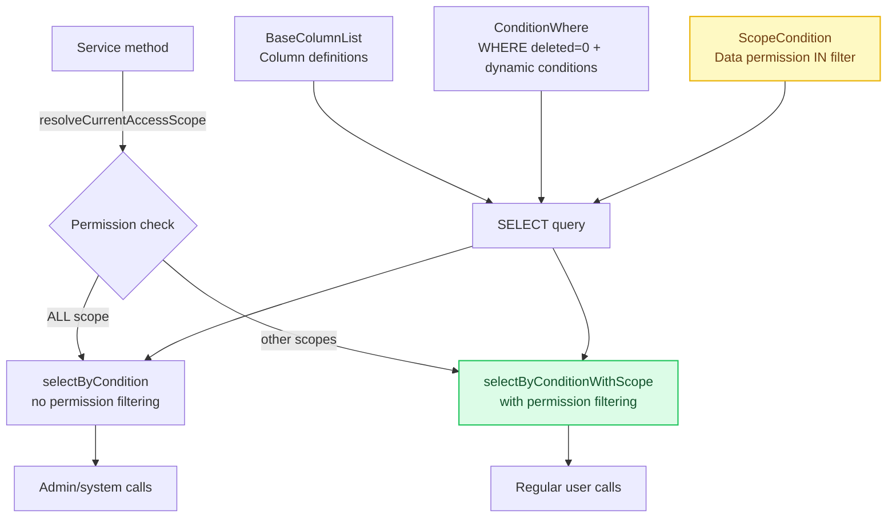
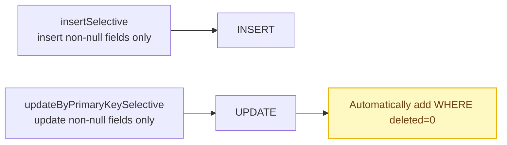

# MyBatis Engineering Patterns: SQL Fragment Reuse and Permission Injection

[中文](../../architecture/mybatis-patterns.md) | English

> Through compositional reuse of `<sql>` fragments, cross-cutting concerns such as data permissions, pagination, and sorting are pushed down from the Service layer to the SQL layer, achieving "write the query once, get permission filtering automatically."

---

## Architecture Overview

**Query Path**



**Write Operations**



---

## Problem Statement

MyBatis XML Mappers are a "semi-handwritten SQL" approach—SQL lives in XML and parameters are passed in from Java. This approach is highly flexible, but at the engineering level it has several common problems:

1. **SQL duplication**: `WHERE deleted = 0`, pagination `LIMIT`, and column lists repeat in every query
2. **Missed permission filtering**: when adding a query endpoint, developers may forget to add the data permission condition
3. **Verbose condition assembly**: a dozen `<if>` tags piled together are hard to read
4. **Maintenance cost**: when the table schema changes, every SQL referencing that table must be modified

This project solves these problems with a compositional pattern of `<sql>` fragments.

## Design Decisions

### Decision 1: Three-Part SQL Fragment Structure

Each Mapper XML defines three standard `<sql>` fragments:

```xml
<!-- 1. Column list: change in one place when the table schema changes -->
<sql id="BaseColumnList">
    id, biz_order_no, lead_id, contact_id, status, ...
</sql>

<!-- 2. Business query conditions: the common WHERE clause -->
<sql id="ConditionWhere">
    where deleted = 0
    <if test="status != null and status != ''">
        and status = #{status}
    </if>
    ...
</sql>

<!-- 3. Data permission conditions: automatically injected row-level filtering -->
<sql id="ScopeCondition">
    <if test="authorizedDistributorIds != null and authorizedDistributorIds.size() > 0">
        and distributor_id in
        <foreach collection="authorizedDistributorIds" item="id" open="(" separator="," close=")">
            #{id}
        </foreach>
    </if>
    ...
</sql>
```

**Why three parts?** Because the change frequency and concerns of these three dimensions are completely different:

- `BaseColumnList`: modified when the table schema changes (low frequency)
- `ConditionWhere`: modified when business query requirements change (medium frequency)
- `ScopeCondition`: modified when permission rules change (low frequency, but with global impact)

### Decision 2: Dual Query Methods (With vs. Without Permissions)

Each Mapper provides two sets of query methods:

```xml
<!-- Without permission filtering: internal calls, admin queries, scheduled jobs -->
<select id="selectByCondition" resultMap="BaseResultMap">
    select <include refid="BaseColumnList"/>
    from distribution_business_order
    <include refid="ConditionWhere"/>
    order by create_time desc, id desc
    limit #{offset}, #{limit}
</select>

<!-- With permission filtering: user-facing query endpoints -->
<select id="selectByConditionWithScope" resultMap="BaseResultMap">
    select <include refid="BaseColumnList"/>
    from distribution_business_order
    <include refid="ConditionWhere"/>
    <include refid="ScopeCondition"/>        ← one extra line
    order by create_time desc, id desc
    limit #{offset}, #{limit}
</select>
```

**Why dual rather than unified?** Unifying on the permission-aware version would force internal service calls (such as scheduled jobs, data migration, and cross-service calls) to also pass permission parameters, adding unnecessary complexity. The dual design lets developers **actively choose** whether permission filtering is needed.

### Decision 3: `ConditionWhere` Starts with `WHERE deleted = 0`

Every `ConditionWhere` fragment starts with `where deleted = 0` instead of writing it separately in each query.

```xml
<sql id="ConditionWhere">
    where deleted = 0                         ← soft-delete filter, always present
    <if test="bizOrderNo != null and bizOrderNo != ''">
        and biz_order_no = #{bizOrderNo}      ← business condition, appended on demand
    </if>
    ...
</sql>
```

**Benefits**:

- Developers do not need to remember to add `deleted = 0` in every query
- If physical deletion or a different field name is needed later, only one place changes

### Decision 4: Double-Layer Filtering in `ScopeCondition`

The permission condition filters not only the distributor dimension by `distributor_id`, but also the person dimension by `member_id` and `owner_user_id` (for the `SELF` scope).

```xml
<sql id="ScopeCondition">
    <!-- Distributor dimension: OWN_DISTRIBUTOR / OWN_AND_CHILDREN -->
    <if test="authorizedDistributorIds != null and authorizedDistributorIds.size() > 0">
        and distributor_id in
        <foreach collection="authorizedDistributorIds" item="id" open="(" separator="," close=")">
            #{id}
        </foreach>
    </if>
    <!-- Person dimension: SELF -->
    <if test="authorizedMemberId != null or authorizedOwnerUserId != null">
        and (
        <if test="authorizedMemberId != null">
            member_id = #{authorizedMemberId}
        </if>
        <if test="authorizedMemberId != null and authorizedOwnerUserId != null">
            or
        </if>
        <if test="authorizedOwnerUserId != null">
            owner_user_id = #{authorizedOwnerUserId}
        </if>
        )
    </if>
</sql>
```

**Combination of the two dimensions**:

| Data Scope | authorizedDistributorIds | authorizedMemberId | authorizedOwnerUserId |
|------------|--------------------------|--------------------|-----------------------|
| ALL | null | null | null |
| OWN_DISTRIBUTOR | [own distributor ID] | null | null |
| OWN_AND_CHILDREN | [own distributor ID, child 1, child 2, ...] | null | null |
| SELF | null | current member ID | current user ID |

### Decision 5: Partial Updates with `insertSelective` / `updateByPrimaryKeySelective`

All write operations use `insertSelective` and `updateByPrimaryKeySelective`, operating only on non-null fields:

```xml
<insert id="insertSelective" useGeneratedKeys="true" keyProperty="id">
    insert into distribution_business_order
    <trim prefix="(" suffix=")" suffixOverrides=",">
        <if test="bizOrderNo != null">biz_order_no,</if>
        <if test="leadId != null">lead_id,</if>
        <if test="status != null">status,</if>
        ...
    </trim>
    <trim prefix="values (" suffix=")" suffixOverrides=",">
        <if test="bizOrderNo != null">#{bizOrderNo},</if>
        <if test="leadId != null">#{leadId},</if>
        <if test="status != null">#{status},</if>
        ...
    </trim>
</insert>
```

**Why not insert all fields?**

- Most fields have default values at creation time (such as `create_time` and `deleted`), so they do not need to be inserted explicitly
- Updates only need to modify changed fields, avoiding overwriting concurrent modifications to other fields
- Combined with `updateByPrimaryKeySelective`, this provides "update non-null fields only" semantics

## Code Implementation

### Complete Mapper XML Template

Taking the business order (`distribution_business_order`) as an example:

```xml
<mapper namespace="com.example.distribution.mapper.distribution.DistributionBusinessOrderMapper">

    <!-- ===== 1. Result mapping ===== -->
    <resultMap id="BaseResultMap" type="...DistributionBusinessOrderEntity">
        <id column="id" property="id"/>
        <result column="biz_order_no" property="bizOrderNo"/>
        <result column="status" property="status"/>
        <!-- ... -->
    </resultMap>

    <!-- ===== 2. Reusable SQL fragments ===== -->
    <sql id="BaseColumnList">
        id, biz_order_no, lead_id, contact_id, status, signed_amount, ...
    </sql>

    <sql id="ConditionWhere">
        where deleted = 0
        <if test="bizOrderNo != null and bizOrderNo != ''">
            and biz_order_no = #{bizOrderNo}
        </if>
        <if test="status != null and status != ''">
            and status = #{status}
        </if>
        <!-- ... -->
    </sql>

    <sql id="ScopeCondition">
        <if test="authorizedDistributorIds != null and authorizedDistributorIds.size() > 0">
            and distributor_id in
            <foreach collection="authorizedDistributorIds" item="id" open="(" separator="," close=")">
                #{id}
            </foreach>
        </if>
        <if test="authorizedMemberId != null or authorizedOwnerUserId != null">
            and (
            <if test="authorizedMemberId != null">member_id = #{authorizedMemberId}</if>
            <if test="authorizedMemberId != null and authorizedOwnerUserId != null"> or </if>
            <if test="authorizedOwnerUserId != null">current_owner_user_id = #{authorizedOwnerUserId}</if>
            )
        </if>
    </sql>

    <!-- ===== 3. Query methods (dual) ===== -->
    <select id="countByCondition" resultType="java.lang.Long">
        select count(*) from distribution_business_order
        <include refid="ConditionWhere"/>
    </select>

    <select id="selectByCondition" resultMap="BaseResultMap">
        select <include refid="BaseColumnList"/>
        from distribution_business_order
        <include refid="ConditionWhere"/>
        order by create_time desc, id desc
        limit #{offset}, #{limit}
    </select>

    <select id="countByConditionWithScope" resultType="java.lang.Long">
        select count(*) from distribution_business_order
        <include refid="ConditionWhere"/>
        <include refid="ScopeCondition"/>
    </select>

    <select id="selectByConditionWithScope" resultMap="BaseResultMap">
        select <include refid="BaseColumnList"/>
        from distribution_business_order
        <include refid="ConditionWhere"/>
        <include refid="ScopeCondition"/>
        order by create_time desc, id desc
        limit #{offset}, #{limit}
    </select>

    <!-- ===== 4. Single-record query ===== -->
    <select id="selectByPrimaryKey" resultMap="BaseResultMap">
        select <include refid="BaseColumnList"/>
        from distribution_business_order
        where id = #{id} and deleted = 0
    </select>

    <!-- ===== 5. Batch query ===== -->
    <select id="selectByIds" resultMap="BaseResultMap">
        select <include refid="BaseColumnList"/>
        from distribution_business_order
        where deleted = 0 and id in
        <foreach collection="ids" item="id" open="(" separator="," close=")">
            #{id}
        </foreach>
    </select>

    <!-- ===== 6. Write operations (partial update) ===== -->
    <insert id="insertSelective" useGeneratedKeys="true" keyProperty="id">
        insert into distribution_business_order
        <trim prefix="(" suffix=")" suffixOverrides=",">
            <if test="bizOrderNo != null">biz_order_no,</if>
            <if test="status != null">status,</if>
            <!-- ... -->
        </trim>
        <trim prefix="values (" suffix=")" suffixOverrides=",">
            <if test="bizOrderNo != null">#{bizOrderNo},</if>
            <if test="status != null">#{status},</if>
            <!-- ... -->
        </trim>
    </insert>

    <update id="updateByPrimaryKeySelective">
        update distribution_business_order
        <set>
            <if test="status != null">status = #{status},</if>
            <if test="signedAmount != null">signed_amount = #{signedAmount},</if>
            <!-- ... -->
        </set>
        where id = #{id} and deleted = 0
    </update>
</mapper>
```

### Corresponding Mapper Interface Signatures

```java
public interface DistributionBusinessOrderMapper {
    // Without permissions
    Long countByCondition(@Param("bizOrderNo") String bizOrderNo, ...);
    List<DistributionBusinessOrderEntity> selectByCondition(@Param("bizOrderNo") String bizOrderNo, ...,
                                                            @Param("offset") int offset, @Param("limit") int limit);
    // With permissions
    Long countByConditionWithScope(@Param("bizOrderNo") String bizOrderNo, ...,
                                   @Param("authorizedDistributorIds") List<Long> authorizedDistributorIds,
                                   @Param("authorizedMemberId") Long authorizedMemberId,
                                   @Param("authorizedOwnerUserId") Long authorizedOwnerUserId);
    List<DistributionBusinessOrderEntity> selectByConditionWithScope(@Param("bizOrderNo") String bizOrderNo, ...,
                                                                     @Param("authorizedDistributorIds") List<Long> authorizedDistributorIds,
                                                                     @Param("authorizedMemberId") Long authorizedMemberId,
                                                                     @Param("authorizedOwnerUserId") Long authorizedOwnerUserId,
                                                                     @Param("offset") int offset, @Param("limit") int limit);
    // Single/batch
    DistributionBusinessOrderEntity selectByPrimaryKey(@Param("id") Long id);
    List<DistributionBusinessOrderEntity> selectByIds(@Param("ids") List<Long> ids);
    // Write operations
    int insertSelective(DistributionBusinessOrderEntity entity);
    int updateByPrimaryKeySelective(DistributionBusinessOrderEntity entity);
}
```

### Service Layer Call Pattern

```java
// List query: resolve permissions → pass parameters → automatic filtering
public PageResponseDTO<DistributionBusinessOrderDTO> listBusinessOrders(...) {
    DistributionDataAccessScope scope = distributionDataPermissionService.resolveCurrentAccessScope();

    List<Long> authorizedDistributorIds = scope.isAllScope() || scope.isSelfScope()
        ? null : scope.getAuthorizedDistributorIds();
    Long authorizedMemberId = scope.isSelfScope() ? scope.getMemberId() : null;
    Long authorizedOwnerUserId = scope.isSelfScope() ? scope.getOperatorUserId() : null;

    long total = mapper.countByConditionWithScope(
        ..., authorizedDistributorIds, authorizedMemberId, authorizedOwnerUserId);
    List<...> entities = mapper.selectByConditionWithScope(
        ..., authorizedDistributorIds, authorizedMemberId, authorizedOwnerUserId, offset, limit);
}
```

## Applicable Scenarios

1. **Any medium-to-large project using MyBatis**: reduce duplication through SQL fragment reuse
2. **Systems requiring row-level data permissions**: inject uniformly through `ScopeCondition`
3. **Multi-role B2B systems**: the same table needs multiple query perspectives (admin vs. regular user)

### When Not to Use

- Frameworks that auto-generate SQL, such as JPA/MyBatis-Plus (this pattern depends on handwritten XML)
- Extremely simple table schemas (e.g., only 3-5 fields), where fragment reuse yields little benefit
- Systems that do not need row-level permissions

## Limitations

### 1. Verbose Parameter Signatures

Permission-aware query methods require 3 extra parameters (`authorizedDistributorIds`, `authorizedMemberId`, `authorizedOwnerUserId`), making Mapper interface method signatures very long.

**Improvement direction**: the permission parameters could be encapsulated in a `ScopeParams` object, but that adds a layer of indirection.

### 2. Consistency Guarantee for `ScopeCondition`

Every Mapper XML requires a handwritten `ScopeCondition` fragment. If a Mapper omits a condition (such as `owner_user_id` for the `SELF` scope), it creates a permission hole.

**Improvement direction**:

- Write unit tests that verify every ScopeCondition fragment contains all necessary conditions
- Or use a MyBatis interceptor to inject permission conditions automatically at runtime

### 3. Index Optimization for `OR` Conditions

The `AND (member_id = ? OR owner_user_id = ?)` condition generated by the `SELF` scope can cause indexes to be skipped.

**Mitigation**: ensure both `member_id` and `owner_user_id` have independent indexes, and use `UNION` instead of `OR` when necessary.

### 4. IN List Length for Batch Queries

`authorizedDistributorIds` is injected via `IN (...)`. If the distributor tree is deep, the list can be long (e.g., 1000+ IDs). MySQL has a length limit for `IN` lists, and overly long lists hurt query performance.

**Mitigation**:

- Limit the maximum depth of the distributor tree
- Cache `authorizedDistributorIds`
- Switch to a temporary table or subquery for very long lists

---

*The pattern described in this document is implemented in the following Mapper XML files:*

- *And all other Mapper XML files that contain a `ScopeCondition` fragment*
