# PII Encryption: Personal Data Encryption and Masking Pattern

[中文](../../architecture/pii-encryption.md) | English

> AES-GCM encryption at rest for personal data such as mobile numbers, combined with HMAC lookup keys and unified masking, meeting GDPR / PIPL compliance requirements.

---

## Architecture Overview

```mermaid
flowchart TB
    subgraph Write Path
        A[Business code] -->|plaintext mobile| B[PiiCipher.encrypt]
        B --> C{PII_KEY configured?}
        C -->|Yes| D[AES/GCM/NoPadding encryption]
        D --> E["enc:v1:iv:tag:cipherText"]
        C -->|No| F[Persist plaintext + warn log]
    end

    subgraph Lookup Path
        G[Business query] -->|plaintext mobile| H[PiiCipher.lookupKey]
        H --> I["HMAC-SHA256(key, 'pii:'+value)"]
        I --> J[Truncate to 32hex]
        J --> K[WHERE lookup_key = ?]
    end

    subgraph Read Path
        L[Query returns ciphertext] --> M[PiiCipher.decrypt]
        M --> N{enc:v1: prefix?}
        N -->|Yes| O[AES/GCM decryption]
        N -->|No| P[Treat as legacy plaintext, return as-is]
    end

    subgraph Presentation Path
        Q[Return to frontend] --> R[PiiCipher.mask]
        R --> S["138****5678"]
        T[Audit log] --> U[PiiCipher.mask]
        U --> V["[pii] mobile number access action=xxx mobile=138****5678"]
    end

    style C fill:#f9f,stroke:#333,stroke-width:2px
    style E fill:#9f9,stroke:#333
```



---

## Problem Statement

Any customer-facing system collects mobile numbers. A mobile number is PII (Personally Identifiable Information) and is subject to regulations such as GDPR / PIPL.

Problems with storing plaintext directly:

| Risk | Consequence |
|------|-------------|
| Database breach | All user mobile numbers exposed |
| Insider export | Unauthorized access to user privacy |
| Difficult auditing | Cannot prove "who accessed a mobile number and when" |
| Compliance audit | Cannot pass PIPL / GDPR audits |

Core challenges:
1. **Encrypted data cannot be queried directly** — "find a user by mobile number" must still be supported
2. **Must not affect business code** — encryption/decryption/masking should be transparent to business code
3. **Needs a degradation path** — development environments should not be forced to configure a key
4. **Auditing must be traceable** — every mobile number access must be logged

## Design Decisions

### Decision 1: AES-GCM Instead of AES-CBC

```java
Cipher cipher = Cipher.getInstance("AES/GCM/NoPadding");
cipher.init(Cipher.ENCRYPT_MODE, key, new GCMParameterSpec(128, iv));
```

**Why GCM?**
- GCM has built-in integrity verification (128-bit tag); a decryption failure immediately reveals that the ciphertext was tampered with
- CBC requires an additional HMAC to reach the same level of security
- GCM performs comparably to CBC on modern JVMs

**Why NoPadding?** GCM uses CTR mode and requires no padding.

### Decision 2: Ciphertext Format `enc:v1:iv:tag:cipherText`

```
enc:v1:a1b2c3...(12-byte IV hex):d4e5f6...(16-byte tag hex):789abc...(ciphertext hex)
```

**Why add a prefix?**
- Distinguishes new ciphertext from legacy plaintext — values without the prefix are treated as plaintext (compatible with existing data)
- The version number `v1` reserves room for future algorithm upgrades
- Self-describing format, easy to identify at a glance during troubleshooting

**Why store IV and Tag separately?** GCM's Tag is an authentication tag; storing it separately from the ciphertext makes debugging and logging easier.

### Decision 3: HMAC Lookup Key Solves "Cannot Query After Encryption"

```java
// Compute lookup_key at write time as well
String lookupKey = HMAC-SHA256(key=SHA-256(PII_KEY), msg="pii:" + mobile).substring(0, 32);
// At query time
SELECT * FROM user WHERE lookup_key = #{lookupKey}
```

**Principle**: same plaintext + same key → same HMAC. Store the HMAC value in a dedicated column; at query time, compute the HMAC and match on it.

**Why truncate to 32 hex?** A full HMAC-SHA256 is 64 hex. Truncating to 32 hex (128 bit) makes the collision probability negligible in practice while saving storage.

**Why add the `"pii:"` prefix?** A domain separator. It prevents HMAC values for different purposes from colliding (e.g., password hashes vs. mobile number lookup keys).

### Decision 4: Keyless Degradation + StartupGuard fail-fast

```
dev/test environments:
  - PII_KEY not configured → persist plaintext + warn log (convenient for local development)

Production:
  - PII_KEY not configured → StartupGuard refuses to start
  - Error message: "bms.pii.key (when missing, mobile numbers are persisted in plaintext and lookup keys are unsalted)"
```

**Why design it this way?** A balance between developer experience and production safety. Development environments do not need real encryption, but production environments must enforce it.

### Decision 5: Unified Masking + Audit Log

```java
// Presentation masking
public String mask(String value) {
    if (s.length() < 7) return "****";
    return s.substring(0, 3) + "****" + s.substring(s.length() - 4);
}

// Audit log
public void audit(String action, Long uid, String mobile) {
    log.info("[pii] mobile number access action={} uid={} mobile={}", action, uid, mask(mobile));
}
```

**Principle**: plaintext mobile numbers never appear in logs. The audit log records "who accessed which masked mobile number".

## Code Implementation

### Full PiiCipher Implementation

```java
@Component
public class PiiCipher {

    private static final String PREFIX = "enc:v1:";
    private static final int IV_LEN = 12;
    private static final int TAG_BITS = 128;

    private final String configuredKey;   // @Value("${app.pii.key:}")
    private final SecureRandom random = new SecureRandom();
    private volatile boolean warned = false;

    /** Encrypt: AES/GCM/NoPadding + random IV */
    public String encrypt(String value) {
        if (value == null || value.isEmpty()) return "";
        byte[] key = keyBytes();
        if (key == null) { warnOnce(); return value; }  // dev degradation

        byte[] iv = new byte[IV_LEN];
        random.nextBytes(iv);
        Cipher cipher = Cipher.getInstance("AES/GCM/NoPadding");
        cipher.init(Cipher.ENCRYPT_MODE, new SecretKeySpec(key, "AES"),
                    new GCMParameterSpec(TAG_BITS, iv));
        byte[] out = cipher.doFinal(value.getBytes(UTF_8));
        byte[] cipherText = Arrays.copyOf(out, out.length - 16);  // strip tag
        byte[] tag = Arrays.copyOfRange(out, out.length - 16, out.length);
        return PREFIX + Hex.toHex(iv) + ":" + Hex.toHex(tag) + ":" + Hex.toHex(cipherText);
    }

    /** Decrypt: no prefix means legacy plaintext */
    public String decrypt(String value) {
        if (value == null || value.isEmpty()) return "";
        if (!value.startsWith(PREFIX)) return value;  // compatible with legacy plaintext
        byte[] key = keyBytes();
        if (key == null) return "";
        // ... decryption logic
    }

    /** Mask: 138****5678 */
    public String mask(String value) {
        String s = value == null ? "" : value;
        if (s.length() < 7) return "****";
        return s.substring(0, 3) + "****" + s.substring(s.length() - 4);
    }

    /** Lookup key: HMAC-SHA256 truncated to 32hex */
    public String lookupKey(String value) {
        String message = "pii:" + (value == null ? "" : value);
        byte[] key = keyBytes();
        if (key == null) {
            // dev degradation: unsalted SHA-256
            return Hex.toHex(SHA-256(message)).substring(0, 32);
        }
        Mac mac = Mac.getInstance("HmacSHA256");
        mac.init(new SecretKeySpec(key, "HmacSHA256"));
        return Hex.toHex(mac.doFinal(message.getBytes(UTF_8))).substring(0, 32);
    }

    /** Key: SHA-256(PII_KEY), fixed at 32 bytes */
    private byte[] keyBytes() {
        if (configuredKey == null || configuredKey.isBlank()) return null;
        return MessageDigest.getInstance("SHA-256").digest(configuredKey.getBytes(UTF_8));
    }
}
```

### Database Table Structure

```sql
CREATE TABLE app_user (
    id          BIGINT PRIMARY KEY,
    mobile_enc  VARCHAR(512) NOT NULL COMMENT 'encrypted mobile number enc:v1:...',
    lookup_key  VARCHAR(32)  NOT NULL COMMENT 'HMAC lookup key',
    INDEX idx_lookup_key (lookup_key)
);
```

### Usage in Business Code

```java
// Write
String enc = piiCipher.encrypt(mobile);
String key = piiCipher.lookupKey(mobile);
userMapper.insert(new User(mobileEnc: enc, lookupKey: key));

// Query
User user = userMapper.selectByLookupKey(piiCipher.lookupKey(mobile));

// Presentation
String masked = piiCipher.mask(piiCipher.decrypt(user.getMobileEnc()));
// Or return the masked value directly, without decrypting
```

## Cross-Language Interop Testing

The Node and Java implementations must produce identical ciphertext (with a fixed IV) or be able to decrypt each other's output (with a random IV).

```
Node (reference)               Java (in production)
    │                              │
    ├─ Fixed key test-key          │
    ├─ Fixed IV (for fixtures)     │
    ├─ encrypt("13800138000")      │
    │  → enc:v1:fixedIv:...        │
    │                              │
    └──────────────────────────────┘
           fixture.json
                │
    Java loads fixture → decrypt → should get "13800138000"
```

**Note**: Production uses a random IV, so encrypting the same plaintext yields a different result each time. Interop tests only verify "can the plaintext be recovered", not byte equality.

## Implementation in This Repository

The same pattern is already implemented in `distribution-starter` and can be read side by side:

- [`common/pii/PiiCipher.java`](../../distribution-starter/src/main/java/com/godzilla/distribution/common/pii/PiiCipher.java) — encryption/decryption, masking, lookup keys, production fail-fast
- Lead table `distribution_lead`: `contact_phone` stores ciphertext, `contact_phone_lookup` stores the HMAC lookup key
- Distributor member table `distribution_distributor_member`: `phone` + `phone_lookup` likewise
- List endpoints return masked mobile numbers; detail endpoints return plaintext only after data permission validation passes
- A production system should additionally layer on the RBAC `sensitive` permission code (see [Admin RBAC](admin-rbac.md)); this repository keeps only the data permission layer
- Key configuration: `app.pii.key`; development environments have a default value, and production injects it via the `PII_KEY` environment variable

## Trade-offs

| Choice | Cost | Mitigation |
|--------|------|------------|
| AES-GCM | Requires JDK 8+ | Standard on modern JVMs |
| Random IV | Same plaintext produces different ciphertext | Lookups rely on lookup_key, not ciphertext equality |
| HMAC truncated to 32hex | Theoretical collision possibility | Collision probability over a 128-bit space is negligible in practice |
| Keyless degradation | dev environments persist plaintext | StartupGuard fail-fast in production as a backstop |
| lookup_key as a dedicated column | One extra column in the table schema | Buys O(1) query capability |

## Related Documents

- [Admin RBAC Model](admin-rbac.md) — The `sensitive` permission code controls plaintext mobile number access
- [Audit Log and Compliance Records](audit-and-compliance.md) — Where PII access auditing lands
- [Production Guardrails](../../case-studies/production-guardrails/) — The StartupGuard fail-fast pattern
