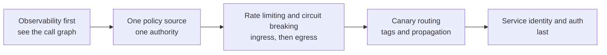

# Three Forms of Service Governance: SDK, Agent, and Sidecar

[中文](../../architecture/service-governance-forms.md) | English

> Every organization's service-governance capability list is roughly the same: discovery, routing, load balancing, rate limiting, circuit breaking, retries, timeouts, authentication, canary routing, observability. What separates systems is not *what* is supported but **the form in which those capabilities enter the process**.

> **Verification**: no runnable implementation in this repository ｜ **Evidence boundary**: engineering trade-off summary across three forms; not a selection benchmark.

---

## 1. Start With the Capability List

Whatever form you choose, the capabilities to cover are fixed:

| Capability | Description | Core? |
|---|---|---|
| Service discovery | Instance registration and health | Yes |
| Load balancing | Round robin / least connections / consistent hashing | Yes |
| Timeouts and retries | Per-call boundaries | Yes |
| Rate limiting | Ingress and egress | Yes |
| Circuit breaking and degradation | Fail fast when a dependency is unhealthy | Yes |
| Routing and canary | By tag, version, or cell | Advanced |
| Authentication | Service identity and authorization | Advanced |
| Observability | Metrics, traces, log context | Yes |

Choosing a form is really answering: **who maintains these capabilities, where do upgrades happen, and whose failure is it when they break.**

---

## 2. The Three Forms

### 2.1 SDK: capability inside the code

Governance logic ships as a library the application depends on and calls in-process.

```
Application process
 ├── Business code
 └── Governance SDK (discovery/routing/breaking/telemetry)
```

**Advantages**

- Best performance: no extra network hop;
- Most complete: full in-process context (threads, connections, serialization);
- Easiest debugging: stack traces and metrics live in the application.

**Costs**

- **Language-bound**: one implementation per language—multi-language teams either duplicate work or ship inconsistent capabilities;
- **Upgrade-bound**: upgrading the SDK means changing a dependency and redeploying; version fragmentation is nearly unavoidable;
- **Failures are in-process**: an SDK bug hits the business process directly and cannot be isolated.

### 2.2 Agent: capability in-process, injected at the bytecode layer

A Java Agent is the canonical example: attached at startup, it weaves governance logic into target methods via bytecode instrumentation—zero changes to business code.

```
Application process
 ├── Business code (no governance dependency)
 └── Agent (bytecode instrumentation + governance logic)
```

**Advantages**

- **Zero intrusion**: lowest adoption cost for existing systems;
- **Unified upgrades**: change the attach configuration, no code changes;
- **Good JVM ecosystem coverage**: mature interception points in frameworks and middleware.

**Costs**

- **Language-limited**: essentially requires a mature bytecode ecosystem (mostly JVM);
- **Hard to debug**: an extra layer in the stack that developers cannot see;
- **Compatibility risk**: framework upgrades break instrumentation points and require ongoing adaptation;
- **Startup coupling**: an agent failure can affect application startup—there must be a switch that lets the app start when the agent fails.

### 2.3 Sidecar: capability outside the process, a dedicated proxy

Each application instance gets a proxy; all ingress and egress traffic passes through it, and a control plane distributes configuration centrally.

```
Application Pod
 ├── Business container
 └── Sidecar proxy  ◀── Control plane (config distribution)
```

**Advantages**

- **Language-agnostic**: any language or framework, as long as traffic goes over the network;
- **Independent upgrades and failures**: a broken proxy can be removed without touching the business;
- **Clear boundary**: governance is a platform capability; product teams do not need to care.

**Costs**

- **An extra hop**: added latency (typically sub-millisecond to a few milliseconds, but not negligible at high QPS with tight latency budgets);
- **Resource overhead**: one proxy per instance—memory and CPU multiply by instance count;
- **The control plane is a new single point**: distribution lag and control-plane outages leave the fleet with stale policy;
- **Out-of-process context loss**: thread pools, in-process calls, and serialization details are invisible to the proxy, so some capabilities degrade.

---

## 3. Decision Matrix

There is no best form—only the form that matches your constraints. Score 1–5 (higher is a better fit):

| Dimension | SDK | Agent | Sidecar |
|---|---:|---:|---:|
| Single-language team | 5 | 4 | 2 |
| Multi-language team | 1 | 2 | 5 |
| Adopting existing systems | 2 | 5 | 4 |
| Extreme low latency | 5 | 4 | 2 |
| Independent upgrade needs | 1 | 4 | 5 |
| Platform-team maturity required | Low | Medium | High |
| Fault isolation | 2 | 2 | 5 |
| Observability completeness | 5 | 4 | 3 |

How three kinds of teams actually choose:

- **Under 10 people, one language, fewer than 20 services**: SDK, or no unified governance at all. A platform at this stage is a liability, not an asset;
- **Mid-to-large, JVM-centric, many legacy systems**: an agent is the best value, used to "make old systems visible first";
- **Multi-language, Kubernetes-native, with a platform team**: sidecar plus control plane, turning governance into infrastructure.

---

## 4. Hybrid Is Normal—Draw the Boundary Clearly

Real systems are rarely pure. Common combinations:

| Combination | Fit | Watch out for |
|---|---|---|
| Agent + SDK | Agent for legacy, SDK for new services that need full capability | Two policy sources must be unified, or one service gets two rule sets |
| Sidecar at the edge + SDK in-process | Sidecar for cross-language ingress, SDK for latency-sensitive core services | State clearly which layer performs rate limiting; avoid double limiting |
| Agent as a stepping stone to sidecar | Agent first for unified observability, then migrate gradually | Keep a capability comparison table during migration to prevent regressions |

**Boundary principle: each governance capability may have exactly one authoritative enforcement point.** Ingress limiting and in-process limiting both enabled will cancel each other's thresholds, and during an incident you cannot tell who is rejecting requests.

---

## 5. Control Plane and Data Plane

Any agent or sidecar form implies a control plane. The control plane owns policy storage, distribution, versioning, and staged rollout.

Four commonly overlooked issues:

1. **Distribution lag**: how long from a policy change to fleet-wide effect? During an incident this is part of your time-to-mitigate;
2. **Control-plane failure**: if it goes down, the data plane must keep running on the last known configuration, not fail wholesale;
3. **Configuration drift**: an instance that has not reached the control plane for a long time runs stale policy—track a "config version" metric;
4. **Policy rollback**: policy is a change too; it must be reversible, within a time limit.

In one sentence: **the control plane is a configuration system, not an ordinary service. When it is down, the system must keep running degraded.**

---

## 6. Five Questions Before Choosing

1. Who owns upgrading and troubleshooting this governance layer? A form without an owner will rot;
2. When it breaks, is the incident the product's or the platform's? Unclear boundaries lead to mutual waiting;
3. How long does an upgrade take and how many services does it touch? Longer than one release cycle means the form is too heavy;
4. Is there a switch that keeps business running when the governance component fails? Without one you have added a single point of failure;
5. Can you state in one sentence which layer enforces rate limiting? If not, it is being enforced twice.

---

## 7. Incremental Path



The order is not arbitrary: **governing traffic you cannot see is tuning while blind**; limiting with multiple policy sources is manufacturing random failures.

---

## 8. Connections to the Rest of This Repository

- Implementation details of canary routing are in [Full-Link Canary Deep Dive](../../playbooks/production-operations/deep-dives/full-link-canary.md) (Chinese);
- "Rules enforced by mechanism, not discipline" shares its origin with [Production Guardrails](../case-studies/production-guardrails/);
- Governance components are systems too, and their changes follow the same [change and canary rules](../../playbooks/production-operations/templates/02-change-and-canary.md) (Chinese).

---

## 9. Honest Boundaries

- This chapter does not compare specific products; product differences change too fast for any conclusion to stay current, and the decision framework outlives the selection;
- The scores in the matrix are **example weights**; re-score them against your own constraints;
- The capability boundary between agents and sidecars evolves with the ecosystem, so these conclusions have a shelf life;
- "No unified governance" is a legitimate choice for small teams, not a capability gap—governance returns grow non-linearly with service count, and before that point it is only cost.
