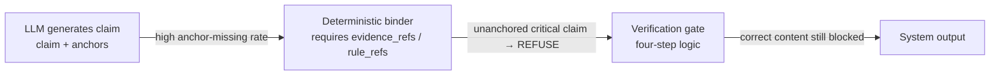

# Component-Correct ≠ System-Effective: An End-to-End Failure Postmortem of a Verification Gate

[中文](../../architecture/verifier-failure-modes.md) | English

> Offline validation passes 100% of the time. End-to-end expected-match rate is only 30.8%–46.2%. Both numbers are true.
> This postmortem explains why they are simultaneously true, and how to build an evaluation discipline in your own system that catches this kind of gap.

> **Verification entry**: [GroundedRAG v1.0.0](https://github.com/StevenTsai/grounded-rag/tree/v1.0.0) (247 unit tests, 95% coverage) ｜ **Evidence boundary**: driven by synthetic data; the real evaluation set is not distributed.

---

## 1. The Gap Itself

The evidence in this article comes from [GroundedRAG](https://github.com/StevenTsai/grounded-rag) (MIT), a RAG reference implementation of the claim-level verification gate ([pattern described in the companion article](claim-level-verifier.md)). At the v1.0.0 release it carried two sets of evaluation numbers side by side:

| Dimension | Deterministic verification (Verify mode) | End-to-end (E2E mode) |
|------|------|------|
| Case count | 34 groups | 13 groups |
| Claim count | 42 | ~30 |
| LLM dependence | None (claims are explicitly provided by the eval set) | High (LLM call rate 84.6%–100%; the rest are direct rule outputs) |
| Pass rate | **100%** | 15% |
| Expected-match rate | — | **30.8%–46.2%** (4–6/13, range over multiple samples) |
| Verdict distribution | — | refuse=10–12, pass=1–2 |

Source: [e2e_eval_analysis.md](https://github.com/StevenTsai/grounded-rag/blob/v1.0.0/docs/e2e_eval_analysis.md) (pinned at `v1.0.0`, 2026-09).

Both sets of numbers coexist in the repository README: the top-of-page badge advertises 1.0 on all three deterministic metrics, while the evaluation docs state an E2E expected-match rate in the low thirties. **Quoting either set without the other as a qualifier overstates what the system can actually do.**

Most teams only publish the left column. Publishing the right column too is the point here: a system-level failure record that is well-structured, auditable, and partially re-runnable.

---

## 2. Root Cause: The Break Is at the Anchor, Not the Logic

Attributing the E2E failures case by case produces a strikingly consistent pattern:

| Case | Expected | Actual | Cause |
|------|------|------|------|
| #1 EGFR first-line | pass | refuse | The LLM produced a **clinically correct** claim, but without bound `rule_refs` |
| #2 T790M second-line | pass | refuse | Same as above |
| #4 RAS wild-type | pass | refuse | Same as above |
| #5 ALK first-line | pass | refuse | Same as above |
| #10 Dosage | refuse | pass | The LLM answered correctly with complete anchors; the expected label itself is questionable (see Honesty Boundary) |

The mechanical breakpoint:



The gate's rules are **hard** for critical claims: no `rule_refs` → REFUSE, **even if the content is correct**; no `evidence_refs` → REFUSE, **even if the content is correct**. The principle is "grounded when anchored, refusable when not": the LLM's self-reported content is not trusted; only provenance anchors count. (Non-critical claims degrade to ANNOTATE with an unverified marker in the same scenario—the refusal force concentrates on critical claims.)

So the question sharpens: **did the gate "get it wrong" in these cases? No. It correctly refused a claim it could not verify, even though that claim happened to be true.** Where the system went wrong is one hop upstream: the pipeline depends on the LLM to produce usable anchors, and the LLM does not guarantee that. A deterministic binder (`_bind_anchors`: string matching plus token intersection, no LLM involved) already exists in the pipeline to recover bindings for unanchored claims, but under real E2E conditions its binding coverage is not enough to close the gap. Claims it cannot recover are either dropped, or hit the citation-integrity check while still unanchored and get refused. Every component, examined alone, is correctly doing its job. The leak is at the contract between them when composed.

This is the anatomy of "component-correct ≠ system-effective":

- **Component-level tests** prove: within the covered input space, no in-contract logic regressions were found (all 34 Verify-mode groups pass—that is what the tests prove: "covered behavior matches expectations," not "defect-free");
- **System-level evaluation** proves: on the real pipeline, the contract between components ("the LLM will produce usable anchors") is an **assumption**, not a guarantee.

RAG systems, agent systems—any architecture of the form "LLM + deterministic shell"—run into this exact problem. It is rarely published, because publishing it means admitting the headline metrics are incomplete.

---

## 3. Why Refusal Is the Correct Behavior

10–12 of the 13 groups were refused. Judged by "pass rate" this is a disaster; judged by risk exposure it is **the system working as designed**:

- The domain is high-risk (medical recommendations). Refusing is preferable to delivering ungrounded content. That is the design goal, not a malfunction;
- Look at the control side: with the same retrieved materials, when a bare model was asked out-of-corpus questions such as "how high is the response rate?", **3 of 8 samples (37.5%)** fabricated out-of-corpus numbers from parametric memory ("ORR is usually 70%–80%", "the FLAURA study was about 77%–80%"—neither figure appears in the retrieved evidence), while 5 samples honestly refused ([control_experiment_live.md](https://github.com/StevenTsai/grounded-rag/blob/v1.0.0/docs/control_experiment_live.md));
- The key point is not 3/8, but that **3/8 and 5/8 came from the same model, the same materials, the same prompt**. The "safety" of bare output is probabilistic and irreproducible.

The gate cannot raise the probability that the model answers correctly. What it can guarantee is that ungrounded critical claims never reach the final answer: if the corpus contains no anchor for a response rate and the LLM still emits a numeric claim → `citation_incomplete` → certain refusal, every time. The boundary of determinism must be stated precisely: what is deterministic is the **verdict**, not the end-to-end output. Whether the LLM emits that claim at all still fluctuates with sampling (this is exactly why the expected-match rate floats between 30.8% and 46.2%); all the system guarantees is "if it is emitted, it will not pass the gate."

So the correct reading of the gap is: **E2E's 30–46% is not "the system is only thirty percent right," but "the system correctly refused the seventy percent of outputs it could not prove to be grounded."** The genuine defect is that a batch of those refusals should have passed (they would pass if upstream supplied the anchors). This fixes the direction of improvement: upstream, not relaxing the gate.

---

## 4. Methodology Extracted: The Dual-Caliber Discipline

The methodology distilled from this postmortem applies to any system built as "deterministic components + probabilistic upstream":

### 4.1 One Metric Measures One Thing

GroundedRAG's three headline metrics each own one segment, and merging them is rejected:

| Metric | Owns | Does not own |
|------|------|------|
| Citation integrity rate | Whether grounded claims carry complete, resolvable anchors | Whether the content is correct |
| Surface consistency rate | Whether good claims are wrongly refused | Whether semantics actually hold |
| Refusal correctness rate | Whether the right things were refused | Whether the right things are answered well |

Its [metrics document](https://github.com/StevenTsai/grounded-rag/blob/v1.0.0/docs/metrics.md) contains a sentence every evaluation doc should steal:

> If an evaluation bundles these three into a single "groundedness/accuracy" number, it is overstating the capability boundary of deterministic verification.

Metric naming is an architecture claim. A system that bundles the three under the name "accuracy" is already using naming to hide its capability boundary.

### 4.2 Component-Caliber and System-Caliber Metrics Must Exist as a Pair

- **Component caliber**: offline, deterministic, no LLM, runnable at scale (the 34 groups can run hundreds of times);
- **System caliber**: end-to-end, includes the generator, small but real (13 groups, each traversing the real pipeline).

Two iron rules:

1. **Always cite them as a pair.** Any component metric that appears alone must be labeled "this is component caliber";
2. **Run both in regression.** A green component caliber does not mean the system caliber has not regressed. In this case the component caliber was green the entire time.

### 4.3 Coverage Is a Component Metric, Not a System Metric

v1.0.0's 247 tests and 95% coverage are real (reproducibly verifiable). They prove **code was executed**; they do not prove **the system works**. Treating coverage as system health is like using a physical exam report to prove an athlete will win the match.

### 4.4 File Failures into Three Root-Cause Classes

The attribution framework from this postmortem is directly reusable:

| Class | Definition | Instance in this case | Fix where |
|------|------|------|------|
| Component wrong | Given in-contract input, output is wrong | None (all Verify cases pass) | Fix the component |
| Contract broken | Assumption between components fails | The LLM does not guarantee usable anchors | Fix the pipeline/upstream |
| Upstream degraded | The input itself drifts | Prompt changes alter anchor behavior | Fix engineering constraints |

The mismatches (7–9 of the 13 groups, floating with sampling) fall almost entirely under "contract broken". **Mis-attribute the cause and the fix will be wrong**: treat a broken contract as a component defect and "fix" the gate (relax anchor requirements); the metrics will improve and the system will become dangerous.

---

## 5. Landing This in Your Own System

For any system of the form "deterministic verification + LLM generation", the minimum viable checklist:

1. **Build the component caliber first**: peel the verification logic out of the pipeline into an evaluation that runs standalone without an LLM (claims explicitly provided by the eval set);
2. **Then build the system caliber**: even if it is only 10–20 groups, you need an end-to-end set that traverses the real pipeline, with expected verdicts labeled per group;
3. **Attribute every failure** to one of the three classes above; file by class, not by symptom;
4. **Publish calibers in pairs**: in external reports, README badges, and paper numbers, component metrics and system metrics always appear together;
5. **Dual-run in regression**: in CI, the component caliber blocks logic regressions and the system caliber blocks contract drift.

---

## 6. Engineering Notes

Two lessons confirmed in passing during the postmortem, recorded here as well:

1. **Cross-platform text I/O must specify encodings explicitly.** v1.0.0's [runner.py](https://github.com/StevenTsai/grounded-rag/blob/v1.0.0/src/groundedrag/eval/runner.py) used `NamedTemporaryFile(mode="w")` without `encoding="utf-8"`: on Chinese Windows the default GBK write followed by a UTF-8 read triggered `UnicodeDecodeError`; green Linux CI masked this. **Green CI ≠ green cross-platform.**
2. **Tests that depend on workspace state are not tests, they are environment snapshots.** Untracked files in the repository root make "clean-repo exit code" style checks fail. Such checks should declare explicitly what they check instead of scanning implicitly.

---

## 7. Honesty Boundary

- The subject of this postmortem is a **public reference implementation** (synthetic-data-driven; the real evaluation set is not distributed), not a production system. Numbers are pinned at `v1.0.0` (`0f8930c`); as the repository evolves, defer to the current values in `docs/`;
- The E2E set is only 13 groups, a single model (mimo-v2.5-pro), and a single domain. 30.8%–46.2% is a range across multiple samples, not a statistical confidence interval. Do not extrapolate it into "systems like this are generally thirty percent correct";
- As of v1.0.0, the deterministic anchor binder `_bind_anchors` **exists** and partially recovers unanchored claims, but its binding coverage under real E2E conditions still does not close the gap. What is written here is a verified failure—not "the binder does not exist yet", and not a claim that it has been fixed;
- The ground truth of the E2E set itself still needs auditing: for example, the dosage question expected `refuse`, the system answered the correct dosage and was judged `pass`, yet the source analysis calls this case "correctly answered". The expected label and the answer semantics are in dispute; the match rate cannot be treated as an uncontested ground truth of system quality;
- This article does not claim "bare RAG inevitably hallucinates". The control experiment's own conclusion makes no such claim either: the 3/8 fabrication is a recorded real failure, and the 5/8 honest refusals are equally real. The single core claim here is one: **the safety of bare output is irreproducible; the value of verification is making it deterministic.**

---

## Evidence and Reproduction

- Repository: [StevenTsai/grounded-rag](https://github.com/StevenTsai/grounded-rag) (MIT)
- Cited version: `v1.0.0` (`0f8930c8455f0f67611767d6702dc714cb21e82c`, 2026-09-18)
- Evidence files: [docs/e2e_eval_analysis.md](https://github.com/StevenTsai/grounded-rag/blob/v1.0.0/docs/e2e_eval_analysis.md) · [docs/control_experiment_live.md](https://github.com/StevenTsai/grounded-rag/blob/v1.0.0/docs/control_experiment_live.md) · [docs/metrics.md](https://github.com/StevenTsai/grounded-rag/blob/v1.0.0/docs/metrics.md)
- Reproduction (deterministic caliber, no API key required):

  ```bash
  git clone https://github.com/StevenTsai/grounded-rag && cd grounded-rag
  git checkout v1.0.0
  pip install -e .
  python -m groundedrag.eval --json     # three metrics + per-group detail
  ```

  The E2E caliber requires an LLM API; steps and historical results are in `docs/e2e_eval_analysis.md`.
