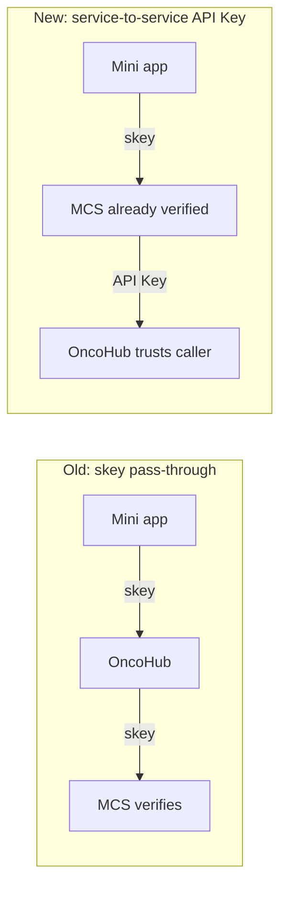
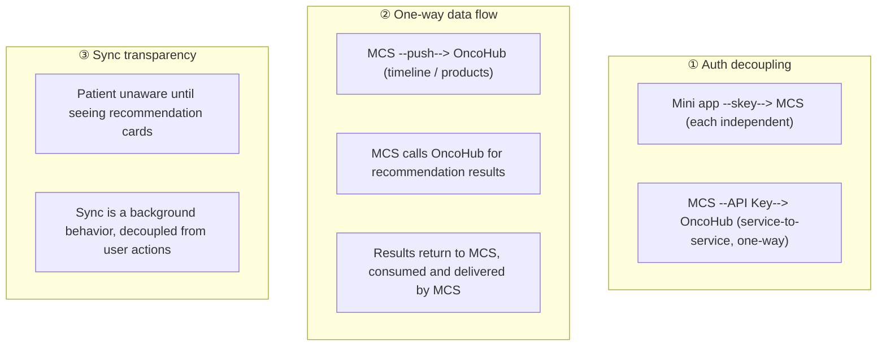

# OncoHub Architecture Evolution: A Design Document Rewritten Eight Times

[中文](../../case-studies/oncohub-architecture-evolution.md) | English

> Good architecture is not drawn correctly the first time; it is corrected by reality, again and again. This article records the evolution of a four-system integration design document from v1.0 to v2.8, and the judgment behind each round of revision.
>
> The case is a retrospective of a personal project, first published on the author's homepage; system names and numbers are facts from that project. No business data is included.

---

## 1. Background: Four Systems and a Document Written in Two Days

One requirement: connect four independent systems into an intelligent-recommendation loop for oncology patients. All four were already delivered and running: a patient-companion mini app (the user entry point), the core business system (called MCS below), a distribution back office (products and fulfillment), and the OncoHub decision platform (rule engine + knowledge graph + recommendation engine).

It did not sound hard: the capabilities all existed; all that was missing was "connecting them". So a design document was written in two days—clear architecture, complete data model, detailed API definitions, plus a degradation plan. The review meeting pushed back with six questions, three of which were "what if you cannot get this external dependency coordinated?", and the answer at the time was "it should be coordinate-able, probably".

That sentence is where the trouble started. The document went from v1.0 to v2.8—eight revisions.

---

## 2. Read the Code Before Drawing the Diagram

The first version's instinct was to make OncoHub the middleman: take data from the mini app with the left hand, call the distribution platform's APIs with the right. The authentication plan was for OncoHub to also support the mini app's skey verification, calling `verify-skey` to obtain the user_id.

Only when someone went to read the code did the architecture diagram turn out to be wrong:

```text
Medical-chaperon-server
├─ MiniappApplication (port 9010)
└─ OpsApplication (port 9020)   ← two applications in one project, sharing MySQL + Redis
```

The mini app backend and the distribution back office **were not two systems at all**—they were two applications of the same project, packaged twice via build profiles. Everything drawn on the basis of "four boxes, two integration plans, two authentication channels" was void: only one backend needed integration. The assumption that "the product data format needs to be guessed" also collapsed—the project already had a complete product CRUD API.

**A wrong architecture diagram was drawn, and then an entire solution was designed on top of it.** The corrected lesson: before drawing architecture on a whiteboard, read the existing systems' code first. Not all of it—directory structure, config files, and the Controller layer, thirty minutes is enough—and those thirty minutes correct most assumptions.

---

## 3. Auth Decoupling: Eliminating a Dependency Beats Complex Degradation

The first authentication plan spent half a page on three-tier degradation: `verify-skey` unavailable → direct read-only database query → server-side whitelist key. It looked rigorous.

The review asked one question: "MCS has already verified the user's identity—why does OncoHub need to verify again?"

Indeed. Every user action in the mini app had already passed MCS's interceptor; the `user_id` was already in the server-side context. OncoHub verifying the skey again was **redoing what someone else had already done**, at three costs: needing the other side to expose a verification interface (external dependency), needing to understand skey storage and expiry logic (coupling), and skey leakage enabling identity forgery (security risk).

The right direction was to make MCS the caller, invoking OncoHub with the already-verified user ID; OncoHub would verify only a service-to-service API Key—local comparison, zero network latency. The three-tier degradation plan became unnecessary because the dependency itself was eliminated:



The judgment generalizes: **the best fault-tolerance design makes degradation unnecessary.** If you find yourself writing complex degradation logic, first ask whether you can eliminate the dependency.

---

## 4. Sync Transparency: Delete the "Sync Button"

The first version placed a "Sync to Yilu Kangxing" button on the mini app's timeline page: the user authorizes, the data syncs—technically reasonable.

Now step into the patient's shoes: a chemotherapy-period patient finishes recording medication and sees a button called "sync" that means nothing to him. Will he click it? His mental model is "I am managing my medical record", not "I am sending data to another system". **The "sync button" exposed a technical implementation detail to the user.**

The right move was to delete the button and add an asynchronous backend call: MCS pushes asynchronously → OncoHub parses the context → recommendations are triggered. The only moment a patient becomes aware of OncoHub is opening the recommendation page and seeing cards generated from his own treatment history. Technical complexity stays cohesive on the server; the user experience stays simple.

---

## 5. Data Flow Follows Data Ownership

The original plan had OncoHub poll the distribution platform for product data (6-hour refresh). But who knows first when a product changes? MCS: price adjusted, status changed, new product listed—it hears first.

**Data should flow from the changer to the consumer.** After switching to push, the latency disappeared and the code shrank from ~100 lines (polling client + error handling + cache refresh) to ~30 lines (receive push + write cache), and OncoHub no longer needed to understand MCS's API format.

---

## 6. The "What We Will Not Change" List

Halfway through writing the design document, the change-scope description was found to contradict itself: one side said "MCS adds no interfaces and changes no business logic", while the same section demanded new push hooks, utility classes, and fields. That is not "no change"; that is "quite a lot of change".

So all four systems plus the partner portal went through a full code review, listing per system what would change and what would not:

| System | Changes | Untouched |
|------|--------|---------|
| Patient-companion mini app | Recommendation card page (new) | Timeline CRUD, patient management, order payment |
| MCS backend | Async push hooks, source field | Existing API paths, business logic |
| OncoHub | 3 new modules + 5 new tables | 76 existing APIs; rule engine / knowledge graph / recommendation engine |
| Distribution admin back office | None | Fully transparent |
| Partner portal | None | Fully transparent |

**"What will not change" is the proof of a system's independence.** If a system needs heavy modification to integrate, the architecture has a problem.

---

## 7. Interface Paths Are the Last Mile

By v2.7 the architecture was clear, but integration testing broke: the same interface was written with two different paths in two sections, and the endpoint did not exist in the target system at all—the real endpoint was another one.

No matter how beautiful the architecture diagram or how elegant the data model, a wrong interface path wastes everything. **Interface paths are the last mile of a design document**: not a detail, but the minimum threshold of executability. v2.8 unified all paths in the document and added call-source attribution fields, closing the loop.

---

## 8. Canary: Move Only When the Data Says So

After the loop worked end to end, rollout went through four phases, each with acceptance criteria and rollback conditions:

| Phase | Scope | Threshold |
|---|---|---|
| 0 Internal validation | 3–5 people | Accuracy 100%; any error stops immediately |
| 1 Small canary | 100 users | Accuracy ≥ 80%, click-through ≥ 10%, daily manual sampling review |
| 2 Expanded canary | 500 users | Accuracy ≥ 80%, click-through ≥ 15%, conversion tracking on |
| 3 Full rollout | 1000+ users | Full loop operational, end-to-end monitoring |

Acceptance was "move when the data says so", not "move when it feels about right".

---

## 9. Eight Revisions and Three Boundaries

Looking back, every revision did the same thing: **turn assumptions into facts.**

| Version | What was discovered | What changed |
|------|-----------|---------|
| v1.0 | Architecture drawn by intuition | The starting point |
| v2.2 | Auth plan over-engineered | skey pass-through → service-to-service API Key |
| v2.4 | Sync button unjustifiable | User-initiated → background async |
| v2.5 | Data flow direction reversed | Pull → push |
| v2.6 | Factual errors (ports, event types) | Corrected by inventorying the codebase |
| v2.7 | Missing visualization and canary strategy | Added ER diagram, sequence diagram, four-phase canary |
| v2.8 | Interface paths inconsistent | Unified throughout + source-attribution loop closed |

The final design converged on three boundaries:



---

## 10. Honesty Boundary

- Single-project retrospective: the score (7.9 → 9.5) is a subjective rating from the team's 10-point design-review process, covering the five dimensions that team cared about at the time; it is not a universal measure;
- The canary thresholds (accuracy ≥ 80%, etc.) come from that project's business judgment of recommendation quality; recalibrate against your own risk surface when reusing;
- This article presents the **evolution method** (reading code to correct assumptions, eliminating dependencies, change-scope lists, data-flow-follows-ownership), not the system's complete architecture document;
- All four systems are delivered, running personal projects; business data, patient data, and internal configuration are not included.

## Evidence Boundary

- First published as: [一份设计文档被改了 8 次，每次都觉得自己是对的](https://steven.caxcz.xin/blog/oncohub-architecture-evolution) (2026-04-11, Chinese)
- This article is the knowledge-base rewrite of that post, adding links to this repository's methodology; the key numbers (eight revisions, 76 existing APIs, four-phase canary) are facts from the original

## Related Articles

- [DDD in Seven Steps](../../playbooks/enterprise-architecture/ddd-seven-step-landing.md) (Chinese) — unified language, bounded contexts, and the "boundary specification"
- [Event-Driven State Machine](../architecture/commission-pipeline.md) — events as business facts that have already happened
- [Template 02: Change and Canary Releases](../../playbooks/production-operations/templates/02-change-and-canary.md) (Chinese) — generic templates for canary phases and rollback conditions
- [System Portfolio Governance](../../playbooks/system-portfolio-governance/00-methodology.md) (Chinese) — inventory and disposition of system portfolios
