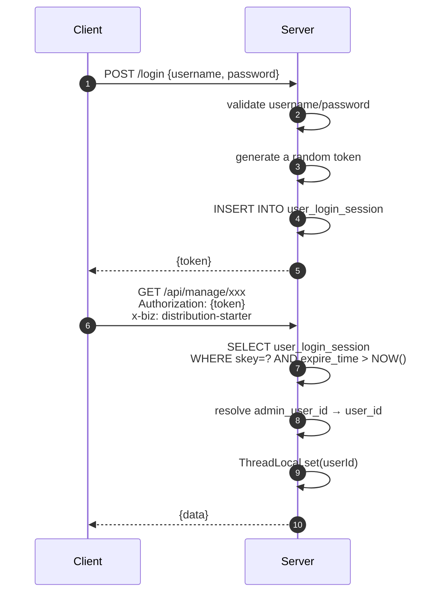

# ADR: Why Session Token over JWT

[中文](../../decisions/why-session-not-jwt.md) | English

> Status: Accepted
> Date: Initial design phase
> Decision Maker: Architecture Team

---

## Background

The system needs an authentication mechanism to identify "who is operating." There are two mainstream approaches:

1. **Session Token**: Server generates a random token, stores it in the database, queries the database on each request to validate
2. **JWT (JSON Web Token)**: Server signs and generates a self-contained token, validates locally on each request

This project chose the Session Token approach.

## Decision

Use database-backed Session Token authentication, with tokens stored in the `user_login_session` table.

### Authentication Flow



### Core Code

```java
// (source file)
private UserLoginSessionEntity getActiveBackendSession(String biz, String token) {
    UserLoginSessionEntityExample example = new UserLoginSessionEntityExample();
    example.createCriteria()
        .andSkeyEqualTo(token)
        .andBizEqualTo(biz)
        .andExpireTimeGreaterThan(new Date());  // Not expired
    List<UserLoginSessionEntity> sessions = userLoginSessionDao.selectByExample(example);
    return sessions == null || sessions.isEmpty() ? null : sessions.get(0);
}
```

## Alternatives Considered

### Option A: JWT

| Pros | Cons |
|------|------|
| Stateless, no database query needed | Cannot actively invalidate (old token still valid after password change) |
| Reduces database pressure | Large token size (~300 bytes vs Session's ~32 bytes) |
| Naturally supports cross-service auth | Need to manage signing key rotation |
| Industry trend | Blacklist mechanism introduces "pseudo-state" |

### Option B: Redis Session

| Pros | Cons |
|------|------|
| Higher query performance than database | Introduces Redis dependency |
| Supports TTL auto-expiry | Need to handle Redis-database consistency |
| | Increases operational complexity |

## Reasons for Choosing Session Token

### 1. Business Scenario Determines

This is an **admin panel system**, not a consumer-facing app with billions of users:
- Concurrent users: tens to hundreds (not millions)
- Auth request frequency: once per API call (not thousands per second)
- Database query overhead is entirely acceptable

### 2. Active Invalidation Is a Hard Requirement

In admin panel scenarios, the following operations require **immediate** invalidation of old tokens:
- User changes password
- Admin disables an account
- Force logout after security incident

With Session Token, simply delete the record from `user_login_session`. JWT requires a blacklist mechanism, adding complexity.

### 3. Multi-Tenant / Multi-Business-Line Support

The `biz` field distinguishes different login sources:

```sql
-- Same user can have multiple sessions (admin panel + partner portal)
SELECT * FROM user_login_session
WHERE skey = ? AND biz = 'distribution-starter' AND expire_time > NOW();
```

JWT's `audience` (aud) field can do something similar, but it's less flexible.

### 4. Compatibility with Existing System

This project was extracted from an existing system that already uses Session Token authentication. Maintaining consistency allows:
- Sharing the same login logic
- No client-side changes needed
- Reduced migration risk

## Trade-offs

### Costs Paid

1. **One Database Query Per Authentication**: Performance impact for high-concurrency scenarios
   - Mitigation: `user_login_session` table has a composite index on `skey` + `biz` + `expire_time`
   - Mitigation: Admin panel concurrency is far below database query capacity limits

2. **Need to Manage Session Expiry Cleanup**: Expired session records need periodic cleanup
   - Mitigation: Can add a scheduled task `DELETE FROM user_login_session WHERE expire_time < NOW()`

3. **Horizontal Scaling Requires Shared Session Storage**: Multi-instance deployment requires all instances to access the same database
   - Mitigation: This project uses the same MySQL database, naturally shared

### Benefits Gained

1. Simple implementation, no additional components needed
2. Supports active invalidation, meeting security compliance requirements
3. Compatible with existing system, zero migration cost
4. Easy debugging (session records in database, directly queryable)

## Future Evolution

If higher concurrency or cross-microservice auth sharing is needed in the future:

1. **Introduce Redis Session Cache**: Add a Redis cache layer on top of the database, with TTL matching database expiry
2. **Migrate to JWT + Blacklist**: If stateless auth is needed, use JWT but retain Redis blacklist for active invalidation
3. **Integrate OAuth2**: If external system integration is needed, add an OAuth2 layer on top of Session

---
