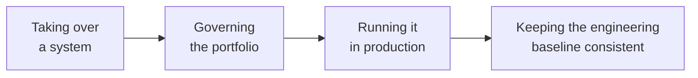

# Methodology Playbooks (Chinese)

> Five practitioner playbooks covering the lifecycle of a system after it ships: taking it over, governing a portfolio, running it in production, keeping the engineering baseline consistent, and extracting private work into public repositories safely.

**Language note:** these playbooks are written in Chinese. They were written as first-person practitioner methodology—judgment, trade-offs, and templates—and the author publishes them in the language they were reasoned in. This page is an index so English readers know what exists and can navigate to it. Machine translation is available through your browser; the templates themselves are language-neutral.

---

## Why They Are Not Translated

Three honest reasons:

1. **The value is in the phrasing.** The playbooks are deliberately terse—"a gate that depends on people's self-discipline is not a gate." Translation flattens exactly this kind of judgment;
2. **They are living documents.** They get revised as practice accumulates; keeping one authoritative text avoids two versions drifting apart;
3. **Cost and focus.** Translating ~220,000 characters would consume the time better spent on evidence and case studies.

If you need a specific playbook in English, open an issue—demand is a reasonable signal to translate one.

---

## What Exists

| Playbook | Covers | Core question | Entry point |
|---|---|---|---|
| **Takeover Engineering** | The moment you inherit a system: should you take it, how much to invest, when to stop | "Will this investment be wasted?" | [README](../playbooks/takeover-engineering/) |
| **System Portfolio Governance** | The holding period: which systems to shut down, merge, or remediate; how to stop the portfolio from only growing | "Is the portfolio growing without bound?" | [README](../playbooks/system-portfolio-governance/) |
| **Production Operations** | The running period: observability, change and canary, incident response, capacity and drills | "When it breaks, can you see it, change it safely, and recover it?" | [README](../playbooks/production-operations/) |
| **Engineering Consistency Standards** | The team baseline: naming, versioning, structure, interfaces, config, release, health metrics, glossary | "Are we all building the same system?" | [Standards](../playbooks/engineering-consistency-standards.md) |
| **Open-Source Compliance** | Before private work becomes public: the split line, leak scanning (open scanner, closed wordlist), an eight-item pre-push checklist, data-boundary declarations | "What must never leave the building?" | [Playbook](../playbooks/open-source-compliance.md) |

The first three share one underlying idea: **define the exit before you start**—an investment cap before you take over a system, an auto-review before a system goes dormant, a rollback before any change ships.

---

## Takeover Engineering

Ten fillable templates plus a free hook.

| Resource | Purpose |
|---|---|
| [21 questions](../playbooks/takeover-engineering/hooks/21-questions.md) | What to ask before accepting a system (free, start here) |
| [Methodology](../playbooks/takeover-engineering/00-methodology.md) | Four principles, six stages, stop-loss gates |
| [Investment discipline](../playbooks/takeover-engineering/01-investment-discipline.md) | L0–L3 effort caps and leverage symmetry |
| [Templates 01–10](../playbooks/takeover-engineering/) | Inventory, risk map, dependency graph, estimation, contract, and more |
| [Case walkthrough](../playbooks/takeover-engineering/case-walkthrough.md) | A fictional end-to-end run (evidence level E5: teaching example, not experience) |

## System Portfolio Governance

| Resource | Purpose |
|---|---|
| [Methodology](../playbooks/system-portfolio-governance/00-methodology.md) | Inventory → diagnosis → decision → execution, plus three gates |
| [Template 01 Inventory](../playbooks/system-portfolio-governance/templates/01-portfolio-inventory.md) | One row per system, the single source of truth |
| [Template 02 Diagnosis](../playbooks/system-portfolio-governance/templates/02-system-diagnosis.md) | Four-layer diagnosis with evidence requirements |
| [Template 03 Decision record](../playbooks/system-portfolio-governance/templates/03-governance-decision.md) | Shut down / merge / remediate / rebuild, with rollback conditions |
| [Template 04 Roadmap and gates](../playbooks/system-portfolio-governance/templates/04-governance-roadmap.md) | Quarterly roadmap, admission and decommission gates |
| [Template 05 Architecture review](../playbooks/system-portfolio-governance/05-architecture-review.md) | Three review levels, one-page memo, exception ledger |

## Production Operations

| Resource | Purpose |
|---|---|
| [Methodology](../playbooks/production-operations/00-methodology.md) | Five principles, four capability domains, minimum viable operations |
| [Template 01 Observability](../playbooks/production-operations/templates/01-observability-alerting.md) | Four signal layers, alert grading, noise reduction, on-call |
| [Template 02 Change and canary](../playbooks/production-operations/templates/02-change-and-canary.md) | C1–C4 changes, staged rollout, stop criteria, expand–contract |
| [Template 03 Incident and postmortem](../playbooks/production-operations/templates/03-incident-postmortem.md) | Severity, roles, mitigation order, four-question review |
| [Template 04 Capacity and drills](../playbooks/production-operations/templates/04-capacity-and-drills.md) | Capacity model, load testing, drills, chaos progression |
| [Full-link canary deep dive](../playbooks/production-operations/deep-dives/full-link-canary.md) | Tag propagation, message canary, data compatibility, ten pitfalls |

## Engineering Consistency Standards

One axiom—*one concept, one word, one authority*—and eight chapters: naming, versioning, project structure, interfaces, configuration and environments, iteration and release, health metrics, and glossary. Each item is marked **mandatory** or **recommended**, with an incremental adoption path so a team does not have to adopt everything on day one.

## Open-Source Compliance

The hygiene layer for this book's own method—turning private production work into a public pattern library. How to draw the split line between private and public, why the scanner is open but the private wordlist is not (`.leak_markers.json` stays out via `.gitignore`), an eight-item pre-push checklist that includes Git history and credential rotation, and data-boundary declarations. [Open the playbook (Chinese)](../playbooks/open-source-compliance.md).

---

## Reading Order

They can be read independently. If you only read one, read **Production Operations**—it has the shortest path from reading to a concrete change in your team. **Open-Source Compliance** sits on a different axis: it applies the moment you publish anything, not at a stage of the running lifecycle.
