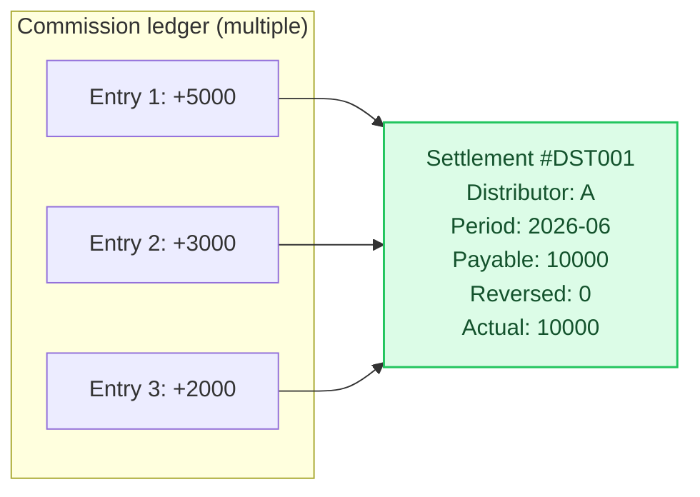
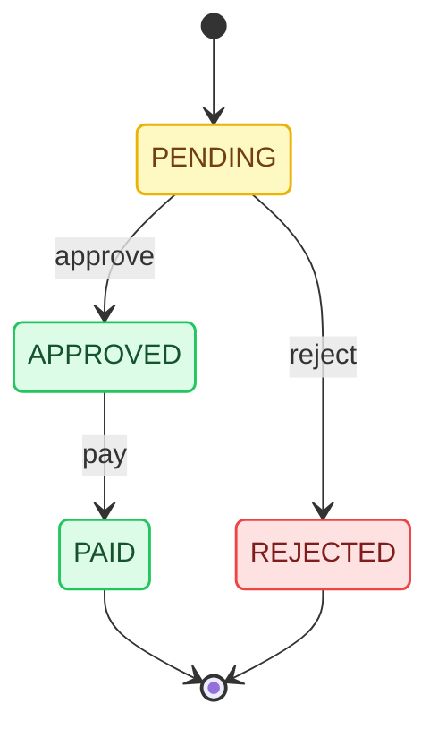

# Step 06: Settlement Flow — From Commission to Payout

[中文](../../tutorial/06-settlement.md) | English

> Commission ledger entries have been generated, but there is still no process for "giving the money to the distributor." This chapter implements the creation, approval, and payout of settlement statements.

---

## Chapter Goals

- Understand the relationship between settlement statements and commission ledger entries
- Implement settlement statement creation (aggregation by distributor + time period)
- Implement the approval → payout process
- Understand the impact of reversals on settlement statements

## Settlement Statement vs Commission Ledger



One settlement statement corresponds to multiple commission ledger entries. The settlement statement is the "payment voucher issued to the distributor."

## Step 1: Recording Receipts for Commission Ledger Entries

For a commission ledger entry to move from `PENDING_REVIEW` to `SETTLEABLE`, receipt information must be recorded:

```java
@Override
@Transactional(rollbackFor = Exception.class)
public void recordReceipt(Long ledgerId, RecordCommissionReceiptRequestDTO request) {
    DistributionCommissionLedgerEntity ledger = getLedgerEntity(ledgerId);

    // Validate the status
    if (!"pending_review".equals(ledger.getStatus())
        && !"locked".equals(ledger.getStatus())) {
        throw new BizException("The current status does not allow receipt entry", ...);
    }

    // Validate the amount
    if (request.getReceivedAmount().compareTo(ledger.getCommissionAmount()) < 0) {
        throw new BizException("The receipt amount cannot be less than the commission amount", ...);
    }

    // Update the ledger status
    DistributionCommissionLedgerEntity update = new DistributionCommissionLedgerEntity();
    update.setId(ledgerId);
    update.setReceivedAmount(request.getReceivedAmount());
    update.setPaymentReferenceNo(request.getPaymentReferenceNo());
    update.setProofUrl(request.getProofUrl());
    update.setReceivedAt(new Date());
    update.setStatus("settleable");
    commissionLedgerMapper.updateByPrimaryKeySelective(update);

    // Automatically create a settlement statement
    Long settlementId = createSettlementForLedger(ledger, operatorUserId);

    // Link the settlement statement
    DistributionCommissionLedgerEntity link = new DistributionCommissionLedgerEntity();
    link.setId(ledgerId);
    link.setSettlementId(settlementId);
    commissionLedgerMapper.updateByPrimaryKeySelective(link);

    auditLogService.record("commission", ledgerId, "record_receipt", ...);
}
```

## Step 2: Creating a Settlement Statement

Two methods are supported: automatic single-entry creation and batch aggregation by time period.

### Automatic Single-Entry Creation (When Recording a Receipt)

```java
private Long createSettlementForLedger(DistributionCommissionLedgerEntity ledger, Long operatorUserId) {
    DistributionSettlementEntity settlement = new DistributionSettlementEntity();
    settlement.setSettlementNo(generateSettlementNo());
    settlement.setDistributorId(ledger.getDistributorId());
    settlement.setPeriodStart(new Date());
    settlement.setPeriodEnd(new Date());
    settlement.setPayableAmount(ledger.getCommissionAmount());
    settlement.setReversedAmount(BigDecimal.ZERO);
    settlement.setActualAmount(ledger.getCommissionAmount());
    settlement.setAuditStatus("pending");
    settlement.setPaymentStatus("pending_audit");
    settlement.setDeleted(0);
    settlementMapper.insertSelective(settlement);

    // Create a line item
    DistributionSettlementItemEntity item = new DistributionSettlementItemEntity();
    item.setSettlementId(settlement.getId());
    item.setCommissionLedgerId(ledger.getId());
    item.setBizOrderId(ledger.getBizOrderId());
    item.setCommissionAmount(ledger.getCommissionAmount());
    item.setStatus("active");
    settlementItemMapper.insertSelective(item);

    return settlement.getId();
}
```

### Batch Aggregation (by Distributor + Time Period)

```java
@Override
@Transactional(rollbackFor = Exception.class)
public Long createSettlement(CreateDistributionSettlementRequestDTO request) {
    // 1. Find settleable commission ledger entries
    List<DistributionCommissionLedgerEntity> settleableLedgers =
        commissionLedgerMapper.selectSettleableByDistributorAndPeriod(
            request.getDistributorId(), request.getPeriodStart(), request.getPeriodEnd());

    if (settleableLedgers.isEmpty()) {
        throw new BizException("No settleable commission ledger entries", ...);
    }

    // 2. Calculate the total amount
    BigDecimal payableAmount = BigDecimal.ZERO;
    for (DistributionCommissionLedgerEntity ledger : settleableLedgers) {
        payableAmount = payableAmount.add(ledger.getCommissionAmount());
    }

    // 3. Create the settlement statement
    DistributionSettlementEntity settlement = new DistributionSettlementEntity();
    settlement.setSettlementNo(generateSettlementNo());
    settlement.setDistributorId(request.getDistributorId());
    settlement.setPeriodStart(request.getPeriodStart());
    settlement.setPeriodEnd(request.getPeriodEnd());
    settlement.setPayableAmount(payableAmount);
    settlement.setActualAmount(payableAmount);
    settlement.setAuditStatus("pending");
    settlement.setPaymentStatus("pending_audit");
    settlementMapper.insertSelective(settlement);

    // 4. Create line items + link ledger entries
    for (DistributionCommissionLedgerEntity ledger : settleableLedgers) {
        DistributionSettlementItemEntity item = new DistributionSettlementItemEntity();
        item.setSettlementId(settlement.getId());
        item.setCommissionLedgerId(ledger.getId());
        item.setBizOrderId(ledger.getBizOrderId());
        item.setCommissionAmount(ledger.getCommissionAmount());
        item.setStatus("active");
        settlementItemMapper.insertSelective(item);

        ledger.setSettlementId(settlement.getId());
        commissionLedgerMapper.updateByPrimaryKeySelective(ledger);
    }

    auditLogService.record("settlement", settlement.getId(), "create", null, settlement, "Create settlement batch");
    return settlement.getId();
}
```

## Step 3: Approval and Payout

The status transitions of a settlement statement:



```java
@Override
@Transactional(rollbackFor = Exception.class)
public void approveSettlement(Long id, ApproveDistributionSettlementRequestDTO request) {
    DistributionSettlementEntity settlement = getSettlementEntity(id);

    if (!"pending".equals(settlement.getAuditStatus())) {
        throw new BizException("Only a settlement statement pending review can be approved", ...);
    }

    DistributionSettlementEntity update = new DistributionSettlementEntity();
    update.setId(id);
    update.setAuditStatus("approved");
    update.setPaymentStatus("pending_payment");
    update.setUpdatedBy(operatorService.getCurrentOperatorUserId());
    settlementMapper.updateByPrimaryKeySelective(update);

    auditLogService.record("settlement", id, "approve", settlement, getSettlementEntity(id), "Approved");
}

@Override
@Transactional(rollbackFor = Exception.class)
public void paySettlement(Long id, PayDistributionSettlementRequestDTO request) {
    DistributionSettlementEntity settlement = getSettlementEntity(id);

    if (!"approved".equals(settlement.getAuditStatus())) {
        throw new BizException("Only an approved settlement statement can be paid out", ...);
    }

    DistributionSettlementEntity update = new DistributionSettlementEntity();
    update.setId(id);
    update.setPaymentStatus("paid");
    update.setPaidAt(new Date());
    update.setPaymentReferenceNo(request.getPaymentReferenceNo());
    update.setUpdatedBy(operatorService.getCurrentOperatorUserId());
    settlementMapper.updateByPrimaryKeySelective(update);

    // Update commission ledger entry status to settled
    List<DistributionSettlementItemEntity> items = settlementItemMapper.selectBySettlementId(id);
    for (DistributionSettlementItemEntity item : items) {
        DistributionCommissionLedgerEntity ledgerUpdate = new DistributionCommissionLedgerEntity();
        ledgerUpdate.setId(item.getCommissionLedgerId());
        ledgerUpdate.setStatus("settled");
        commissionLedgerMapper.updateByPrimaryKeySelective(ledgerUpdate);
    }

    auditLogService.record("settlement", id, "pay", settlement, getSettlementEntity(id), "Confirm payout");
}
```

## Step 4: Impact of Reversals on Settlement Statements

When a settled commission is reversed, the settlement statement's `reversed_amount` and `actual_amount` must be updated:

```java
private void markPaidSettlementReversed(DistributionCommissionLedgerEntity sourceLedger,
                                        DistributionCommissionLedgerEntity reverseLedger) {
    if (sourceLedger.getSettlementId() == null) return;

    DistributionSettlementEntity settlement = settlementMapper.selectByPrimaryKey(sourceLedger.getSettlementId());
    if (settlement == null) return;

    // Update the settlement statement's reversed amount
    BigDecimal reversedAmount = settlement.getReversedAmount().add(reverseLedger.getCommissionAmount().abs());
    BigDecimal actualAmount = settlement.getPayableAmount().subtract(reversedAmount);

    DistributionSettlementEntity update = new DistributionSettlementEntity();
    update.setId(settlement.getId());
    update.setReversedAmount(reversedAmount);
    update.setActualAmount(actualAmount);
    settlementMapper.updateByPrimaryKeySelective(update);

    // Update the line item status
    List<DistributionSettlementItemEntity> items = settlementItemMapper.selectBySettlementId(settlement.getId());
    for (DistributionSettlementItemEntity item : items) {
        if (sourceLedger.getId().equals(item.getCommissionLedgerId())) {
            item.setStatus("reversed");
            settlementItemMapper.updateByPrimaryKeySelective(item);
            break;
        }
    }
}
```

## Verification

```sql
-- 1. After recording a receipt, check whether a settlement statement was created automatically
SELECT * FROM distribution_settlement WHERE distributor_id = 1;

-- 2. Check the line items
SELECT * FROM distribution_settlement_item WHERE settlement_id = 1;

-- 3. Approve
-- 4. Confirm payout
-- 5. Check whether the commission ledger entry status has changed to settled
SELECT status FROM distribution_commission_ledger WHERE id = 1;
```

## Next Steps

The settlement flow is in place, but regulated industries still require compliance checks. The next step adds compliance records.

→ [Step 07: Compliance Check](07-compliance.md)

---
