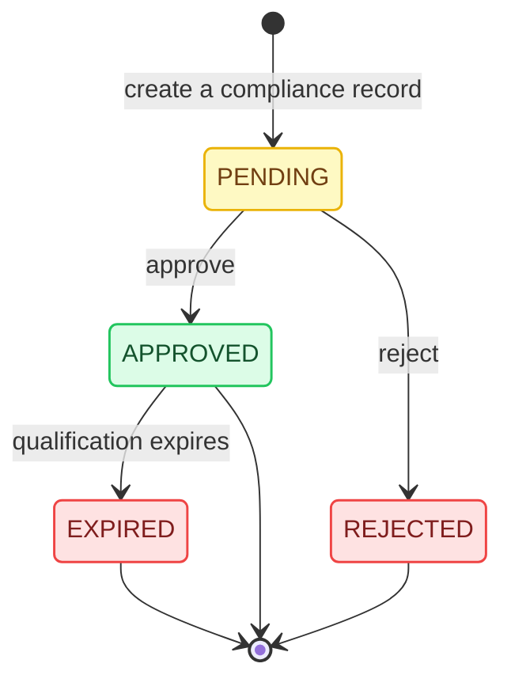
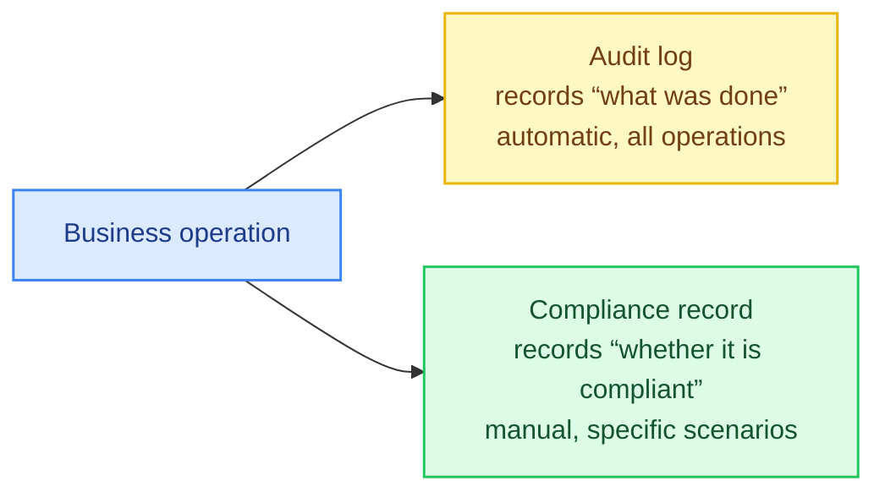

# Step 07: Compliance Check — The Last Line of Defense for Regulated Industries

[中文](../../tutorial/07-compliance.md) | English

> Distribution systems operate in regulated industries such as healthcare and finance, and require compliance records to prove the legality of business actions. This chapter adds a compliance check layer.

---

## Chapter Goals

- Understand the difference between audit logs and compliance records
- Create the compliance record table and service
- Implement the creation and review flow for compliance records
- Understand how compliance checks are embedded in business processes

## Audit Log vs Compliance Record

| Dimension | Audit Log | Compliance Record |
|------|---------|---------|
| Purpose | Record the change history of all operations | Record business actions that require compliance review |
| Write timing | Automatically recorded on every write operation | Created when triggered by business |
| Content | before/after JSON snapshot | Compliance content + attachments + review result |
| Review process | None (pure recording) | Pending → approved/rejected flow |
| Deletion | Cannot be deleted | Cannot be deleted |

**In one sentence**: an audit log is "passive recording"; a compliance record is "active management."

## Step 1: Create the Table

```sql
CREATE TABLE distribution_compliance_record (
    id              BIGINT NOT NULL AUTO_INCREMENT,
    biz_type        VARCHAR(32) NOT NULL COMMENT 'Associated business type',
    biz_id          BIGINT NOT NULL COMMENT 'Associated business ID',
    product_line_code VARCHAR(32) COMMENT 'Product line',
    record_type     VARCHAR(32) NOT NULL COMMENT 'Record type: qualification/training/authorization/violation/approval',
    status          VARCHAR(32) NOT NULL DEFAULT 'pending' COMMENT 'Status: pending/approved/rejected/expired',
    content         TEXT COMMENT 'Compliance content description',
    attachments_json JSON COMMENT 'JSON array of attachments',
    reviewed_by     BIGINT COMMENT 'Reviewer',
    reviewed_at     DATETIME COMMENT 'Review time',
    remark          VARCHAR(500),
    created_by      BIGINT,
    updated_by      BIGINT,
    create_time     DATETIME NOT NULL DEFAULT CURRENT_TIMESTAMP,
    modify_time     DATETIME NOT NULL DEFAULT CURRENT_TIMESTAMP ON UPDATE CURRENT_TIMESTAMP,
    deleted         TINYINT NOT NULL DEFAULT 0,
    PRIMARY KEY (id),
    KEY idx_biz (biz_type, biz_id),
    KEY idx_record_type (record_type),
    KEY idx_status (status)
);
```

## Step 2: Compliance Record Types

| record_type | Description | Trigger Scenario |
|------------|------|---------|
| `qualification` | Qualification review | When a distributor onboards |
| `training` | Training record | When a member completes training |
| `authorization` | Authorization letter | When a distributor obtains product authorization |
| `violation` | Violation record | When a violation is discovered |
| `approval` | Approval record | Approval of an important operation |

## Step 3: Compliance Service

```java
// (source file)
@Service
public class DistributionComplianceServiceImpl implements DistributionComplianceService {

    @Autowired private DistributionComplianceRecordMapper complianceMapper;
    @Autowired private DistributionOperatorService operatorService;
    @Autowired private DistributionAuditLogService auditLogService;

    @Override
    @Transactional(rollbackFor = Exception.class)
    public Long createRecord(CreateComplianceRecordRequestDTO request) {
        validateRecordType(request.getRecordType());

        Long operatorUserId = operatorService.getCurrentOperatorUserId();

        DistributionComplianceRecordEntity entity = new DistributionComplianceRecordEntity();
        entity.setBizType(request.getBizType());
        entity.setBizId(request.getBizId());
        entity.setProductLineCode(request.getProductLineCode());
        entity.setRecordType(request.getRecordType());
        entity.setStatus("pending");
        entity.setContent(request.getContent());
        entity.setAttachmentsJson(writeAttachments(request.getAttachments()));
        entity.setCreatedBy(operatorUserId);
        entity.setUpdatedBy(operatorUserId);
        entity.setDeleted(0);
        complianceMapper.insertSelective(entity);

        auditLogService.record("compliance", entity.getId(), "create", null, entity, "Create compliance record");
        return entity.getId();
    }

    @Override
    @Transactional(rollbackFor = Exception.class)
    public void reviewRecord(Long id, ReviewComplianceRecordRequestDTO request) {
        DistributionComplianceRecordEntity existing = getRecordEntity(id);

        if (!"pending".equals(existing.getStatus())) {
            throw new BizException("Only records pending review can be reviewed", ...);
        }

        Long operatorUserId = operatorService.getCurrentOperatorUserId();

        DistributionComplianceRecordEntity update = new DistributionComplianceRecordEntity();
        update.setId(id);
        update.setStatus(request.getStatus());  // "approved" or "rejected"
        update.setReviewedBy(operatorUserId);
        update.setReviewedAt(new Date());
        update.setRemark(request.getRemark());
        update.setUpdatedBy(operatorUserId);
        complianceMapper.updateByPrimaryKeySelective(update);

        auditLogService.record("compliance", id, "review_" + request.getStatus(),
            existing, getRecordEntity(id), "Review compliance record");
    }
}
```

## Step 4: Compliance Record Lifecycle



## Step 5: Embedding in Business Processes

Compliance checks are not a standalone module; they are embedded in business processes. Typical scenarios:

### Scenario 1: Qualification Review When a Distributor Onboards

```java
// In DistributorServiceImpl.createDistributor():
distributorMapper.insertSelective(entity);

// Automatically create a compliance record (pending review)
ComplianceRecordRequestDTO compliance = new ComplianceRecordRequestDTO();
compliance.setBizType("distributor");
compliance.setBizId(entity.getId());
compliance.setRecordType("qualification");
compliance.setContent("Distributor qualification review");
compliance.setAttachments(request.getQualificationAttachments());
complianceService.createRecord(compliance);
```

### Scenario 2: Compliance Validation Before Commission Settlement

```java
// Before settlement, check for rejected compliance records
public void validateComplianceBeforeSettlement(Long distributorId) {
    List<DistributionComplianceRecordEntity> violations =
        complianceMapper.selectByBizAndStatus("distributor", distributorId, "rejected");

    if (!violations.isEmpty()) {
        throw new BizException("The distributor has violation records; settlement is not allowed", ...);
    }
}
```

### Scenario 3: Member Training Status Check

```java
// Check the member's training status before creating a business order
private void validateMemberTrainingStatus(Long memberId) {
    DistributionDistributorMemberEntity member = memberMapper.selectByPrimaryKey(memberId);
    if (!"completed".equals(member.getTrainingStatus())) {
        throw new BizException("The member has not completed training and cannot create a business order", ...);
    }
}
```

## Querying Compliance Records

```java
// Query compliance records by business object
PageResponseDTO<DistributionComplianceRecordDTO> records =
    complianceService.listRecords("distributor", 1L, "qualification", null, 1, 20);

// Query records pending review
PageResponseDTO<DistributionComplianceRecordDTO> pending =
    complianceService.listRecords(null, null, null, "pending", 1, 20);
```

## Working with Audit Logs

Compliance records and audit logs complement each other:



Queries can cross-validate:

```sql
-- View the complete operation history of a distributor
SELECT * FROM distribution_audit_log
WHERE biz_type = 'distributor' AND biz_id = 1
ORDER BY create_time DESC;

-- View the compliance records of that distributor
SELECT * FROM distribution_compliance_record
WHERE biz_type = 'distributor' AND biz_id = 1
ORDER BY create_time DESC;
```

## Verification

```bash
# 1. Create a compliance record
curl -X POST \
     -H "Authorization: test-token-123" \
     -H "x-biz: distribution-starter" \
     -H "Content-Type: application/json" \
     -d '{"bizType":"distributor","bizId":1,"recordType":"qualification","content":"Qualification review"}' \
     http://localhost:9030/api/manage/distribution/compliance-records

# 2. Query records pending review
curl -H "Authorization: test-token-123" \
     -H "x-biz: distribution-starter" \
     "http://localhost:9030/api/manage/distribution/compliance-records?status=pending"

# 3. Approve the review
curl -X POST \
     -H "Authorization: test-token-123" \
     -H "x-biz: distribution-starter" \
     -H "Content-Type: application/json" \
     -d '{"status":"approved","remark":"Qualification passed"}' \
     http://localhost:9030/api/manage/distribution/compliance-records/1/review
```

## Congratulations!

You have completed the entire distribution management system from scratch. Let's review what we built:

| Step | Content | Core Pattern |
|------|------|---------|
| 01 | Domain model | Entity design, relationship modeling |
| 02 | Data permissions | 4-level scope, SQL-layer injection |
| 03 | CRUD scaffolding | Three-layer architecture, dual queries, batch loading |
| 04 | Audit log | JSON snapshots, unified entry point |
| 05 | Commission flow | Event-driven state machine, rule snapshots, reversal mechanism |
| 06 | Settlement flow | Aggregation, approval, payout, reversal linkage |
| 07 | Compliance check | Review workflow, business embedding |

## Next Steps

- Read the [architecture design documents](../architecture/data-permission-model.md) to gain a deeper understanding of the design decisions behind each pattern
- Read the [extend a new module guide](../guides/extend-new-module.md) to learn how to add new features
- Read the [ADR documents](../decisions/why-session-not-jwt.md) to understand the trade-offs behind technology choices

---
