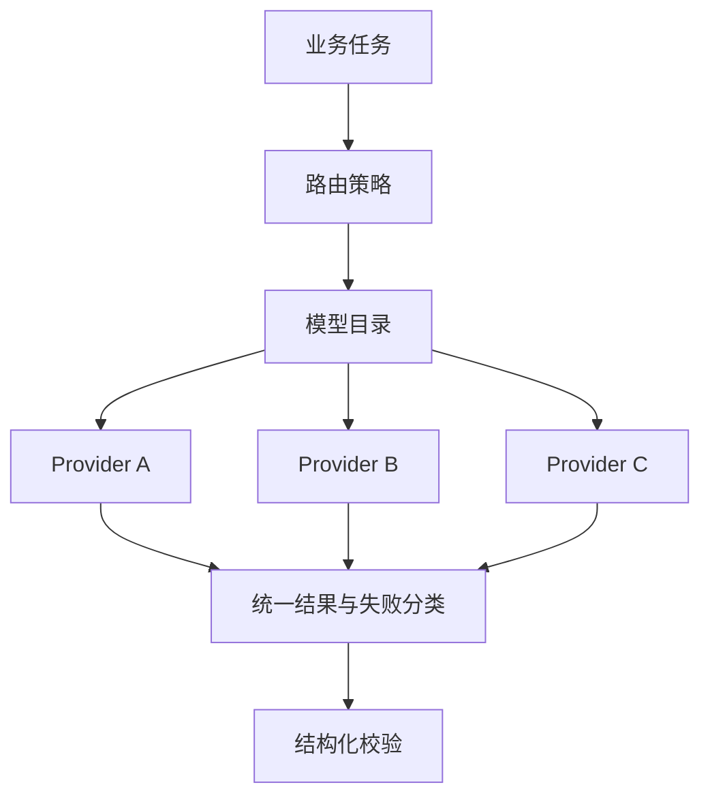

# 多模型路由与故障隔离：把模型当成运行时资源

> “接入了多个模型”不是架构能力。真正的分水岭是：**一个 Provider 超时、限流或输出异常时，系统能否局部失败、可控重试并继续交付。**

---

## 一、成本不是一个单价

AI 任务的总成本至少由四部分组成：

```text
总成本 =
  输入 token × 单价
  + 输出 token × 单价
  + 重试与失败浪费
  + 人工复核和任务等待
```

长文档任务中，重试浪费经常比单价差异更显著。一次失败可能意味着重新处理整份输入；分段处理后则可能只重跑一个局部阶段。

因此路由目标不是“永远选择最强模型”，而是在正确性、延迟、成本与可用性之间做**按任务分级**的选择。

---

## 二、架构分三层



### 2.1 模型目录

模型目录回答“当前有哪些候选模型”。它至少包含：

- 逻辑模型 ID；
- Provider 与真实模型名；
- 上下文和输出上限；
- 支持的能力；
- 成本等级；
- 超时和并发限制；
- 健康状态。

业务任务只引用逻辑模型或任务类型，不把 Provider 的 if/else 写进业务代码。

### 2.2 Provider 适配层

适配层负责统一请求、响应、流式事件、错误码和用量字段。业务层不直接理解各 Provider 的差异。

### 2.3 路由策略

策略至少考虑：

- 任务类型与质量要求；
- 输入/输出长度；
- 是否需要工具调用或严格结构；
- 延迟预算；
- Provider 健康状态；
- 用户或租户的显式选择。

路由策略应该可配置、可观测、可回滚。

---

## 三、先按任务分级

| 任务 | 默认策略 | 失败策略 |
|---|---|---|
| 分类、抽取、摘要 | 低成本模型优先 | 可重试或换候选 |
| 长文审阅 | 稳定结构化输出优先 | 分段重试，不整单重跑 |
| 高风险决策辅助 | 质量与可核验性优先 | 失败即拒答/转人工 |
| 创意或低风险生成 | 延迟与成本优先 | 可降级到较弱模型 |

必须明确一点：**降级只能降低体验，不能降低安全门槛。**

如果高风险任务切换到较弱模型，仍要经过同一套结构校验和证据校验；校验不过就不能交付。

---

## 四、失败隔离

### 4.1 限流

限流同时在两个方向实施：

- 保护 Provider，避免超过配额；
- 保护自身 Worker 和连接池，避免积压。

排队长度、等待时间和拒绝率需要有上限。

### 4.2 超时

为连接、首 token、总响应和任务级处理分别设置超时。仅设置 HTTP 超时不足以限制一个多阶段任务的总耗时。

### 4.3 熔断

连续失败达到阈值后暂时停止向故障 Provider 发送新任务，经过冷却期只放少量探测流量。

熔断状态应持久或可重建，不能因为进程重启就把坏依赖当成健康。

### 4.4 空返回与截断

“HTTP 200”不等于成功。必须检查：

- 是否有有效内容；
- 是否达到输出上限；
- 是否满足任务所需的结构；
- 是否是 Provider 的软错误提示。

### 4.5 重试预算

重试按错误类型分级：

| 错误 | 是否重试 |
|---|---|
| 瞬时网络失败 | 可以，指数退避 |
| 429 / 临时限流 | 可以，遵守 Retry-After |
| 认证失败 | 不重试，立即告警 |
| 输入超长 | 不原样重试，先拆分或拒绝 |
| 输出截断 | 不原样重试，扩大预算或拆阶段 |
| 业务校验失败 | 不直接重试，定位规则或输入 |

每次任务应有总重试预算，而不是每层各自无限重试。

---

## 五、异步任务与背压

LLM 调用可能持续几十秒甚至更久，不适合占住同步 API 线程。

推荐结构：

```text
API 创建任务
  -> 队列
  -> Worker 调模型
  -> 阶段结果落库
  -> SSE 推送进度
  -> 断线后轮询结果
```

需要保证：

- 同一任务不会被多个 Worker 同时执行；
- Worker 重入时不重复扣费或重复产生业务结果；
- 队列拥塞时有背压和明确超时；
- 客户端断开不等于任务取消，除非产品明确要求。

---

## 六、缓存的位置

缓存不是只有 Prompt Caching。工程上可以分层：

1. **配置缓存**：模型目录、路由规则和健康状态；
2. **输入归一化缓存**：解析后的文档、页级文本和哈希；
3. **结果缓存**：只缓存可复用、可失效且不违反数据隔离的结果；
4. **Provider Prompt 缓存**：在 Prompt 结构稳定后再启用。

高风险、强个性化或包含敏感数据的任务，不应跨租户复用结果缓存。

---

## 七、可观测指标

至少观察以下指标：

| 指标 | 用途 |
|---|---|
| 请求成功率 | 区分“接口成功”和“结果可用” |
| 首 token / 总耗时 P50/P95 | 判断用户体验和超时设置 |
| 每任务 token 与成本 | 识别长上下文和重试浪费 |
| 重试次数与原因 | 找出系统性失败 |
| 熔断打开次数 | 识别不稳定 Provider |
| 结构校验失败率 | 判断模型与提示是否适配 |
| 业务校验拒绝率 | 判断规则或输入质量 |
| 队列等待时间 | 判断容量与背压 |

“有返回文本”的请求成功率会掩盖大多数质量问题，应同时统计结构校验和业务校验结果。

---

## 八、切换与回滚

模型切换本质上是一次线上依赖变更，需要：

- 小流量灰度；
- 任务级固定模型版本；
- 结果质量对照；
- 成本与延迟对照；
- 一键回滚到上一模型目录；
- 已创建任务继续使用创建时的模型版本。

任务执行中途静默切换模型，会破坏可复现性。

---

## 九、常见错误

1. **业务代码直接写 Provider 分支**：新增或替换模型需要改代码；
2. **只把多个模型放进下拉框**：没有失败隔离，不叫路由；
3. **把 HTTP 200 当成功**：空返回、截断和结构错误都被忽略；
4. **重试没有总预算**：Provider 抖动时成本迅速放大；
5. **同步接口等待长任务**：连接和线程池被慢调用占满；
6. **降级绕过校验**：体验保住了，安全边界却消失了；
7. **无版本地切换模型**：结果无法复现，问题无法归因。

---

## 十、落地检查清单

- [ ] 业务只依赖逻辑模型或任务类型；
- [ ] 模型目录包含能力、上限、成本和健康状态；
- [ ] Provider 差异被适配层隔离；
- [ ] 超时覆盖首 token 与任务总时长；
- [ ] 限流、熔断和背压均有明确阈值；
- [ ] 空返回、截断、结构失败分别计数；
- [ ] 重试有总预算，业务错误不盲目重试；
- [ ] 长任务异步化并支持断线恢复；
- [ ] 模型切换可灰度、可回滚、可复现；
- [ ] 降级不绕过结构和证据校验。

---

## 十一、诚实边界

- 多模型不会自动提高质量，错误路由可能同时增加成本和方差；
- 熔断只能阻止故障扩散，不能修复 Provider 侧问题；
- 成本阈值依赖具体 Provider、缓存策略和输出长度，本文不给统一基准；
- 本文方法提炼自工程实践，未附带对应私有系统的完整代码与运营数据。

## 相关文档

- [结构化输出治理](structured-output-governance.md)
- [长文档多阶段生成](long-document-pipeline.md)
- [组件正确 ≠ 系统有效](../../architecture/verifier-failure-modes.md)
