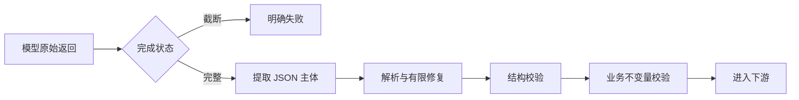

# 结构化输出治理：失败边界必须先于 Prompt

> Prompt 可以提高模型输出正确结果的概率，但不能独自承担系统正确性。
>
> 真正决定下游是否安全的，是系统有没有定义清楚：**什么样的返回不配进入下一步。**

---

## 一、问题不在 `json.loads()`

很多系统把结构化输出简化成：

```text
调用模型 -> json.loads(response) -> 进入业务系统
```

线上实际会遇到：

- 输出被截断；
- JSON 被包在 Markdown 代码块里；
- 前后混入解释文字；
- 字符串含未转义换行或控制字符；
- 字段类型、枚举或 ID 格式错误；
- 数组为空或重复；
- 风险等级与风险明细不一致；
- 语法合法的 JSON 表达了业务上不可能的状态。

其中任何一项都不应该靠“再写一句更严格的 Prompt”来兜底。

---

## 二、五层失败边界



### 第一层：先检查完成状态

在解析 JSON 之前检查 Provider 的 `finish_reason`、`stop_reason` 或等价字段。

如果输出因长度限制被截断，应当直接判定失败。半截 JSON、少了一半列表或缺失后半段文本，往往比明确失败更危险：它可能被修复器补成一份看似完整但内容错误的结果。

### 第二层：提取 JSON 主体

只允许剥离明确的外层包装，例如代码块围栏和前后说明文字。提取规则必须：

- 有确定边界；
- 找不到唯一主体就失败；
- 不猜测缺失的开始或结束符号；
- 保留原始返回作为诊断证据。

### 第三层：解析与有限修复

修复只处理语法层问题，例如尾逗号、未转义控制字符或明确可恢复的括号问题。

每次修复必须满足：

1. 输入和输出都被记录；
2. 修复次数有上限，通常是 0–1 次；
3. 修复失败就结束，不进入无限循环；
4. 修复器不能补造缺失业务字段。

“修复 JSON”不是“让模型重新编一份业务结果”。

### 第四层：结构校验

结构校验至少覆盖：

| 层级 | 检查内容 |
|---|---|
| 顶层 | 必须是对象或系统约定类型 |
| 字段 | 必填、类型、可空性和长度 |
| 枚举 | 值域是否合法，未知值如何处理 |
| 标识 | ID、URL、时间、金额格式 |
| 集合 | 元素类型、数量、去重和顺序 |
| 一致性 | 汇总字段与明细是否一致 |

结构合法仍然只是“可以继续检查”，不是“业务可信”。

### 第五层：业务不变量

业务层必须重新推导可以推导的事实：

- 风险总数从 `risks` 数组计算，不采信模型自报总数；
- 总体风险等级由规则计算，不采信模型自报等级；
- 金额区间、状态和权限必须满足领域不变量；
- 非目标类型输入应明确拒绝；
- 不给建议时必须给出可识别的原因。

原则是：**模型可以提出结论，系统必须重新计算能重新计算的部分。**

---

## 三、错误分类与动作

不要把所有失败都映射成“重试”。

| 失败类型 | 示例 | 默认动作 |
|---|---|---|
| 传输失败 | 超时、连接中断 | 有预算重试 |
| 被限流 | 429 / Provider 配额 | 退避或切换候选 |
| 截断 | 输出达到上限 | 缩小任务或拆分 |
| 无有效主体 | 全是解释文本 | 有限重试，不原地硬修 |
| 语法失败 | JSON 无法解析 | 一次修复，仍失败则终止 |
| 结构失败 | 字段缺失、类型错误 | 不进入业务层 |
| 业务失败 | 不变量不成立 | 拒绝并记录原因 |

结构性失败和业务失败不应在同一个重试循环里处理。前者可能需要重新生成，后者需要修正规则或输入。

---

## 四、有限修复状态机

```text
RECEIVED
  -> TRUNCATED                 -> FAILED
  -> EXTRACTED
  -> PARSE_FAILED
       -> REPAIR_ONCE
            -> STRUCTURE_READY -> BUSINESS_CHECK
            -> FAILED
  -> STRUCTURE_INVALID         -> FAILED
  -> BUSINESS_INVALID          -> REFUSED
  -> READY
```

状态机要让失败停留在正确位置。例如截断不应该被“修复器”处理，业务不变量错误也不应该通过换一个 Prompt 静默变成成功。

---

## 五、Provider 无关的接口

不同模型对 JSON Mode、工具调用和流式输出的支持不同。业务层不应直接依赖某一家 API 字段。

建议统一为：

```text
LlmCallResult
  content
  finishReason
  usage
  providerRequestId
```

结构化处理链只依赖这个结果对象。Provider 适配器负责把它转换成统一语义。

---

## 六、可测试性

把纯解析、结构校验和业务不变量提取成无网络依赖的函数，针对以下输入写单元测试：

- 完整对象；
- 代码块包裹；
- 前后杂质；
- 截断 JSON；
- 非法枚举；
- 汇总不一致；
- 空数组和重复元素；
- 超长字符串；
- 恶意字段名；
- 不适用输入。

不要只测试“模型输出正确时能否解析”。真正需要证明的是：**错误输出不会越过边界。**

---

## 七、可观测性

一次结构化调用至少记录：

- Provider、模型和任务类型；
- 输入/输出 token；
- 是否截断；
- 提取与修复次数；
- 失败层级与稳定错误码；
- 总耗时和重试耗时；
- 是否进入人工审查。

日志中不要直接保存完整敏感原文。可以保存哈希、字段路径和脱敏片段。

---

## 八、常见错误

1. **先 `json.loads()`，再判断是否截断**：解析失败会掩盖真实原因；
2. **修复器无限重试**：成本失控，而且可能把错误内容改成另一个错误；
3. **结构合法就放行**：业务不变量仍可能不成立；
4. **由模型自报关键性**：模型可以借“非关键”绕过严格校验；
5. **统一捕获所有异常**：无法区分传输、语法和业务失败；
6. **只测试成功样例**：最重要的工作恰恰是验证失败边界。

---

## 九、落地检查清单

- [ ] 在解析前检查完成状态和截断；
- [ ] JSON 主体提取失败时立即终止；
- [ ] 修复次数和重试预算均有硬上限；
- [ ] 结构校验与业务校验分层；
- [ ] 汇总值由明细重新计算；
- [ ] 每个失败层级有稳定错误码；
- [ ] 失败路径有单元测试和端到端测试；
- [ ] Provider 差异被适配器隔离；
- [ ] 日志保留诊断信息但不泄露敏感原文。

---

## 十、诚实边界

- 精细校验不能提高模型首次生成正确答案的概率，它只能阻止不合格结果进入下游；
- 某些语义错误无法仅靠结构规则发现，仍需要证据校验、业务规则或人工复核；
- JSON Schema 只能表达结构约束，无法自动证明业务真实性；
- 本文阈值和状态名是示例，应按任务、Provider 和输出上限校准。

## 相关文档

- [多模型路由与故障隔离](model-routing-and-resilience.md)
- [长文档多阶段生成](long-document-pipeline.md)
- [声明级校验门](../../architecture/claim-level-verifier.md)
- [组件正确 ≠ 系统有效](../../architecture/verifier-failure-modes.md)
