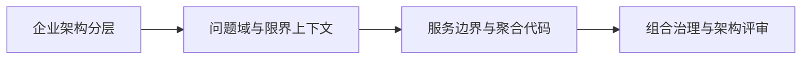

# 企业架构实践（Enterprise Architecture Playbook）

> **定位**：回答“企业级系统为什么这样划分、业务规则怎样进入代码、架构决策怎样被持续讨论”。
>
> **范围**：DDD 从方法到代码的七步落地，以及 TOGAF / Zachman 在真实组织中的裁剪与使用。本文档不把框架本身当作交付物。

---

## 它补的是哪一层

现有文档分别处理：

- 单个系统内部的设计模式；
- 接手系统时的证据评估；
- 系统组合的盘点、诊断与关停并转；
- 生产期的变更、故障和演练。

本 playbook 补的是更上游的一层：**业务如何被划分，领域边界如何形成，应用与数据各自承载什么，架构决策如何变成可执行方案。**

---

## 两篇文档

| 文档 | 解决的问题 | 主要产出 |
|---|---|---|
| [DDD 七步落地](ddd-seven-step-landing.md) | 领域模型只停留在图里，代码仍按数据库表堆 Service | 统一语言、上下文、服务边界与聚合代码约束 |
| [TOGAF 实践](togaf-in-practice.md) | 方法论文档很厚，但无法支持系统归并、选型和需求分析 | BA/DA/AA/TA、端到端主线、事件优先分析与轻量评估 |

---

## 推荐阅读顺序

1. 先读 [TOGAF 实践](togaf-in-practice.md)，建立企业架构的全局分层和决策视角；
2. 再读 [DDD 七步落地](ddd-seven-step-landing.md)，把问题域推进到上下文、服务边界和聚合代码；
3. 最后回到[架构组合治理](../system-portfolio-governance/)和[架构评审机制](../system-portfolio-governance/05-architecture-review.md)，把结论变成组合决策与组织闸门。

---

## 与系统组合治理的关系

企业架构负责解释“为什么应该这样划分”，系统组合治理负责回答“现有系统该保留、合并、治理还是关停”。

两者不能互相替代：

- 只有企业架构，没有组合治理，会产出很多正确但无法执行的蓝图；
- 只有组合治理，没有企业架构，可能把重复系统合并成一个边界仍然错误的系统。

---

## 证据边界

两篇文档提炼自大型组织与复杂业务系统的工程实践，示例均已泛化。组织规模、系统数量、团队结构和合规要求会显著影响裁剪方式，文中阈值不构成行业基准；本仓库不附带对应组织的系统名称、业务数据或内部文档。
