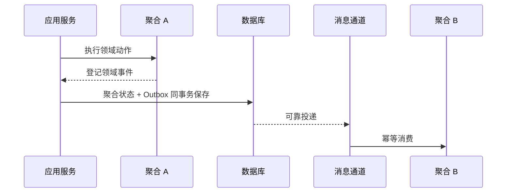

# DDD 七步落地：从领域语言走到聚合代码

> DDD 最常见的失败，不是团队“学不会”，而是只做了战略设计：培训、画图、分层讨论都完成了，代码仍然按数据库表堆 Service。
>
> 本文把落地拆成七步，每一步都要求可检查的产出物，并用聚合代码说明领域规则怎样进入实现。

---

## 一、先明确 DDD 解决什么

敏捷解决迭代节奏和协作方式，DDD 解决复杂业务系统的边界、模型与代码表达。以下问题更适合引入 DDD：

- 多个团队对同一业务概念有不同命名和定义；
- 一个业务活动横跨多个系统，但责任边界说不清；
- 存量单体无法拆分，模块之间共享数据表；
- 业务规则散落在 Controller、Service 和 SQL 中；
- 系统改一个状态要同时修改多处，且没有一致性边界。

DDD 不负责自动产生微服务，也不保证系统一定可拆。它首先是一套**降低业务复杂度、建立模型边界**的方法。

---

## 二、七步法的产出物

| 步骤 | 阶段 | 要做什么 | 必须产出 |
|---|---|---|---|
| ① 统一领域语言 | 战略 | 统一术语、含义、边界和英文映射 | 中英文词汇表与反例 |
| ② 梳理核心业务流程 | 战略 | 从业务事实与事件出发梳理状态和规则 | 流程、状态与规则清单 |
| ③ 领域分析建模 | 战略 | 名词找对象、动词找能力、关系找约束 | 场景/主体/状态/动作/规则分析表 |
| ④ 输出领域模型 | 战略 | 类图、构造型、约束与核心场景样例 | 团队能读懂的模型 |
| ⑤ 识别限界上下文 | 战略 | 按问题域而非代码相关性划分边界 | 上下文清单与关系图 |
| ⑥ 划分服务 | 战术 | 业务上下文加性能、事务、部署和通信约束 | 服务候选与拆分理由 |
| ⑦ 写清服务边界 | 战术 | 明确做什么、不做什么、主数据归谁 | 服务边界说明书 |

步骤顺序可以迭代，但不能跳过产出物。没有词汇表和边界说明的“领域模型图”，通常只能当宣传图。

---

## 三、战略设计

### 3.1 统一语言不是术语表装饰

每个核心术语至少记录：

| 列 | 示例问题 |
|---|---|
| 中文名 | 业务人员实际怎么说？ |
| 唯一定义 | 它是什么，不是什么？ |
| 英文类名 | 代码中如何命名？ |
| 工程缩写 | 配置、日志和接口是否一致？ |
| 反例 | 最容易与哪个相邻概念混淆？ |

同一词在不同上下文中可以有不同模型，但必须明确上下文。禁止在同一个上下文里让“客户”“门店”“商户”混用。

术语表要能约束代码、接口、数据库和文档，否则只是知识库里的静态表格。

### 3.2 从事件梳理流程

事件是已经发生的业务事实，例如“订单已确认”“结算已审核”。从终态事件向前推：

1. 终态事实是什么？
2. 它由哪些前序事实触发？
3. 有哪些失败和例外？
4. 谁执行动作？
5. 哪些状态和不变量必须成立？

相比直接描述页面和按钮，事件优先更容易暴露跨系统依赖和缺失状态。

### 3.3 从分析表提取模型

分析表至少覆盖：

- 业务场景；
- 主体和次要对象；
- 前置与结果状态；
- 业务动作；
- 规则与不变量；
- 实体间关系；
- 事件和外部副作用。

模型图必须配套一个 20 分钟能走通的核心场景。只看类图，团队无法判断模型是否真的支持业务。

### 3.4 限界上下文按问题域划分

“这些代码经常一起改”只能说明相关性，不能证明它们是同一个限界上下文。

判断边界时优先问：

- 这个模型解决的是哪个业务问题？
- 同一术语在这里是否具有不同含义？
- 这里的主数据由谁拥有？
- 边界内需要什么一致性保证？
- 跨边界协作是事件、查询还是命令？

上下文边界不是数据库拆分方案，也不是团队组织图的直接映射。

---

## 四、从上下文到服务

业务上下文是服务划分的主要依据，但不是唯一依据。还要评估：

| 维度 | 需要回答的问题 |
|---|---|
| 性能 | 两部分是否有显著不同的延迟或容量要求？ |
| 事务 | 是否必须同事务强一致？ |
| 部署 | 是否必须独立发布或扩缩容？ |
| 通信 | 同步调用、异步事件还是共享查询？ |
| 团队 | 谁长期拥有该边界？ |
| 故障 | 某部分失败是否应隔离？ |

一个限界上下文可以对应一个模块，也可以对应多个服务；一个服务也可以承载多个小上下文，前提是边界和一致性成本可控。

服务边界说明书至少要写：

- 服务定位；
- 负责的业务活动；
- 明确不负责的内容；
- 主数据与权威源；
- 暴露的命令与查询；
- 发布和消费的事件；
- 依赖及降级策略；
- 数据保留与迁移约束。

---

## 五、聚合不是“有关联的实体堆在一起”

聚合是一个事务中需要保持强一致的最小边界。划分时依次问：

1. 这些对象是否必须在同一个事务里保持不变量？
2. 它们是否会被并发修改？
3. 生命周期是否强依赖？
4. 外部对象是否需要直接修改内部实体？

如果答案是否定的，优先通过 ID 引用和领域事件协作。

示例结构：

```java
public final class TaskOrder {
    private final TaskOrderId id;
    private TaskStatus status;
    private VehicleId vehicleId;
    private TimeWindow window;

    public void assign(VehicleId vehicle, TimeWindow targetWindow) {
        if (status != TaskStatus.CREATED) {
            throw new DomainException("仅待分派任务可分派");
        }
        this.vehicleId = vehicle;
        this.window = targetWindow;
        this.status = TaskStatus.ASSIGNED;
    }

    public void cancel(String reason) {
        if (status == TaskStatus.COMPLETED) {
            throw new DomainException("已完成任务不可取消");
        }
        this.status = TaskStatus.CANCELLED;
    }
}
```

关键点：

- 聚合根只暴露业务方法，不暴露可任意修改状态的 setter；
- 值对象不可变；
- 跨聚合只保存 ID；
- 规则在状态变更时执行，而不是散落在 Controller；
- 仓储只面向聚合根。

---

## 六、领域事件与跨聚合一致性

一个业务动作需要更新多个聚合时，常见结构是：



不要因为跨聚合就默认引入分布式事务。优先判断是否真的需要强一致；若可以最终一致，使用 Outbox、幂等消费和明确补偿。

事件设计要注意：

- 事件是过去发生的事实，不是修改命令；
- 事件带唯一 ID、发生时间、聚合 ID 和版本；
- 消费必须幂等；
- 失败重试和人工兜底有明确边界；
- 事件结构变更需要兼容策略。

---

## 七、分层不要照搬教科书

标准四层可以作为基线：

```text
接口层
应用层
领域层
基础设施层
```

存量系统常常需要过渡结构。例如：

```text
app            用例编排
app-client     对外契约
domain-core    领域逻辑
domain-query   查询模型
infrastructure 持久化与外部依赖
```

增加查询层是为了避免把列表查询硬塞进领域逻辑，不表示所有系统都必须 CQRS。原则是：

- 领域层不依赖具体框架和数据库；
- 应用层编排用例与事务；
- 接口层只做协议转换和校验；
- 基础设施通过接口实现外部依赖；
- 为存量兼容允许例外，但例外必须有退出计划。

---

## 八、如何判断 DDD 是否真的落地

不要用“画了多少张模型图”评估。检查以下信号：

| 信号 | 未落地 | 已落地 |
|---|---|---|
| 词汇 | 同一概念多种叫法 | 代码、接口、文档使用同一语言 |
| 规则 | Service 中大量 if/else | 聚合方法维护业务不变量 |
| 边界 | 按表或代码目录拆分 | 按问题域和一致性边界划分 |
| 跨模块 | 直接调用或共享表 | 命令、查询或领域事件协作 |
| 查询 | 所有查询都经过聚合 | 读模型与写模型按需分离 |
| 测试 | 只测 Controller 和 SQL | 可对状态转移和业务规则做单元测试 |
| 边界说明 | 只有图，没有责任清单 | 明确做什么、不做什么、主数据归属 |

---

## 九、常见坑

1. **从画图开始**：没有代码落点，模型很快过期；
2. **把相关性当上下文**：最后拆出的只是代码模块；
3. **一个聚合装下所有关联对象**：事务范围过大，并发冲突高；
4. **贫血模型换名字**：Entity 仍只有 getter/setter，规则仍在 Service；
5. **所有聚合都发事件**：事件链过长，系统难以追踪；
6. **为每个上下文建微服务**：忽略性能、事务和团队成本；
7. **没有边界说明书**：三个月后新代码重新侵入旧边界；
8. **DDD 和交付节奏分裂**：模型评审完成，代码仍按另一套规则开发。

---

## 十、落地检查清单

- [ ] 选了一个真实、边界混乱的核心场景作为试点；
- [ ] 统一语言已进入代码、接口、数据库和文档；
- [ ] 七步法的每一步都有可检查产出物；
- [ ] 限界上下文按问题域划分，并有关系说明；
- [ ] 服务拆分同时评估业务与技术约束；
- [ ] 每个聚合有不变量、业务方法和明确生命周期；
- [ ] 跨聚合协作优先使用 ID 引用与领域事件；
- [ ] 查询模型有清楚位置，不污染领域规则；
- [ ] 边界说明书写明主数据和“不做什么”；
- [ ] 有从模型到代码、测试和发布的完整样例。

---

## 十一、诚实边界

- DDD 适合复杂问题域，不适合所有 CRUD 系统；
- 七步法不是固定瀑布流程，实际项目会迭代和回退；
- 限界上下文与服务不是一对一关系，不能把 DDD 直接等同于微服务；
- 本文示例使用 Java 语法，但方法不依赖 Java；
- 阶段划分与团队经验、存量代码和组织结构有关，本文不承诺单一项目的结果可无损复制。

## 相关文档

- [从零构建：领域模型](../../tutorial/01-domain-model.md)
- [事件驱动状态机](../../architecture/commission-pipeline.md)
- [TOGAF 实践](togaf-in-practice.md)
- [系统组合治理](../system-portfolio-governance/00-methodology.md)
