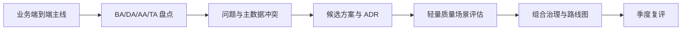

# TOGAF 实践：企业架构不是画更厚的图

> 架构是**变化成本高的决策集合**。变化成本低的实现细节可以交给团队，企业架构应聚焦那些选错后难以回退的边界、主数据和平台能力。
>
> 本文说明 Zachman、TOGAF、BA/DA/AA/TA 各自解决什么问题，以及怎样把方法论裁剪成能支持决策的工具。

---

## 一、先厘清框架的分工

| 框架或方法 | 本质 | 主要用途 |
|---|---|---|
| Zachman | 企业描述本体 | 检查“业务、数据、应用、技术”等维度是否遗漏 |
| TOGAF | 描述体系、内容模型与架构开发方法 | 组织架构内容和演进过程 |
| DDD | 领域建模方法 | 从业务问题域形成上下文、聚合和代码边界 |
| 组合治理 | 决策与执行机制 | 对系统群做保留、合并、治理和关停 |

这些方法互补。实际落地时通常只采用 TOGAF 的描述体系和部分 ADM 活动，用 Zachman 检查完整性，用 DDD 解决领域建模，用组合治理把结论落成动作。

---

## 二、BA / DA / AA / TA

四层各回答一个问题，缺一层都可能导致方案失真：

| 层 | 回答的问题 | 典型产出 |
|---|---|---|
| 业务架构 BA | 业务活动怎样运行，边界在哪？ | 业务能力、流程、组织与责任 |
| 数据架构 DA | 主数据是什么，流向哪里，谁权威？ | 领域模型、数据资产、主数据 |
| 应用架构 AA | 哪些系统承载哪些能力？ | 应用组合、功能映射、集成关系 |
| 技术架构 TA | 用什么平台和技术实现？ | 中间件、部署、容量、治理 |

只做应用模块分解，不研究业务活动和主数据，是“整理了代码”，还不是企业架构。

---

## 三、用 L1 框架定位问题

一个简单而有效的定位框架：

- 横轴：业务阶段，例如市场、销售、交付、运营、职能支撑；
- 纵轴：业务活动、应用系统、数据、技术承载；
- 单元：一个业务活动在某一阶段的唯一主要归属。

它至少能识别两类结构问题：

1. **同一业务活动挂在多个系统下**：重复建设或责任边界不清；
2. **同一系统横跨多个业务阶段和问题域**：边界过大，变更影响面高。

“唯一归属”不是要求所有能力集中到一个系统，而是要求明确谁是主责、谁提供支撑、谁只保留查询。

---

## 四、从两条端到端主线开始

只按部门和系统盘点，会把问题切成局部最优。建议同时梳理两条主线：

1. **客户或用户端到端**：从触点到最终结果，用户经历哪些活动与状态；
2. **产品供给端到端**：从资源、产品、履约到支撑，信息如何流转。

两条线交汇时，通常会暴露：

- 同一业务口径在多系统重复实现；
- 主数据没有唯一权威源；
- 同一事件在不同渠道被不同逻辑处理；
- 一个系统的变更会拖累多个无关业务；
- 多个中间层网关或审批节点没有明确价值。

输出不应停在架构图，而应形成一张“能力—系统—数据—责任”的映射表，直接连接组合治理决策。

---

## 五、需求分析：事件优先于动作

从页面按钮和现有流程出发，容易复制当前系统的组织方式。事件优先的做法是：

1. 找到业务最终要发生的事实；
2. 倒推必要的前序事实；
3. 列出例外和补偿；
4. 再确定操作者、动作和界面；
5. 最后输出流程与用例。

事件是客观发生的事实，动作和页面更容易变化。这个顺序能减少“为了现有系统方便而设计新系统”的问题。

需求追踪建议形成完整链路：

```text
目标
  -> 业务事件
  -> 用例与边界
  -> 领域模型
  -> 验收场景
  -> 自动化测试
```

---

## 六、非功能需求必须量化

“高性能”“高可用”“易扩展”不是可验证的需求。

可以用 ISO/IEC 25010 的质量特性作为检查表：

- 功能适合性；
- 性能效率；
- 兼容性；
- 易用性；
- 可靠性；
- 安全性；
- 可维护性；
- 可移植性。

再用场景法把形容词转成可测表述：

```text
在 [负载/数据规模/故障条件] 下，
[系统/业务动作] 应达到 [指标]，
观测窗口为 [时间]。
```

例如：

```text
在峰值写入为基线的 3 倍、单数据库节点故障时，
订单创建仍应在 P95 < 2 秒内完成，
已提交订单不得丢失。
```

---

## 七、轻量使用 ATAM 与效用树

完整的 ATAM 评审不适合每次迭代。可以采用轻量版本：

1. 用效用树把业务目标拆成质量属性；
2. 为每个质量属性选 1–3 个关键场景；
3. 标出架构中的敏感点和折衷点；
4. 输出风险、非风险、敏感点和折衷点；
5. 把结论直接写进 ADR 和设计评审材料。

关键不是开一次大评审会，而是在高成本选择发生前，用有限时间找出“哪个质量属性受什么结构影响”。

---

## 八、技术债按借款管理

技术债是“短期选择导致长期成本更高”的设计或实现。它允许存在，但需要记录：

- 欠了什么；
- 为什么借；
- 利率是什么（维护、变更、故障和安全成本）；
- 谁负责偿还；
- 什么条件下必须偿还；
- 未偿还是否阻止下一次扩展。

技术债登记应连接到架构决策和组合治理，而不是变成一张永远排不上优先级的缺陷列表。

---

## 九、把方法论变成决策流程



每一步都应产出可执行结果：

- 盘点产出归属与主数据清单；
- 需求分析产出事件、用例和边界；
- 架构选择产出至少两个选项和代价；
- 评审产出风险、例外和责任人；
- 治理产出关停、合并、治理或重建计划。

如果一轮方法论活动结束只留下文档，没有系统处置或决策变化，就没有完成闭环。

---

## 十、架构师的角色

企业架构师通常同时承担三种职责：

1. **决策者**：对变化成本高的选择负责，并明确放弃的选项；
2. **协调者**：建立跨团队的共同语言，处理边界和依赖冲突；
3. **布道者**：让术语、模型、接口和评审规则能够被持续使用。

三者缺一，架构都会退化成“画图 + 盖章”。

---

## 十一、常见坑

1. **为方法论服务**：文档越写越厚，业务决策没有变化；
2. **没有 Sponsor**：局部优化互相抵消，边界问题无人裁决；
3. **只做应用架构**：业务活动和主数据没人负责；
4. **同一活动多个主责系统**：重复建设长期存在；
5. **非功能需求后补**：选型完成后才发现无法满足；
6. **ATAM 过重**：评审变成大型会议，团队绕开流程；
7. **技术债只记录不偿还**：账面越来越复杂，交付越来越慢；
8. **只验收文档质量**：而不验收系统处置、体验和成本变化。

---

## 十二、落地检查清单

- [ ] 明确哪些决策变化成本高，哪些交给团队；
- [ ] 业务、数据、应用、技术四层均有产出；
- [ ] 用业务阶段 × 四层定位重复建设和边界问题；
- [ ] 至少梳理客户与产品两条端到端主线；
- [ ] 每个业务活动有唯一主要归属；
- [ ] 每项主数据有唯一权威源；
- [ ] 非功能需求写成可测场景；
- [ ] 关键方案有至少两个选项和放弃代价；
- [ ] ATAM 按关键节点裁剪，不追求大而全；
- [ ] 技术债有责任人和偿还触发条件；
- [ ] 方法论结果能进入组合治理和季度复评。

---

## 十三、诚实边界

- TOGAF 和 Zachman 是组织架构工作的工具，不会自动产生正确边界；
- 大型组织的自上而下立项方式不适用于所有规模，小团队可以采用更轻的决策记录和定期复盘；
- 文中企业规模和治理节奏均为抽象，不应直接作为其他组织的基准；
- 方法论无法替代组织授权。没有决策权，再完整的盘点也很难推动关停并转。

## 相关文档

- [DDD 七步落地](ddd-seven-step-landing.md)
- [架构组合治理](../system-portfolio-governance/00-methodology.md)
- [架构评审机制](../system-portfolio-governance/05-architecture-review.md)
- [工程一致性规范](../engineering-consistency-standards.md)
